<p align="center">
  
</p>

<p align="center">
  <strong>Native ABI as a first-class, verifiable object.</strong><br>
  <sub>An ABI semantic layer for describing, identifying, verifying and evolving native binary interfaces.</sub>
</p>

<p align="center">
  <a href="LICENSE"></a>
  
  
  
  
</p>

<p align="center">
  <a href="README_ZH.md">中文</a> · English
</p>

<details>
<summary>Contents</summary>

- [Why ABIX?](#why-abix)
- [A Small Example](#a-small-example)
- [Native, Not a VM](#native-not-a-vm)
- [The ABIX Model](#the-abix-model)
- [ABIX Interface](#abix-interface)
- [ABIX IR](#abix-ir)
- [AMC](#amc)
- [Self-Hosting](#self-hosting)
- [Architecture](#architecture)
- [What ABIX Is Not](#what-abix-is-not)
- [Competitive Landscape](#competitive-landscape)
- [Ecosystem](#ecosystem)
- [Project Structure](#project-structure)
- [Getting Started](#getting-started)
- [Documentation](#documentation)
- [Current Status](#current-status)
- [Roadmap](#roadmap)
- [Contributing](#contributing)
- [Community](#community)
- [License](#license)

</details>

---

ABIX is an **ABI semantic layer** for describing, identifying, verifying and evolving native binary interfaces. It makes ABI information explicit and machine-readable, independent of any particular compiler or language implementation.

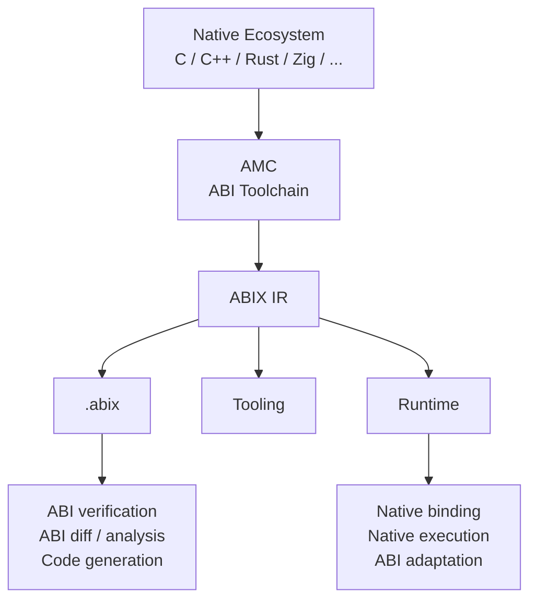

ABIX is currently implemented with **C++ as its first host language**; the Rust provider and Zig backend are available as 0.2.0 previews, and the ABI model itself is designed to stay language-independent.

---

## Why ABIX?

In native software the ABI is usually an implicit consequence of the compiler, target platform, calling convention, data layout, CRT, linker, binary format and language implementation. It exists, but it is hard to inspect, compare, verify and reuse as an independent artifact.

ABIX makes it explicit:

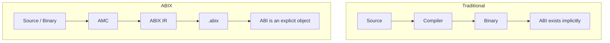

Once ABI is an object, it can be consumed across the toolchain:

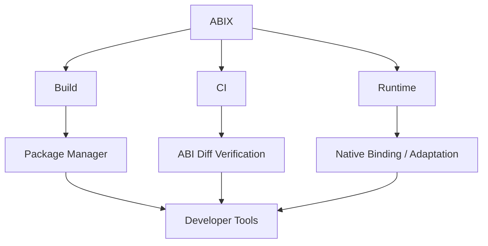

---

## A Small Example

Suppose a library exposes:

```cpp
struct Foo {
    int id;
    double value;
};

int add(int a, int b);
```

The native ABI contains more than the source declaration:

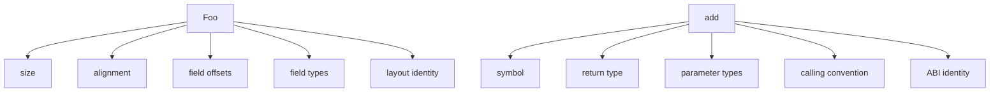

ABIX records these facts in a machine-readable model, so an ABI change becomes directly observable instead of a crash after loading a binary (illustrative output):

```text
$ amc diff foo-v1.abix foo-v2.abix

ABI BREAK

Foo
 └── field: value
      offset: 8 → 16

LayoutHash
  old: 7e...
  new: 91...

Result: incompatible
```

---

## Native, Not a VM

ABIX is not a virtual machine, an RPC framework, or a universal object runtime. For a compatible native function the intended execution path is:

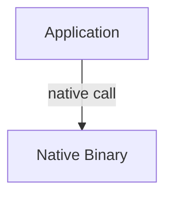

ABIX may participate in **discover / verify / identify / bind / adapt**, but it does not continuously interpret or dispatch compatible calls.

> **Establish the ABI relationship dynamically, then execute through the native ABI.**

---

## The ABIX Model

ABIX is centered on a small set of concepts:

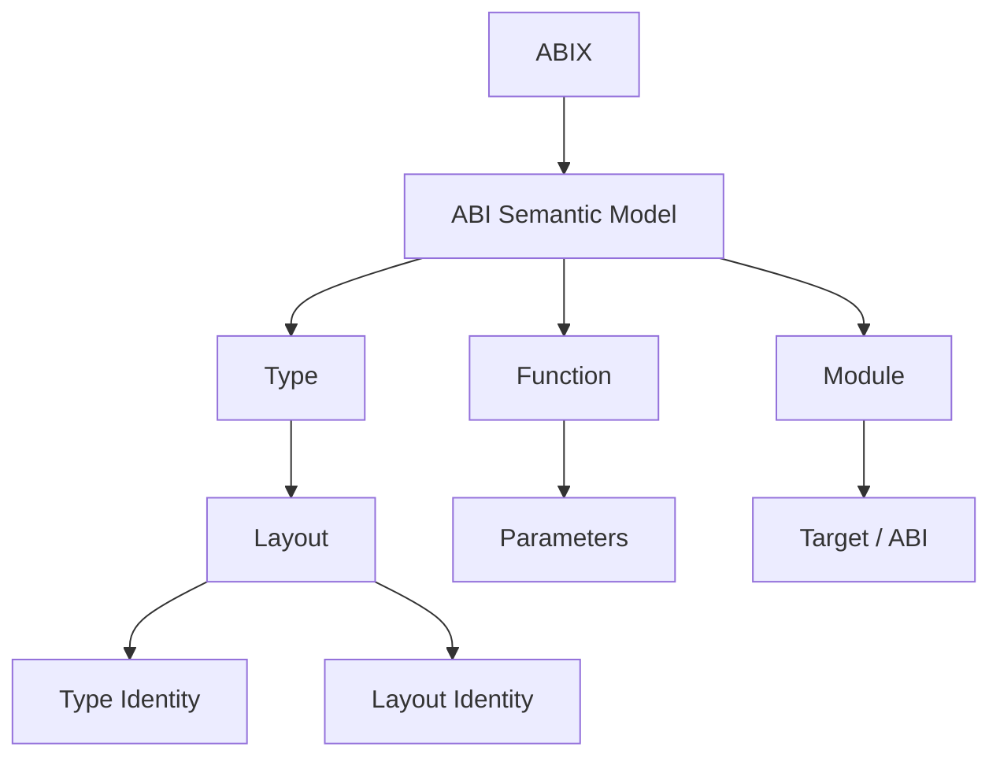

The model describes existing native binary contracts. It does not replace C++, Rust or C with a new universal runtime type system.

Type identity is a 128-bit `TypeID`; layout identity is a separate `LayoutHash`; the module-level artifact identity is the `ABIHash`. Interface identity is a separate `InterfaceId` and is covered in the next section. See [ABI identity & compatibility](docs/architecture/compatibility.md).

---

## ABIX Interface

ABIX also provides an **interface contract layer** for non-intrusive polymorphism across shared-library and language boundaries. A provider type is never modified: a generated adapter receives the object handle as its first argument, and the consumer resolves stable slots once at bind time.

- **Interface identity** is a content hash over the interface name, version and ordered method signatures. It is separate from `TypeID` / `LayoutHash` / `ABIHash` and never feeds them.
- **Method identity** is `(interface_id, slot)`; `bind()` verifies the recorded signature and reports `signature_mismatch` instead of calling an incompatible adapter.
- **Static and dynamic discovery**: an in-process `InterfaceRegistry`, module manifests with leases for plugins, and an Owner ABI for cross-module ownership.
- **Proxy**: `InterfaceProxy<Traits>` turns a contract into `shape.area()`; after one `bind()` the call is a native indirect call.

```cpp
using namespace skl::abix::poly;
constexpr auto i32 = skl::abix::model::canonical_type_id("prim:i32");

struct ShapeTraits {
    static constexpr skl::abix::util::StaticArray signatures = {method_signature("area", i32, nullptr, 0)};
    static constexpr InterfaceId id = interface_id("Shape", 1, signatures);
    static constexpr uint32_t version = 1;
    static constexpr size_t slots = 1;
    static constexpr uint32_t area_slot = 0;
};

class Shape : public InterfaceProxy<ShapeTraits> {
    using Base = InterfaceProxy<ShapeTraits>;

public:
    using Base::Base;
    int area() const noexcept { return this->template call<int (*)(const void *)>(ShapeTraits::area_slot); }
};

Shape shape(registry, &square, square_id);   // i32 / registry / square / square_id come from the provider
int area = shape.area();                     // plain native indirect call
```

See [`docs/abix/interface.md`](docs/abix/interface.md) for the contract, proxy, discovery, lease and Owner ABI APIs.

---

## ABIX IR

The ABIX Intermediate Representation is the common representation shared by language tooling and the runtime:

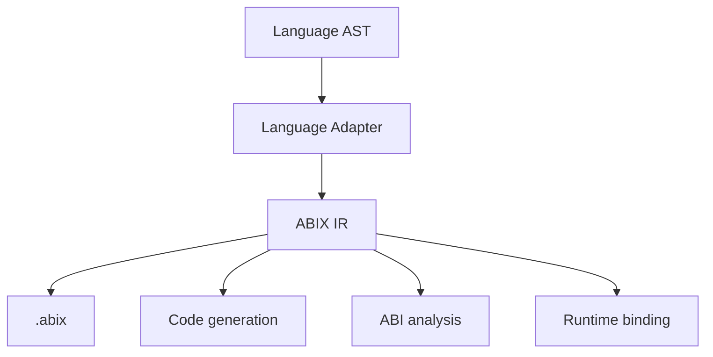

The IR focuses on ABI semantics rather than source-level detail. Its serialized form is the `.abix` artifact:

- [`docs/abix/abix.md`](docs/abix/abix.md) — the canonical `.abix` artifact
- [`docs/abix/abic.md`](docs/abix/abic.md) — the `.abic.toml` build configuration
- [`docs/abix/metadata_modes.md`](docs/abix/metadata_modes.md) — the three metadata modes
- [`docs/abix/interface.md`](docs/abix/interface.md) — the ABIX Interface layer (non-intrusive polymorphism)
- [`docs/abix/std.md`](docs/abix/std.md) — ABIX-STD cross-language ABI primitives

---

## AMC

**AMC — ABI Meta Compiler** is the toolchain entry point.

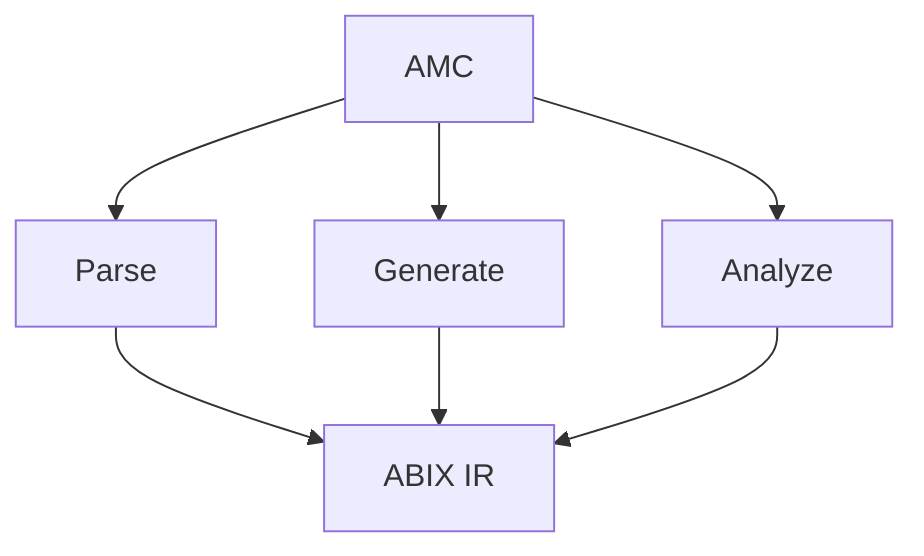

Typical workflows:

```bash
# Build ABI metadata from sources
amc build -c package.abic.toml -B build

# Inspect / query
amc inspect build/build/package.abix
amc query  build/build/package.abix --type Foo --layout
amc context build/build/package.abix --format llm

# Compare, verify and generate
amc diff  v1.abix v2.abix
amc verify -c package.abic.toml -B build
amc generate build/build/package.abix -l rust -o gen/
```

AMC is an extensible toolchain, not a language-specific compiler: frontends extract ABI from a language AST, ABIX IR stays the common representation. The `amc-cpp` frontend/backend links Clang/LLVM; `amc-rust` provides a Rust provider (frontend + backend), and `amc-zig` is a backend-only projection. `amc-dump`, the optional LLDB plugin and `amc-mcp` expose the same artifact to debuggers and AI agents. See [`docs/amc/amc.md`](docs/amc/amc.md).

---

## Self-Hosting

ABIX 0.1.0 is self-hosting for its own public ABI: it describes its public ABI with its own model, and uses that to build and verify the next version.

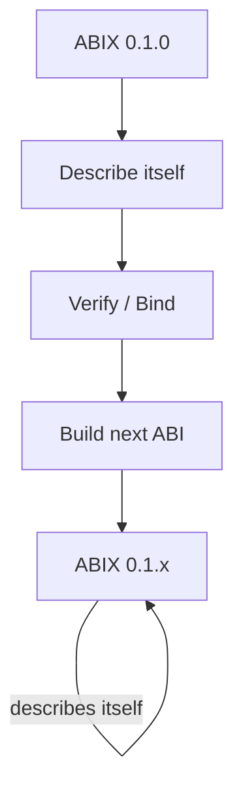

This separates the **stable bootstrap ABI** from **internal implementation** (runtime internals, data structures, synchronization, caches) so the implementation can evolve while its external contract stays explicit. See [`docs/getting-started/self-hosting.md`](docs/getting-started/self-hosting.md).

---

## Architecture

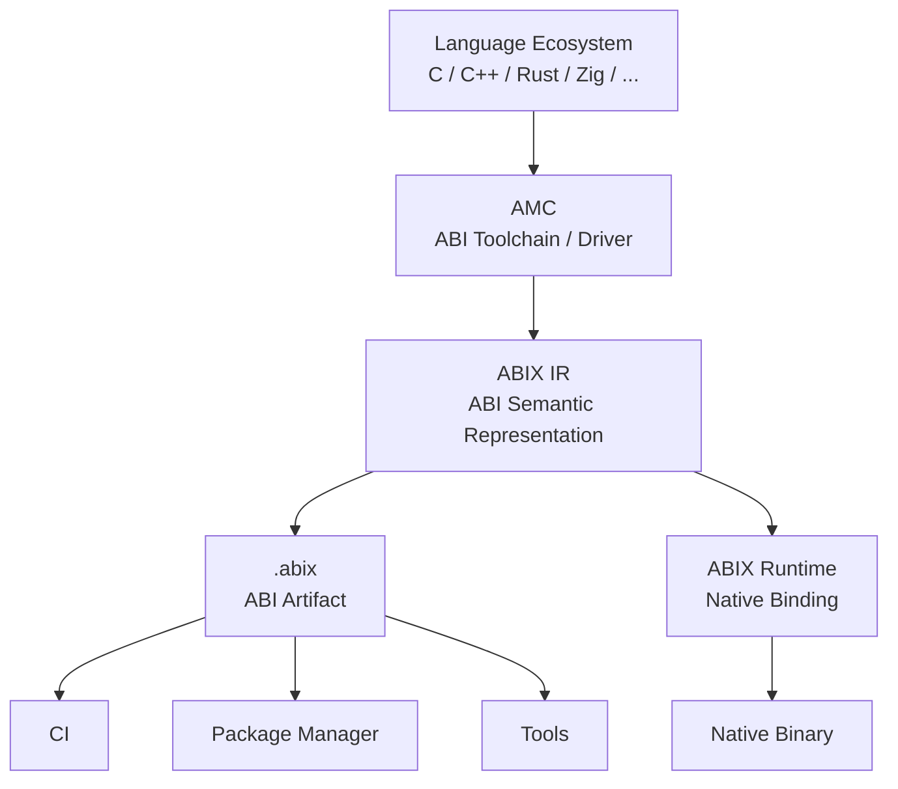

The core architectural rule:

> **There should be one source of ABI truth.** The runtime may use a projection of the ABI model, but must not independently redefine ABI semantics.

Tooling is split into `libabix-format` / `libabix-abi` / `libabix-metadata` / `libabix-tools`, plus the header-only `libabix-runtime`, so every consumer shares exactly one `.abix` / Metadata Region parser. The runtime layers stay independent: the ABI model and metadata projection, native DLL binding with RCU lifecycle, and the interface contract layer.

---

## What ABIX Is Not

| System                   | ABIX's boundary                                          |
| ------------------------ | -------------------------------------------------------- |
| VM / Interpreter         | Compatible calls remain native                           |
| RPC framework            | No network transport is required                         |
| Universal object model   | Does not define a new object universe                    |
| Debug information format | ABI semantics are separate from source/debug information |
| C ABI wrapper            | Does not reduce every interface to `void*`               |
| Compiler replacement     | AMC builds on language/compiler ecosystems               |
| Reflection-only system   | ABI identity and compatibility are first-class           |

ABIX works alongside existing compiler, linker, debugger, build-system and language ecosystems rather than replacing them.

---

## Competitive Landscape

ABIX has no single one-to-one competitor. The problems it solves are scattered across ABI analysis (libabigail), package management (Conan, vcpkg), FFI (bindgen), component models (COM, Wasm Component Model), RPC/IDL (gRPC/Protobuf), and build systems (CMake/Bazel). ABIX unifies these native binary lifecycle capabilities onto a single ABI/IR.

| What others solve    | What ABIX adds                     |
| -------------------- | ---------------------------------- |
| ABI analysis / diff  | ABI IR / contract / verification   |
| Package / build      | ABI metadata as first-class object |
| Source-oriented FFI  | Binary-oriented binding            |
| Wire-level contracts | Native binary boundary semantics   |

For a detailed analysis see [docs/development/competitors.md](docs/development/competitors.md).

---

## Ecosystem

ABIX is designed as an open foundation for native binary interoperability.

AMC provides tooling around ABIX, while higher-level applications can be built independently across areas such as:

- ABI governance and CI
- Cross-language interoperability
- Native plugin systems
- Package and binary management
- IDE and LSP integration
- AI-assisted development
- Robotics and runtime systems

The project aims to support both community-driven and commercial adoption while keeping the core ABI technology broadly reusable and interoperable.

For details see [docs/ecosystem/ecosystem.md](docs/ecosystem/ecosystem.md). For project sustainability, see [docs/ecosystem/sustainability.md](docs/ecosystem/sustainability.md).

---

## Project Structure

```text
ABIX
├── ABIX/                  header-only ABI model and runtime
│   ├── Model/             Model.h ABI.h Bootstrap.h Map.h Compat.h
│   ├── Metadata/          Metadata.h Registry.h Descriptor.h
│   ├── Runtime/           Runtime.h Registry.h Type.h TypeSig.h Search.h Function.h
│   ├── Interface/         Contract.h Proxy.h Registry.h Ref.h Module.h ...
│   ├── DLL/               DLL.h Object.h Function.h FnSig.h Export.h *Ptr.h
│   ├── RCU/               RCU.h Config.h Domain.h Deadline.h
│   ├── Bridge/            Bridge.h Adapter.h Refl.h MICS.h
│   ├── Binary/            BinaryImage.h ELF.h MachO.h PE.h
│   ├── STD/               String.h Span.h Optional.h Result.h Callback.h
│   └── Util/              Util.h Config.h Log.h Atomic.h Hash.h Array.h Mem.h
├── AMC/                   ABI toolchain
│   ├── src/CLI/           build, inspect, query, context, diff, verify, generate, ...
│   ├── src/Core/          .abix format, metadata, query, verify, adapter, symbol store
│   ├── src/Lang/          C++ frontend/backend, Rust provider, Zig backend
│   └── src/Tool/          dump and MCP server
├── Aue/                   experimental Lua boundary layer and conformance runner
├── test/                  Catch2 runtime and unit tests
├── bench/                 Google Benchmark suites
├── dlls/                  cross-DLL test plugins and fixtures
├── tools/                 MCP demo, token-cost, LLDB and test runners
├── scripts/               developer scripts (git hooks, Markdown reflow)
├── src/                   self-hosting ABI inputs
├── docs/                  specification, guides, API, architecture, AI, benchmarks
└── mics/                  reflection submodule (MICS / HLMD)
```

---

## Getting Started

### Requirements

- C++17 or later
- CMake 3.20+ and Ninja
- LLVM / Clang tooling (`clang-cpp`) for the AMC C++ frontend
- Python 3 for the AMC integration, feature and interop tests
- optional: Rust (`rustc`) and Zig for the cross-language providers, Lua 5.4 for Aue, LLDB for the native plugin
- a supported native toolchain

> **Platform support:** Linux, macOS and **Windows**. Windows builds use the MSYS2 UCRT64 toolchain (GCC or Clang); see [`CONTRIBUTING.md`](CONTRIBUTING.md#windows-msys2-ucrt64). On macOS, Homebrew LLVM is keg-only; pass `-DCMAKE_PREFIX_PATH="$(brew --prefix llvm)"` so the AMC targets are built.

### Build

```bash
git clone <repository>
cd ABIX
cmake -B build/Release -DCMAKE_BUILD_TYPE=Release -G Ninja -S .
cmake --build build/Release --parallel
ctest --test-dir build/Release --output-on-failure
```

### Try it

```bash
# Build an .abix artifact from the example config
./build/Release/bin/amc build -c AMC/tests/fixtures/amc_test.abic.toml -B build/demo

# Inspect it
./build/Release/bin/amc inspect build/demo/build/amc_test.abix

# Query a type and its layout
./build/Release/bin/amc query build/demo/build/amc_test.abix --type AmcTestFoo --layout

# LLM-friendly ABI context
./build/Release/bin/amc context build/demo/build/amc_test.abix --format llm
```

For the first complete walkthrough see [`docs/getting-started/getting-started.md`](docs/getting-started/getting-started.md).

---

## Documentation

### Start Here

- [Getting Started](docs/getting-started/getting-started.md)
- [Architecture](docs/architecture/architecture.md)
- [ABIX Specification](.agents/ABI-SPEC.md)
- [`.abix` — Canonical ABI Artifact](docs/abix/abix.md)

### Core Concepts

- [ABI Identity & Compat](docs/architecture/compatibility.md)
- [`.abic` — ABI Configuration](docs/abix/abic.md)
- [Metadata Modes](docs/abix/metadata_modes.md)
- [ABIX Interface](docs/abix/interface.md)
- [ABIX-STD](docs/abix/std.md)
- [Self-Hosting](docs/getting-started/self-hosting.md)

### Runtime

- [Runtime Overview](docs/architecture/runtime.md)
- [API Reference](docs/abix/api.md)
- [Performance & Benchmarks](docs/benchmark/benchmark.md)

### AMC Toolchain

- [AMC](docs/amc/amc.md)
- [Language Plugins](.agents/LANGUAGE-PLUGIN.md)
- [MCP: ABI Metadata for AI agents](docs/ai/MCP.md)

### Project & Development

- [Roadmap](docs/development/roadmap.md) · [authoritative roadmap](.agents/ROADMAP.md)
- [Testing](docs/development/testing.md)
- [Design Notes](docs/development/design-notes.md)
- [Contributing](CONTRIBUTING.md)
- [Agent Instructions](.agents/AGENTS.md)

---

## Current Status

**ABIX 0.1.0** — an unstable, pre-1.0 foundation preview. The ABI model, the canonical `.abix` artifact, the AMC toolchain and the header-only runtime are usable in real engineering:

- **ABI model and artifact**: `TypeID` / `LayoutHash` / `ABIHash`, canonical hashing, canonical layout encoding, and the `.abix` v4 reader/writer.
- **ABI workflow**: inspection, query, context, diff, compatibility classification, verification, adapter generation and `.abic.toml` configuration.
- **Metadata**: three modes, an embedded pointer-free Metadata Region, `.abix.meta`, a symbol server, and ELF / Mach-O / PE inspection.
- **Runtime**: type/function registry, native DLL binding, RCU hot reload, and the BinaryImage capability layer.
- **Interface**: non-intrusive contracts, proxies, static/dynamic discovery, leases and the Owner ABI.
- **AI tooling**: `amc context --format llm`, `amc-mcp`, structured `abix.error/1` errors, and an optional LLDB plugin.
- **Language providers**: C++ frontend/backend, Rust frontend/backend, and a Zig backend-only projection (the 0.2.0 preview).
- **Aue**: an experimental Lua boundary layer with differential conformance tests.

`ABIX 0.2.0 — Cross-language` is in progress: the `amc-rust` provider and the C++ → ABIX → Rust closed loop are delivered, `amc-zig` is backend-only, and the Rust/Zig interop suite builds one native library and runs both consumers. The remaining work is broader cross-language bindings, stabilization and external validation.

Current focus:

- strengthening the ABIX specification and compatibility rules
- improving AMC usability and diagnostics
- language / toolchain integration (more frontends, broader bindings)
- ABI compatibility analysis and regression cases
- documentation, examples and benchmarks
- external validation and adoption

---

## Roadmap

ABIX releases are project stages, not feature lists:

- **ABIX 0.1.0 — Foundation, self-hosting and toolchain** (current, pre-1.0/unstable)
- **ABIX 0.2.0 — Cross-language** (in progress; the Rust provider and Zig backend are delivered)
- **ABIX 0.3.0 — Ecosystem** (AI/agent integration, LSP, package management)

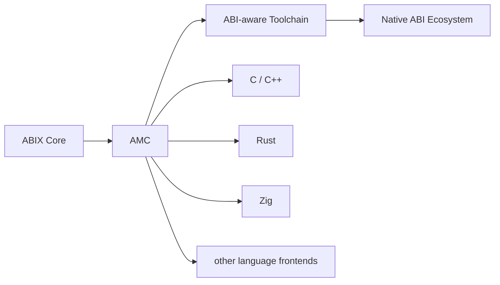

The roadmap prioritises interoperability and real-world usage over adding runtime features. See [`docs/development/roadmap.md`](docs/development/roadmap.md) and the authoritative [`ROADMAP.md`](.agents/ROADMAP.md).

---

## Contributing

Contributions are welcome: language frontends, ABI extraction, IR design, code generation, runtime integration, compatibility testing, build-system integration, documentation, examples and benchmarks.

See [`CONTRIBUTING.md`](CONTRIBUTING.md).

---

## Community

If ABIX is useful to you: star the repository, open issues and discussions, share experiments and use cases, or contribute documentation and code. External feedback is especially valuable while the model and toolchain are still evolving.

---

## License

See [`LICENSE`](LICENSE).
