<p align="center">
  
</p>

<p align="center">
  <strong>把原生 ABI 变成一等、可验证的对象。</strong><br>
  <sub>用于描述、标识、校验并演进原生二进制接口的 ABI 语义层。</sub>
</p>

<p align="center">
  <a href="LICENSE"></a>
  
  
  
  
</p>

<p align="center">
  中文 · <a href="README.md">English</a>
</p>

<details>
<summary>目录</summary>

- [为什么需要 ABIX？](#为什么需要-abix)
- [一个小例子](#一个小例子)
- [原生执行，而不是 VM](#原生执行而不是-vm)
- [ABIX 模型](#abix-模型)
- [ABIX Interface](#abix-interface)
- [ABIX IR](#abix-ir)
- [AMC](#amc)
- [自举 (Self-Hosting)](#自举-self-hosting)
- [架构](#架构)
- [ABIX 不是什么](#abix-不是什么)
- [竞品分析](#竞品分析)
- [生态](#生态)
- [项目结构](#项目结构)
- [快速上手](#快速上手)
- [文档](#文档)
- [当前状态](#当前状态)
- [路线图](#路线图)
- [参与贡献](#参与贡献)
- [社区](#社区)
- [许可证](#许可证)

</details>

---

ABIX 是一个 **ABI 语义层**：用于描述、标识、校验并演进原生二进制接口。它让 ABI 信息变得显式、机器可读，且不依赖某个具体编译器或语言实现。

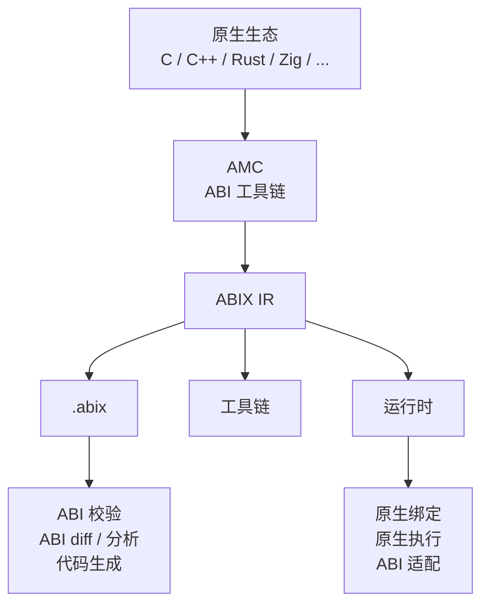

ABIX 目前以 **C++ 作为第一个宿主语言**实现；Rust provider 与 Zig backend 已作为 0.2.0 预览交付，ABI 模型本身保持语言无关。

---

## 为什么需要 ABIX？

在原生软件里，ABI 通常是编译器、目标平台、调用约定、数据布局、CRT、链接器、二进制格式和语言实现共同作用下的**隐式结果**。它确实存在，却难以被检查、比较、验证，也难以作为独立 artifact 复用。

ABIX 让它显式化：

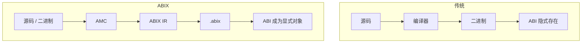

一旦 ABI 成为对象，它就能贯穿整个工具链：

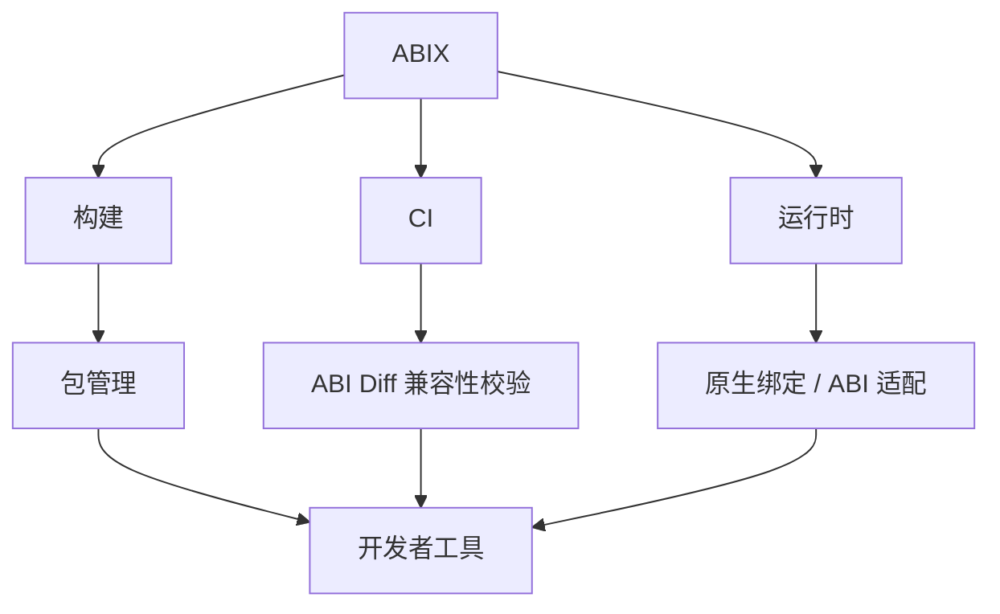

---

## 一个小例子

假设某个库导出：

```cpp
struct Foo {
    int id;
    double value;
};

int add(int a, int b);
```

原生 ABI 远不止源码声明本身：

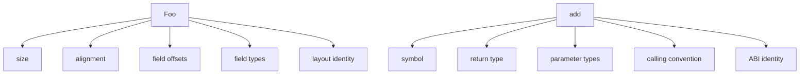

ABIX 把这些 ABI 事实记录为机器可读模型，于是 ABI 变化可以被直接观察，而不是等到加载二进制时才崩溃(输出为示意)：

```text
$ amc diff foo-v1.abix foo-v2.abix

ABI BREAK

Foo
 └── field: value
      offset: 8 → 16

LayoutHash
  old: 7e...
  new: 91...

Result: incompatible
```

可直接运行、可复制的 C++ → ABIX → Rust/Zig 工程见 [`example/cross_language/`](example/cross_language/)。它构建一个原生库，并让 C++、Rust、Zig 三个消费者使用同一份 `.abix` 运行。

---

## 原生执行，而不是 VM

ABIX 不是虚拟机、不是 RPC 框架、也不是通用对象运行时。对一个兼容的原生函数，期望的执行路径是：

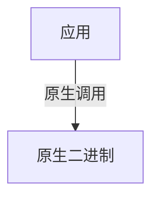

ABIX 可以参与 **发现 / 校验 / 标识 / 绑定 / 适配**，但不会持续解释或分派兼容调用。

> **动态建立 ABI 关系，然后走原生 ABI 执行。**

---

## ABIX 模型

ABIX 围绕少量概念展开：

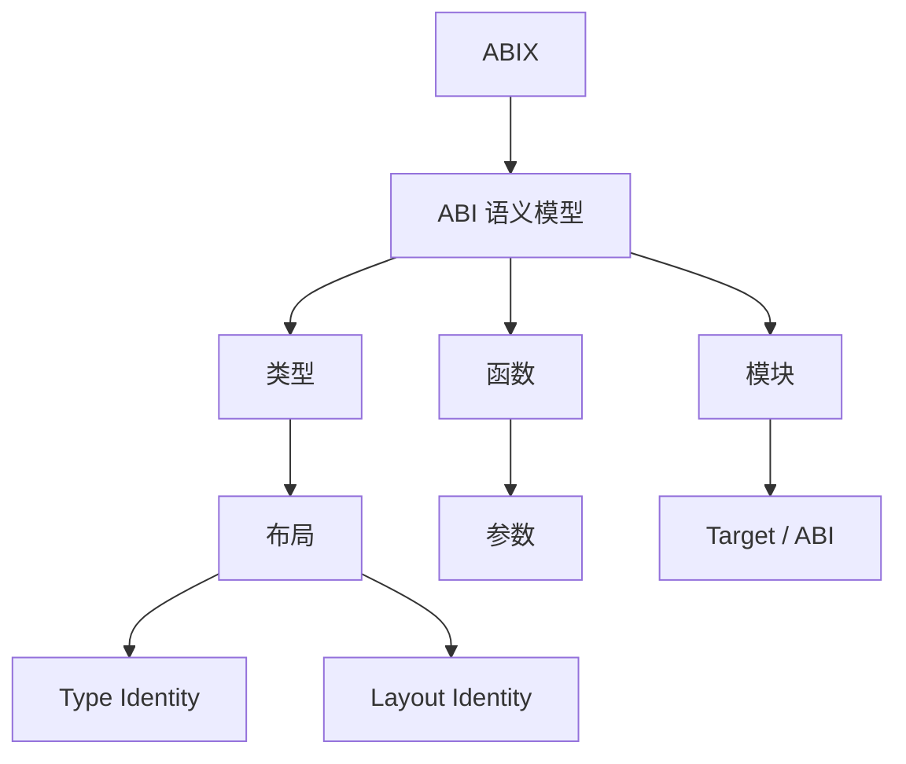

该模型描述的是既有的原生二进制契约，而不是用一套新的通用运行时类型系统去取代 C++ / Rust / C。

类型身份是 128 位 `TypeID`；布局身份是独立的 `LayoutHash`；模块级 artifact 身份是 `ABIHash`。接口身份是独立的 `InterfaceId`，见下一节。详见 [ABI 身份与兼容性](docs/architecture/compatibility_zh.md)。

---

## ABIX Interface

ABIX 还提供**接口契约层**，用于跨共享库、跨语言的**非侵入式多态**。实现方类型不被修改：生成的适配器以对象句柄为第一个参数，消费端在绑定期一次性解析稳定槽位。

- **接口身份** 是接口名、版本与有序方法签名的内容哈希；它与 `TypeID` / `LayoutHash` / `ABIHash` 相互独立，也从不参与它们的计算。
- **方法身份** 是 `(interface_id, slot)`；`bind()` 会校验记录的方法签名，不匹配时返回 `signature_mismatch`，而不是调用不兼容的适配器。
- **静态与动态发现**：进程内 `InterfaceRegistry`、带租约的插件 module manifest，以及用于跨模块所有权的 Owner ABI。
- **代理**：`UniqueInterfaceProxy<Traits>` 把契约变成 `shape.area()`；一次 `bind()` 之后就是普通原生间接调用。

```cpp
using namespace skl::abix::poly;
constexpr auto i32 = skl::abix::model::canonical_type_id("prim:i32");

struct ShapeTraits {
    static constexpr skl::mics::utils::array signatures = {method_signature("area", i32, nullptr, 0)};
    static constexpr InterfaceId id = interface_id("Shape", 1, signatures);
    static constexpr uint32_t version = 1;
    struct alignas(8) Slots {
        uint32_t area;
    };
    alignas(8) static constexpr Slots slots = skl::mics::utils::make_iota<Slots, signatures.size(), 0>();
};

class Shape : public UniqueInterfaceProxy<ShapeTraits> {
    using Base = UniqueInterfaceProxy<ShapeTraits>;

public:
    using Base::Base;
    int area() const noexcept { return this->template call<int (*)(const void *)>(ShapeTraits::slots.area); }
};

Shape shape(registry, &square, square_id);   // i32 / registry / square / square_id 由 provider 提供
int area = shape.area();                     // 普通原生间接调用
```

契约、代理、发现、租约与 Owner ABI 的完整 API 见 [`docs/abix/interface_zh.md`](docs/abix/interface_zh.md)。

---

## ABIX IR

ABIX 中间表示是语言工具与运行时共享的统一表示：

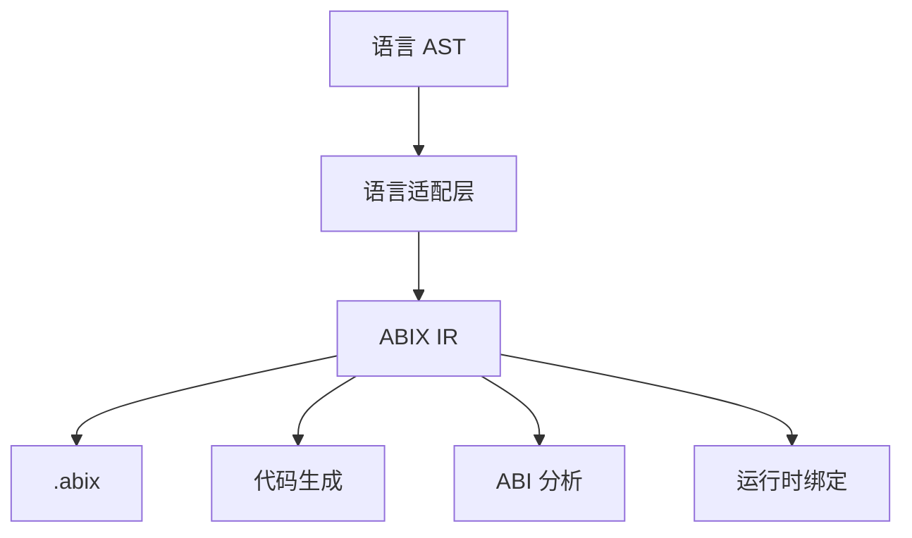

IR 关注 ABI 语义，而非源码级实现细节。其序列化形式即 `.abix`：

- [`docs/abix/abix_zh.md`](docs/abix/abix_zh.md) — 规范化的 `.abix` artifact
- [`docs/abix/abic_zh.md`](docs/abix/abic_zh.md) — `.abic.toml` 构建配置
- [`docs/abix/metadata_modes_zh.md`](docs/abix/metadata_modes_zh.md) — 三种 metadata 模式
- [`docs/abix/interface_zh.md`](docs/abix/interface_zh.md) — ABIX Interface 层 (非侵入式多态)
- [`docs/abix/std_zh.md`](docs/abix/std_zh.md) — ABIX-STD 跨语言 ABI 原语

---

## AMC

**AMC — ABI Meta Compiler** 是工具链入口。

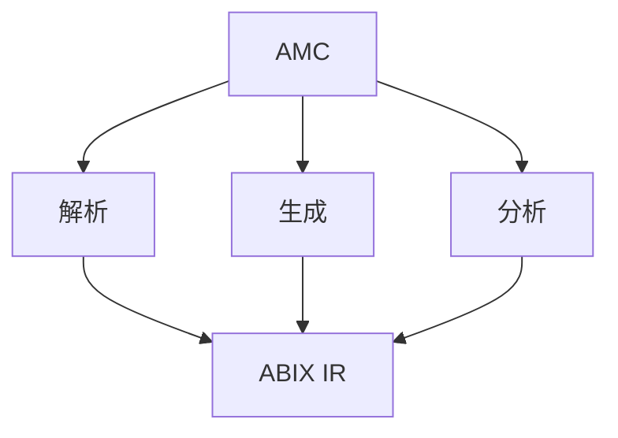

典型用法：

```bash
# 从源码构建 ABI metadata
amc build -c package.abic.toml -B build

# 查看 / 查询
amc inspect build/build/package.abix
amc query  build/build/package.abix --type Foo --layout
amc context build/build/package.abix --format llm

# 对比、校验与生成
amc diff  v1.abix v2.abix
amc verify -c package.abic.toml -B build
amc generate build/build/package.abix -l rust -o gen/
```

AMC 是可扩展工具链而非语言专用编译器：前端从语言 AST 提取 ABI，ABIX IR 始终是统一表示。`amc-cpp` 前端/后端链接 Clang/LLVM；`amc-rust` 提供 Rust provider (frontend + backend)，`amc-zig` 是 backend-only 投影；`amc-dump`、可选的 LLDB 插件与 `amc-mcp` 把同一份 artifact 暴露给调试器与 AI Agent。详见 [`docs/amc/amc_zh.md`](docs/amc/amc_zh.md)。

---

## 自举 (Self-Hosting)

ABIX 0.1.0 对自身公开 ABI 是自举的：用自己的模型描述自己的公开 ABI，并用它构建和校验下一个版本。

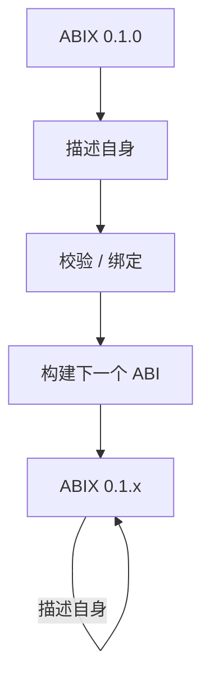

这把**稳定的 bootstrap ABI** 与**内部实现**(运行时内部结构、数据结构、同步、缓存) 分离开，使实现可以演进，而对外契约始终显式、可验证。详见 [`docs/getting-started/self-hosting_zh.md`](docs/getting-started/self-hosting_zh.md)。

---

## 架构

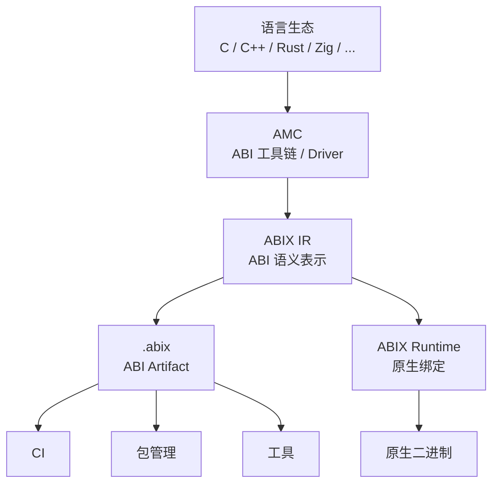

核心架构原则：

> **ABI 事实只能有一个来源。** 运行时可以使用 ABI 模型的投影，但不得自行重新定义 ABI 语义。

工具链拆分为 `libabix-format` / `libabix-abi` / `libabix-metadata` / `libabix-tools`，外加 header-only 的 `libabix-runtime`，确保所有消费者共享唯一的 `.abix` / Metadata Region parser。运行时各层保持独立：ABI 模型与 metadata 投影、原生 DLL 绑定与 RCU 生命周期、接口契约层。

---

## ABIX 不是什么

| 系统          | ABIX 的边界                       |
| ------------- | --------------------------------- |
| VM / 解释器   | 兼容调用保持原生                  |
| RPC 框架      | 不需要网络传输                    |
| 通用对象模型  | 不定义新的对象宇宙                |
| 调试信息格式  | ABI 语义与源码/调试信息分离       |
| C ABI wrapper | 不要求把所有接口退化为 `void*`    |
| 编译器替代品  | AMC 建立在既有语言/编译器生态之上 |
| 纯反射系统    | ABI 身份与兼容性是一等公民        |

ABIX 与既有编译器、链接器、调试器、构建系统和语言生态并存，而不是取代它们。

---

## 竞品分析

ABIX 没有单一的一对一竞品。它要解决的问题分散在 ABI 分析(libabigail)、包管理(Conan、vcpkg)、FFI(bindgen)、组件模型(COM、Wasm Component Model)、RPC/IDL(gRPC/Protobuf)和构建系统(CMake/Bazel)等不同项目中。ABIX 的价值在于把这些分散的原生二进制生命周期能力统一到一个 ABI/IR 上。

| 别人解决什么    | ABIX 增加什么                    |
| --------------- | -------------------------------- |
| ABI 分析 / diff | ABI IR / contract / verification |
| 包管理 / 构建   | ABI metadata 作为一等公民        |
| 源码导向的 FFI  | 二进制导向的绑定                 |
| 线级协议        | 原生二进制边界语义               |

详细分析见 [docs/development/competitors_zh.md](docs/development/competitors_zh.md)。

---

## 生态

ABIX 被设计为原生二进制互操作的开放基础层。

AMC 围绕 ABIX 提供工具链，更高层次的应用可以独立构建，覆盖：

- ABI 治理与 CI
- 跨语言互操作
- 原生插件系统
- 包与二进制管理
- IDE 与 LSP 集成
- AI 辅助开发
- Robotics 与运行时系统

项目致力于支持社区驱动和商业采用，同时保持核心 ABI 技术广泛可复用和可互操作。

详见 [docs/ecosystem/ecosystem_zh.md](docs/ecosystem/ecosystem_zh.md)。项目可持续性见 [docs/ecosystem/sustainability_zh.md](docs/ecosystem/sustainability_zh.md)。

---

## 项目结构

```text
ABIX
├── ABIX/                  纯头文件 ABI 模型与运行时
│   ├── Model/             Model.h ABI.h Bootstrap.h Map.h Compat.h
│   ├── Metadata/          Metadata.h Registry.h Descriptor.h
│   ├── Runtime/           Runtime.h Registry.h Type.h TypeSig.h Search.h Function.h
│   ├── Interface/         Contract.h Proxy.h Registry.h Ref.h Module.h ...
│   ├── DLL/               DLL.h Object.h Function.h FnSig.h Export.h *Ptr.h
│   ├── RCU/               RCU.h Config.h Domain.h Deadline.h
│   ├── Bridge/            Bridge.h Adapter.h Refl.h MICS.h
│   ├── Binary/            BinaryImage.h ELF.h MachO.h PE.h
│   ├── STD/               String.h Span.h Optional.h Result.h Callback.h
│   └── Util/              Util.h Config.h Log.h Atomic.h Hash.h Array.h Mem.h
├── AMC/                   ABI 工具链
│   ├── src/CLI/           build、inspect、query、context、diff、verify、generate 等
│   ├── src/Core/          .abix 格式、metadata、query、verify、adapter、符号存储
│   ├── src/Lang/          C++ 前端/后端、Rust provider、Zig backend
│   └── src/Tool/          dump 与 MCP server
├── Aue/                   实验性 Lua 边界层与一致性测试
├── test/                  Catch2 运行时与单元测试
├── bench/                 Google Benchmark 基准
├── dlls/                  跨 DLL 测试插件与 fixture
├── tools/                 MCP demo、token 成本、LLDB 与测试运行脚本
├── scripts/               开发脚本 (git hooks、Markdown 重排)
├── src/                   自举 ABI 输入
├── docs/                  规范、指南、API、架构、AI、基准
└── mics/                  反射子模块 (MICS / HLMD)
```

---

## 快速上手

### 依赖

- C++17 或更高
- CMake 3.20+ 与 Ninja
- LLVM / Clang 工具链 (`clang-cpp`，AMC C++ 前端需要)
- Python 3 (AMC 集成、功能与互操作测试)
- 可选：Rust (`rustc`) 与 Zig (跨语言 provider)、Lua 5.4 (Aue)、LLDB (原生插件)
- 受支持的原生工具链

> **平台支持：** 支持 Linux、macOS 与 **Windows**。Windows 上使用 MSYS2 UCRT64 工具链 (GCC 或 Clang) 构建；见 [`CONTRIBUTING.md`](CONTRIBUTING.md#windows-msys2-ucrt64)。macOS 上 Homebrew LLVM 是 keg-only，请传 `-DCMAKE_PREFIX_PATH="$(brew --prefix llvm)"`，否则 AMC 目标会被跳过。

### 构建

```bash
git clone <repository>
cd ABIX
cmake -B build/Release -DCMAKE_BUILD_TYPE=Release -G Ninja -S .
cmake --build build/Release --parallel
ctest --test-dir build/Release --output-on-failure
```

### 试用

```bash
# 从示例配置构建 .abix
./build/Release/bin/amc build -c AMC/tests/fixtures/amc_test.abic.toml -B build/demo

# 查看
./build/Release/bin/amc inspect build/demo/build/amc_test.abix

# 查询类型及其布局
./build/Release/bin/amc query build/demo/build/amc_test.abix --type AmcTestFoo --layout

# LLM 友好的 ABI 上下文
./build/Release/bin/amc context build/demo/build/amc_test.abix --format llm
```

完整走查见 [`docs/getting-started/getting-started_zh.md`](docs/getting-started/getting-started_zh.md)。

---

## 文档

### 从这里开始

- [快速上手](docs/getting-started/getting-started_zh.md)
- [架构](docs/architecture/architecture_zh.md)
- [ABIX 规范](.agents/ABI-SPEC.md)
- [`.abix` — 规范化 ABI Artifact](docs/abix/abix_zh.md)

### 核心概念

- [ABI 身份与兼容性](docs/architecture/compatibility_zh.md)
- [`.abic` — ABI 配置](docs/abix/abic_zh.md)
- [Metadata 三种模式](docs/abix/metadata_modes_zh.md)
- [ABIX Interface](docs/abix/interface_zh.md)
- [ABIX-STD](docs/abix/std_zh.md)
- [自举](docs/getting-started/self-hosting_zh.md)

### 语言

- [跨语言 ABI 投影](docs/lang/README_zh.md)
- [C++](docs/lang/cpp_zh.md)
- [Rust](docs/lang/rust_zh.md)
- [Zig](docs/lang/zig_zh.md)

### 运行时

- [运行时概览](docs/architecture/runtime_zh.md)
- [API 参考](docs/abix/api_zh.md)
- [性能与基准](docs/benchmark/benchmark_zh.md)

### AMC 工具链

- [AMC](docs/amc/amc_zh.md)
- [语言插件](.agents/LANGUAGE-PLUGIN.md)
- [MCP：面向 AI Agent 的 ABI Metadata](docs/ai/MCP_zh.md)

### 项目与开发

- [路线图](docs/development/roadmap_zh.md) · [权威路线图](.agents/ROADMAP.md)
- [测试](docs/development/testing_zh.md)
- [设计笔记](docs/development/design-notes_zh.md)
- [参与贡献](CONTRIBUTING.md)
- [Agent 行为准则](.agents/AGENTS.md)

---

## 当前状态

**ABIX 0.1.0** — 非稳定、pre-1.0 的基础预览。ABI 模型、规范化 `.abix` artifact、AMC 工具链与 header-only 运行时已经可用于真实工程：

- **ABI 模型与 artifact**：`TypeID` / `LayoutHash` / `ABIHash`、规范化哈希、规范化布局编码，以及 `.abix` v4 读写。
- **ABI 工作流**：inspect、query、context、diff、兼容性分类、verify、adapter 生成与 `.abic.toml` 配置。
- **Metadata**：三种模式、内嵌的 pointer-free Metadata Region、`.abix.meta`、symbol server，以及 ELF / Mach-O / PE 检查。
- **Runtime**：类型/函数 registry、原生 DLL 绑定、RCU 热重载与 BinaryImage 能力层。
- **Interface**：非侵入式契约、代理、静态/动态发现、租约与 Owner ABI。
- **AI 工具**：`amc context --format llm`、`amc-mcp`、结构化 `abix.error/1` 错误，以及可选的 LLDB 插件。
- **语言 provider**：C++ 前端/后端、Rust 前端/后端，以及 backend-only 的 Zig 投影 (0.2.0 预览)。
- **Aue**：实验性 Lua 边界层与差分一致性测试。

`ABIX 0.2.0 — Cross-language` 正在进行：`amc-rust` provider 与 C++ → ABIX → Rust 闭环已经交付，`amc-zig` 仅有 backend，Rust/Zig 互操作测试会构建同一个原生库并运行两个消费者。剩余工作是更广泛的跨语言绑定、稳定性与外部验证。

当前重点：

- 强化 ABIX 规范与兼容性规则
- 提升 AMC 易用性与诊断
- 语言 / 工具链集成 (更多前端、更广泛的绑定)
- ABI 兼容性分析与回归用例
- 文档、示例与基准
- 外部验证与采用

---

## 路线图

ABIX 的发布按项目阶段划分，而不是功能清单：

- **ABIX 0.1.0 — Foundation, self-hosting and toolchain** (当前，pre-1.0/unstable)
- **ABIX 0.2.0 — Cross-language** (进行中；Rust provider 与 Zig backend 已交付)
- **ABIX 0.3.0 — Ecosystem** (AMC Interface 去分派优化、AI/Agent 集成、LSP、包管理)

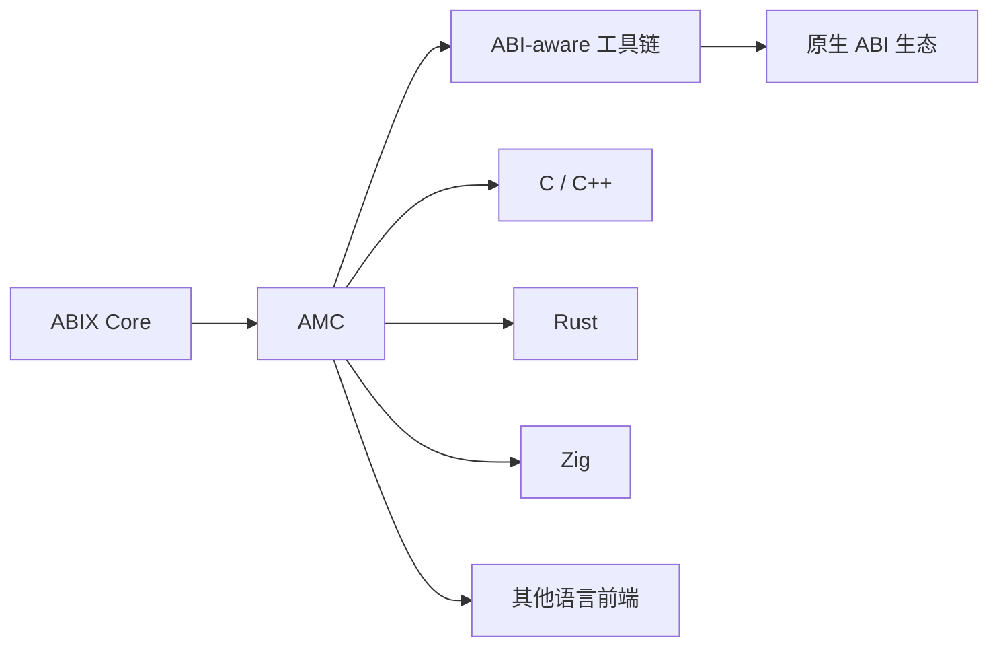

路线图优先考虑互操作性与真实使用，而不是增加运行时特性。见 [`docs/development/roadmap_zh.md`](docs/development/roadmap_zh.md) 与权威的 [`ROADMAP.md`](.agents/ROADMAP.md)。

---

## 参与贡献

欢迎贡献：语言前端、ABI 提取、IR 设计、代码生成、运行时集成、兼容性测试、构建系统集成、文档、示例与基准。

见 [`CONTRIBUTING.md`](CONTRIBUTING.md)。

---

## 社区

如果 ABIX 对你有用：欢迎 star、提 issue / discussion、分享实验与用例，或贡献文档和代码。在模型与工具链仍在演进时，外部反馈尤其宝贵。

---

## 许可证

见 [`LICENSE`](LICENSE)。
