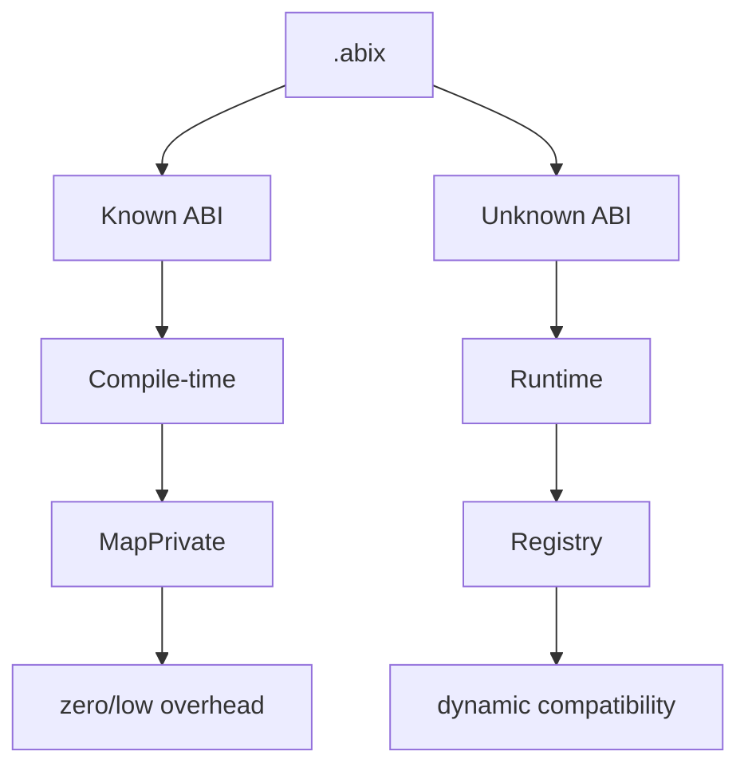
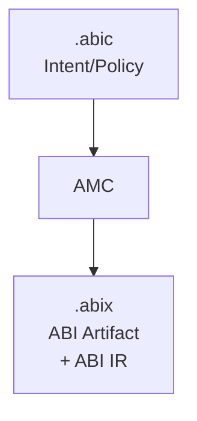

# .abic — ABI Configuration

<p align="center">
  <a href="abic_zh.md">中文</a> · English
</p>

<details>

<summary>Contents</summary>

- [Positioning](#positioning)
- [Core Responsibilities](#core-responsibilities)
- [Format: TOML](#format-toml)
- [Complete Example](#complete-example)
- [Configuration Section Details](#configuration-section-details)
- [Runtime Modes](#runtime-modes)
- [Relationship with .abix](#relationship-with-abix)
- [Minimal Example](#minimal-example)
- [Design Principles](#design-principles)

</details>

## Positioning

`.abic` is a **declarative ABI configuration file** that describes the intent and strategy for "how to build ABI", rather than the ABI facts themselves.

```
.abic = Intent / Policy
.abix = Fact / Artifact
```

`.abic` is closer to CMakeLists.txt / Cargo.toml / protobuf options / compiler configuration, rather than a final ABI database.

## Core Responsibilities

| Responsibility | Section | Description |
|------|------|------|
| Declare source | `[[import]]` | Language and the files to scan, plus optional flags / compilation database |
| Declare export scope | `[[import]].symbols` | Which types and functions form the exported ABI surface |
| Declare output | `[[export]]` | Where the `.abix` artifact is written |
| Declare ownership | `[[owned]]`, `[[contract]]` | Release policies and per-interaction ownership modes |
| Declare error boundary | `[[error]]` | Where a function reports status and carries its result |
| Declare target | `[target]` | Target platform facts used for verification |

## Format: TOML

`.abic` is intended for **humans**, therefore it uses a readable format like TOML.

## Complete Example

```toml
[package]
name = "mylib"
version = "2.0"

[[import]]
language = "cpp"                       # cpp | rust (frontends); lua/zig are generate-only
flags = ["-std=c++17"]
# compile_commands = "compile_commands.json"   # optional, replaces flags
files = ["src/foo.hpp", "src/bar.hpp"]
symbols = ["Foo", "Bar", "FooKind", "foo_create", "foo_destroy", "bar_process"]

# Release policy: how an owned value is created and released.
[[owned]]
type = "Foo"
create = "foo_create"
destroy = "foo_destroy"

# Per-interaction ownership mode (borrowed / owned / copy).
[[contract]]
function = "foo_create"
returns = "owned"
release = "foo_destroy"

[[contract]]
function = "bar_process"
params = ["borrowed"]

# Error boundary: status in the return value, result through parameter 2.
[[error]]
function = "bar_process"
success = 0
value = 2

# Generic instantiation: the frontend instantiates the template and AMC records
# the concrete entity `abix_span_i32`.
[[instantiate]]
template = "abix_std::abix_span"
args = ["int32_t"]
as = "abix_span_i32"

# Target platform facts (integers; `endianness` is a keyword).
[target]
arch = 1
os = 1
abi = 1
pointer_bits = 64
endianness = "little"                  # little | big

[[export]]
output = "build/mylib.abix"
```

## Configuration Section Details

### `[package]`

| Field | Type | Description |
|------|------|------|
| `name` | string | Package name (recorded in the artifact and the metadata region) |
| `version` | string | Version string (independent of the `.abix` format version) |

### `[[import]]`

Exactly one import per file. It selects the language frontend and the source.

| Field | Type | Description |
|------|------|------|
| `language` | string | `cpp` or `rust`. (`lua` / `zig` have no frontend and are used only with `amc generate -l`.) |
| `files` | string[] | Source/header files to scan (relative to the `.abic.toml` directory) |
| `symbols` | string[] | Types and functions that form the exported ABI surface |
| `flags` | string[] | Compiler flags for the frontend (optional) |
| `compile_commands` | string | `compile_commands.json` path; when present it replaces `flags` (optional) |

`files` and `symbols` are required. AMC scans only the listed files, not the whole
project.

### `[[export]]`

| Field | Type | Description |
|------|------|------|
| `output` | string | Output path of the `.abix` artifact, relative to the build directory |

### `[[owned]]` — release policy

| Field | Type | Description |
|------|------|------|
| `type` | string | Value type whose lifetime is managed by the library |
| `create` | string | Factory function name (optional) |
| `destroy` | string | Release function name (required) |

### `[[contract]]` — per-interaction ownership

| Field | Type | Description |
|------|------|------|
| `function` | string | Function whose return/parameters the contract describes |
| `returns` | string | Mode of the return value: `borrowed` / `owned` / `copy` |
| `release` | string | Release function name for an `owned` return |
| `params` | string[] | Positional modes for the parameters |

Ownership is a **contract, not a layout fact**: it never participates in
`TypeID` / `LayoutHash` / `ABIHash`. An absent contract means `unspecified`; a
reader must not infer `borrowed` or `owned`. See
[`ABI-SPEC.md`](../../.agents/ABI-SPEC.md) §9.

### `[[error]]` — error boundary

| Field | Type | Description |
|------|------|------|
| `function` | string | Function whose status/result the contract describes |
| `status` | string | `return` (default) or `parameter`; also `return_field` when the return value is an aggregate (emitted automatically for an `abix_result_*` return) |
| `success` | int | Status value that means success (default `0`) |
| `value` | int | Parameter index carrying the result value (omit when the return value is the result) |

It lets a backend turn a bare C status code into a typed result; a language-native
exception/panic must not cross the ABI boundary. See
[`ABI-SPEC.md`](../../.agents/ABI-SPEC.md) §6.1. With `status = return_field`
the status and value are fields of the returned record: when `[[expose]]` emits a
thunk that returns `abix_result_*` it records `return_field` with the status and
value field indices, so a consumer gets a typed `Result` for the exposed method.

### `[[instantiate]]` — generic instantiation

| Field | Type | Description |
|------|------|------|
| `template` | string | Generic entity name (may be qualified, e.g. `abix_std::abix_span`) |
| `args` | string[] | Canonical type arguments, e.g. `["int32_t"]` |
| `as` | string | Exported name of the concrete entity (also emitted as a source alias) |
| `contract` | string | ABIX-STD contract to lower to: `sequence-view`, `string-view`, `optional` or `result` (optional; `purpose` is an accepted alias) |
| `element` | string | Element spelling the contract requires, e.g. `int` (optional; matched against the pointer's pointee `TypeID`) |
| `mutable` | bool | Require a non-const data pointer (optional, default `false`) |

The **language frontend** performs the instantiation and the constraint check
(Clang/Sema for C++); AMC coordinates the request and records the concrete ABI
facts. ABIX records concrete entities, not generic parameters. When a `contract`
is given, AMC also **lowers** the concrete type against that contract and records
the result: `direct` (the type is already the boundary entity), `needs_adapter`
(compatible shape, a thin adapter is generated), or a rejection. A successful
instantiation does **not** by itself claim ABIX-STD contract compatibility. See
[`ABI-SPEC.md`](../../.agents/ABI-SPEC.md) §18.

### `[[view]]` — container accessor adapter

| Field | Type | Description |
|------|------|------|
| `type` | string | Container type (its layout stays opaque) |
| `data_accessor` | string | Function returning the data pointer |
| `size_accessor` | string | Function returning the element count |

Lowers a container to the sequence view through accessors (for example a
`std::vector<T>`'s `data()`/`size()`), without exposing its internal layout. AMC
generates a thin adapter; the borrow lifetime and invalidation conditions remain
part of the caller's contract.

### `[[contract-type]]` — a non-template contract type

| Field | Type | Description |
|------|------|------|
| `type` | string | Concrete type (e.g. `abix_callback`, `DemoMap`) |
| `contract` | string | ABIX-STD contract: `callback` or `opaque` |

For contract types that are not templates (a callback struct, or an opaque Map /
Set handle), so no `[[instantiate]]` is needed. An `opaque` type is used through
accessor operations; its layout is not consumed.

### `[[range]]` — iterable range adapter

| Field | Type | Description |
|------|------|------|
| `type` | string | Container type (its layout stays opaque) |
| `size_accessor` | string | Function returning the element count |
| `at_accessor` | string | Function returning element `index` |

Exposes a non-contiguous container as an iterable range (length + indexed
access) without assuming contiguous memory.

### `[[expose]]` — automatic capability generation

| Field | Type | Description |
|------|------|------|
| `type` | string | Concrete type to expose (e.g. `cmdly::MemoryHistory`) |
| `methods` | string[] | Member function names to expose (inherited methods included) |
| `constructor` | string[] | Constructor parameter spellings (omit/empty = default constructor) |
| `destructor` | bool | Emit a destroy entry (default `true`) |
| `opaque` | bool | Consumers see an opaque handle (default `true`) |

The C++ frontend emits `abix_<Type>_create/_destroy/_<method>` **thunks** and
records them as ABI entities, so neither the producer nor the consumer writes an
adapter by hand. Only public members are supported, and only representations the
bridge can express: a parameter or return type that is not a known, layout-safe
type is rejected (`... needs a contract`) rather than guessed at. A signature
that mentions an ABIX-STD boundary type (`abix_span_*`, `abix_str_*`,
`abix_result_*`) records the matching contract automatically; a native STL
parameter type needs an explicit `[[adapt]]` mapping. An `abix_result_*` return
binds to the error boundary automatically (see `[[error]]`).

### `[thunks]` — generated thunk source

| Field | Type | Description |
|------|------|------|
| `output` | string | Path of the generated C thunk source (compiled into the producer) |

Required when `[[expose]]` is present.

### `[[adapt]]` — native↔ABIX-STD parameter adaptation

| Field | Type | Description |
|------|------|------|
| `native` | string | Native kind: `std::string`, `std::string_view`, `std::vector` or `std::span` |
| `target` | string | ABIX-STD boundary type the parameter is marshalled onto (e.g. `abix_str_utf8`, `abix_span_i32`) |
| `element` | string | Element spelling for `std::vector`/`std::span` (e.g. `int32_t`); ignored otherwise |

An STL type must not cross the boundary raw (see
[`ABI-SPEC.md`](../../.agents/ABI-SPEC.md) §18): a declared mapping is required
before `[[expose]]` will adapt a method that takes it. On a match the generated
thunk takes the boundary type and marshals it onto the native type
(`std::string(data, len)`, `std::vector<T>(data, data + len)`, ...); the adapter
is generated and linked, never inferred. Only **parameters** are adapted — a
return value mapped to a borrowed view would dangle, so returns still need their
own contract. A non-const lvalue reference and a mutable `std::span<T>` are not
adapted (writing back through a borrowed view is not modelled).

### `[[interface]]` — a named interface contract

| Field | Type | Description |
|------|------|------|
| `name` | string | Interface name (part of its identity) |
| `version` | int | Interface version (default `1`) |
| `methods` | string[] | Interface methods, **in slot order**; each names an already-recorded function whose signature becomes that method's contract |

The interface identity is a content hash over the name, version and ordered
method signatures — not a class name and not a vtable address. It is a **contract,
not a layout fact**: it never feeds `TypeID` / `LayoutHash` / `ABIHash`. See
[`interface.md`](interface.md).

### `[[implements]]` — bind a concrete type to an interface

| Field | Type | Description |
|------|------|------|
| `interface` | string | The `[[interface]]` this implementation satisfies |
| `type` | string | The concrete type implementing it |
| `methods` | string[] | In slot order, the recorded adapter function bound to each interface method; its count must equal the interface's method count |

The binding maps `(interface_id, slot)` to an adapter function signature; the
adapter's first parameter is the object handle. ABIX standardises no private
vtable: a provider keeps its own layout and virtual functions, and the adapter is
the only bridge. `amc generate -l cpp` projects each interface as
`k<Name>Interface`, `k<Name>Version`, `enum class <Name>Slot`, a
`<Name>_<method>_fn` typedef, a `Traits` struct (id / version / slots / expected
signatures) and — when every method takes the object handle first — an
`InterfaceProxy<Traits>`-derived proxy class, so a consumer can declare, bind and
call the interface without touching the provider's layout. See
[`interface.md`](interface.md) and ABI-SPEC §19.

### `[target]`

| Field | Type | Description |
|------|------|------|
| `arch` | uint | Target architecture code |
| `os` | uint | Target OS code |
| `abi` | uint | Target ABI code |
| `pointer_bits` | uint | Pointer width in bits (`0` = unknown) |
| `endianness` | string | `little` / `big` |

`[target]` describes the **target platform**; unknown facts are reported as
`unverifiable` by runtime verification rather than assumed compatible. See
[`ABI-SPEC.md`](../../.agents/ABI-SPEC.md) §10.

## Runtime Modes

### `static`

All ABI information is determined at compile time, generating `constexpr` metadata and `MapPrivate`.

```
.abic → AMC → .abix → AMC → .abix.hpp → Compiler → inline
```

### `dynamic`

All ABI information is loaded at runtime, queried dynamically via `mmap` + Registry.

```
.abic → AMC → .abix → Runtime → mmap → Registry → dynamic query
```

### `hybrid` (recommended)

Known ABIs take the static path, unknown ABIs take the dynamic path.



## Relationship with .abix



- `.abic` is input: describes intent
- `.abix` is output: records facts
- AMC is the compiler: transforms intent into facts

**The Source of Truth is always `.abix`**, not `.abic`. `.abic` is only used at build time and does not participate at runtime.

## Minimal Example

Export a single type; everything else takes a default:

```toml
[package]
name = "minimal"
version = "1.0"

[[import]]
language = "cpp"
files = ["src/foo.hpp"]
symbols = ["Foo"]

[[export]]
output = "build/minimal.abix"
```

AMC fills in defaults for the optional fields (no contracts, no target facts).

## Design Principles

1. **Declarative**: describes "what you want", not "how to do it"
2. **Human-readable**: TOML format, easy to hand-write and version-control
3. **Completable**: all optional fields have sensible defaults
4. **Decoupled from version**: the package `version` is independent of the `.abix` format version
5. **Build-time only**: no dependency on `.abic` at runtime
6. **Contracts are additive**: ownership / error / target sections are optional and never change `TypeID` / `LayoutHash` / `ABIHash`
