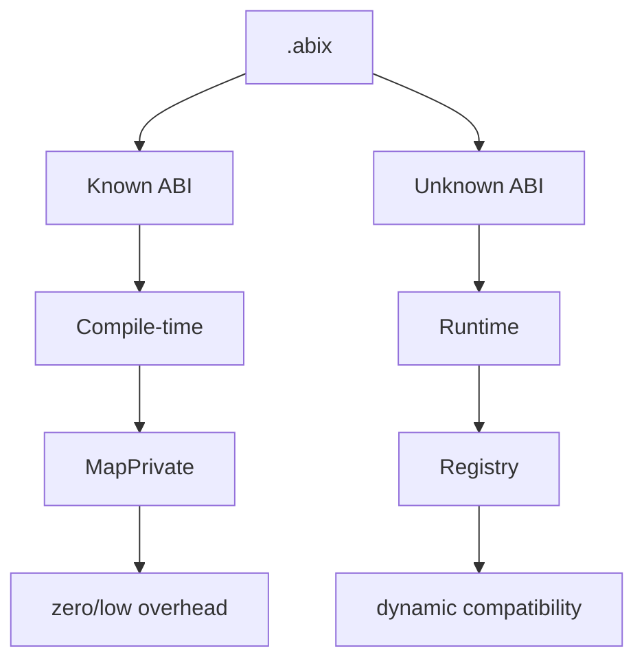
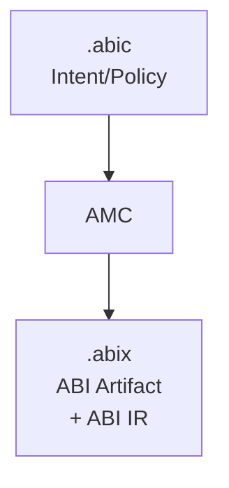

# .abic — ABI Configuration

<p align="center">
  <a href="abic_zh.md">中文</a> · English
</p>

<details>

<summary>Contents</summary>

- [Positioning](#positioning)
- [Core Responsibilities](#core-responsibilities)
- [Format: TOML](#format-toml)
- [Complete Example](#complete-example)
- [Configuration Section Details](#configuration-section-details)
- [Runtime Modes](#runtime-modes)
- [Relationship with .abix](#relationship-with-abix)
- [Minimal Example](#minimal-example)
- [Design Principles](#design-principles)

</details>

## Positioning

`.abic` is a **declarative ABI configuration file** that describes the intent and strategy for "how to build ABI", rather than the ABI facts themselves.

```
.abic = Intent / Policy
.abix = Fact / Artifact
```

`.abic` is closer to CMakeLists.txt / Cargo.toml / protobuf options / compiler configuration, rather than a final ABI database.

## Core Responsibilities

| Responsibility | Section | Description |
|------|------|------|
| Declare source | `[[import]]` | Language and the files to scan, plus optional flags / compilation database |
| Declare export scope | `[[import]].symbols` | Which types and functions form the exported ABI surface |
| Declare output | `[[export]]` | Where the `.abix` artifact is written |
| Declare ownership | `[[owned]]`, `[[contract]]` | Release policies and per-interaction ownership modes |
| Declare error boundary | `[[error]]` | Where a function reports status and carries its result |
| Declare target | `[target]` | Target platform facts used for verification |

## Format: TOML

`.abic` is intended for **humans**, therefore it uses a readable format like TOML.

## Complete Example

```toml
[package]
name = "mylib"
version = "2.0"

[[import]]
language = "cpp"                       # cpp | rust (frontends); lua/zig are generate-only
flags = ["-std=c++17"]
# compile_commands = "compile_commands.json"   # optional, replaces flags
files = ["src/foo.hpp", "src/bar.hpp"]
symbols = ["Foo", "Bar", "FooKind", "foo_create", "foo_destroy", "bar_process"]

# Release policy: how an owned value is created and released.
[[owned]]
type = "Foo"
create = "foo_create"
destroy = "foo_destroy"

# Per-interaction ownership mode (borrowed / owned / copy).
[[contract]]
function = "foo_create"
returns = "owned"
release = "foo_destroy"

[[contract]]
function = "bar_process"
params = ["borrowed"]

# Error boundary: status in the return value, result through parameter 2.
[[error]]
function = "bar_process"
success = 0
value = 2

# Target platform facts (integers; `endianness` is a keyword).
[target]
arch = 1
os = 1
abi = 1
pointer_bits = 64
endianness = "little"                  # little | big

[[export]]
output = "build/mylib.abix"
```

## Configuration Section Details

### `[package]`

| Field | Type | Description |
|------|------|------|
| `name` | string | Package name (recorded in the artifact and the metadata region) |
| `version` | string | Version string (independent of the `.abix` format version) |

### `[[import]]`

Exactly one import per file. It selects the language frontend and the source.

| Field | Type | Description |
|------|------|------|
| `language` | string | `cpp` or `rust`. (`lua` / `zig` have no frontend and are used only with `amc generate -l`.) |
| `files` | string[] | Source/header files to scan (relative to the `.abic.toml` directory) |
| `symbols` | string[] | Types and functions that form the exported ABI surface |
| `flags` | string[] | Compiler flags for the frontend (optional) |
| `compile_commands` | string | `compile_commands.json` path; when present it replaces `flags` (optional) |

`files` and `symbols` are required. AMC scans only the listed files, not the whole
project.

### `[[export]]`

| Field | Type | Description |
|------|------|------|
| `output` | string | Output path of the `.abix` artifact, relative to the build directory |

### `[[owned]]` — release policy

| Field | Type | Description |
|------|------|------|
| `type` | string | Value type whose lifetime is managed by the library |
| `create` | string | Factory function name (optional) |
| `destroy` | string | Release function name (required) |

### `[[contract]]` — per-interaction ownership

| Field | Type | Description |
|------|------|------|
| `function` | string | Function whose return/parameters the contract describes |
| `returns` | string | Mode of the return value: `borrowed` / `owned` / `copy` |
| `release` | string | Release function name for an `owned` return |
| `params` | string[] | Positional modes for the parameters |

Ownership is a **contract, not a layout fact**: it never participates in
`TypeID` / `LayoutHash` / `ABIHash`. An absent contract means `unspecified`; a
reader must not infer `borrowed` or `owned`. See
[`ABI-SPEC.md`](../../.agents/ABI-SPEC.md) §9.

### `[[error]]` — error boundary

| Field | Type | Description |
|------|------|------|
| `function` | string | Function whose status/result the contract describes |
| `status` | string | `return` (default) or `parameter` |
| `success` | int | Status value that means success (default `0`) |
| `value` | int | Parameter index carrying the result value (omit when the return value is the result) |

It lets a backend turn a bare C status code into a typed result; a language-native
exception/panic must not cross the ABI boundary. See
[`ABI-SPEC.md`](../../.agents/ABI-SPEC.md) §6.1.

### `[target]`

| Field | Type | Description |
|------|------|------|
| `arch` | uint | Target architecture code |
| `os` | uint | Target OS code |
| `abi` | uint | Target ABI code |
| `pointer_bits` | uint | Pointer width in bits (`0` = unknown) |
| `endianness` | string | `little` / `big` |

`[target]` describes the **target platform**; unknown facts are reported as
`unverifiable` by runtime verification rather than assumed compatible. See
[`ABI-SPEC.md`](../../.agents/ABI-SPEC.md) §10.

## Runtime Modes

### `static`

All ABI information is determined at compile time, generating `constexpr` metadata and `MapPrivate`.

```
.abic → AMC → .abix → AMC → .abix.hpp → Compiler → inline
```

### `dynamic`

All ABI information is loaded at runtime, queried dynamically via `mmap` + Registry.

```
.abic → AMC → .abix → Runtime → mmap → Registry → dynamic query
```

### `hybrid` (recommended)

Known ABIs take the static path, unknown ABIs take the dynamic path.



## Relationship with .abix



- `.abic` is input: describes intent
- `.abix` is output: records facts
- AMC is the compiler: transforms intent into facts

**The Source of Truth is always `.abix`**, not `.abic`. `.abic` is only used at build time and does not participate at runtime.

## Minimal Example

Export a single type; everything else takes a default:

```toml
[package]
name = "minimal"
version = "1.0"

[[import]]
language = "cpp"
files = ["src/foo.hpp"]
symbols = ["Foo"]

[[export]]
output = "build/minimal.abix"
```

AMC fills in defaults for the optional fields (no contracts, no target facts).

## Design Principles

1. **Declarative**: describes "what you want", not "how to do it"
2. **Human-readable**: TOML format, easy to hand-write and version-control
3. **Completable**: all optional fields have sensible defaults
4. **Decoupled from version**: the package `version` is independent of the `.abix` format version
5. **Build-time only**: no dependency on `.abic` at runtime
6. **Contracts are additive**: ownership / error / target sections are optional and never change `TypeID` / `LayoutHash` / `ABIHash`
