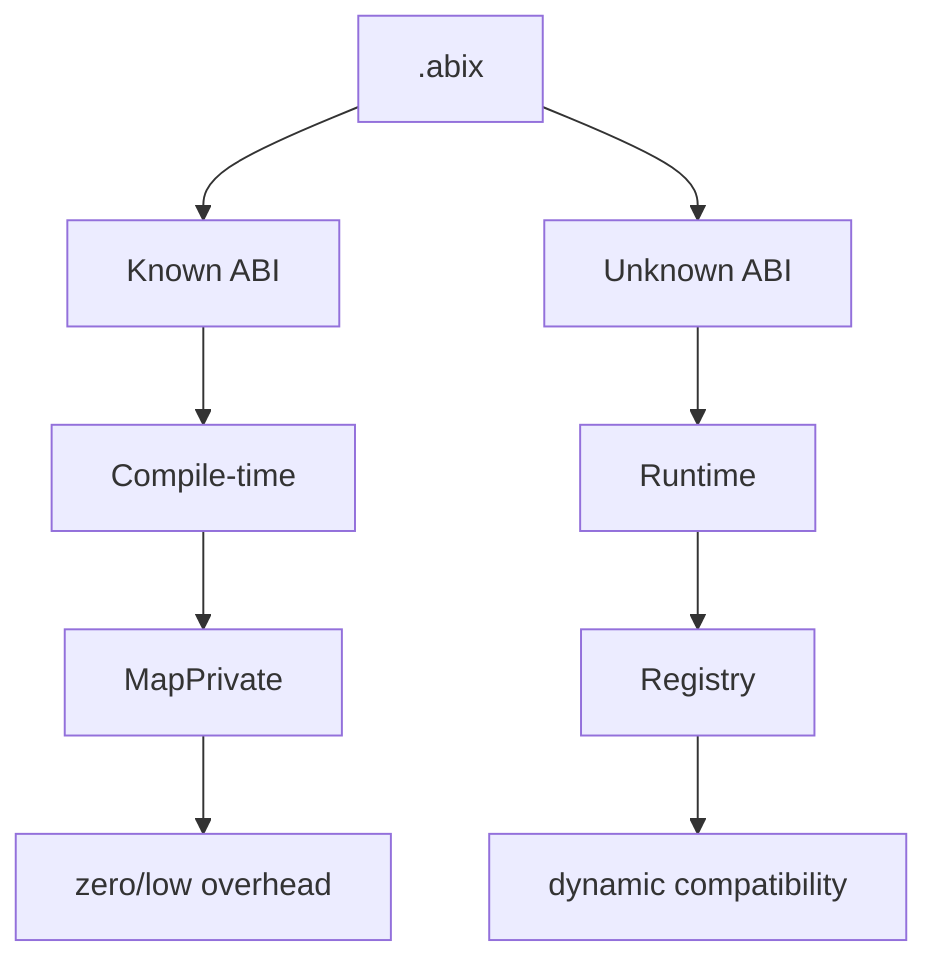
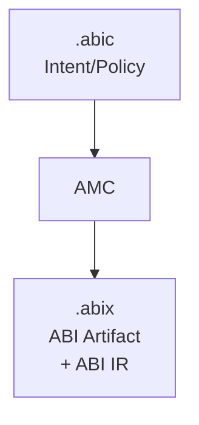

# .abic — ABI Configuration

<p align="center">
  中文 · <a href="abic.md">English</a>
</p>

<details>

<summary>目录</summary>

- [定位](#定位)
- [核心职责](#核心职责)
- [格式：TOML](#格式toml)
- [完整示例](#完整示例)
- [配置节详解](#配置节详解)
- [运行模式](#运行模式)
- [与 .abix 的关系](#与-abix-的关系)
- [最小示例](#最小示例)
- [设计原则](#设计原则)

</details>

## 定位

`.abic` 是**声明式 ABI 配置文件**，描述"如何构建 ABI"的意图与策略，而非 ABI 事实本身。

```
.abic = Intent / Policy
.abix = Fact / Artifact
```

`.abic` 更接近 CMakeLists.txt / Cargo.toml / protobuf options / compiler configuration，而不是最终 ABI 数据库。

## 核心职责

| 职责 | 配置节 | 说明 |
|------|------|------|
| 声明源 | `[[import]]` | 语言与要扫描的文件，以及可选 flags / compilation database |
| 声明导出范围 | `[[import]].symbols` | 哪些类型、函数构成导出的 ABI 表面 |
| 声明输出 | `[[export]]` | `.abix` 产物写到哪里 |
| 声明所有权 | `[[owned]]`、`[[contract]]` | 释放策略与逐交互所有权模式 |
| 声明错误边界 | `[[error]]` | 函数在哪里报告状态、结果放在哪里 |
| 声明目标平台 | `[target]` | 用于验证的目标平台事实 |

## 格式：TOML

`.abic` 面向**人**，因此使用 TOML 这种可读的格式。

## 完整示例

```toml
[package]
name = "mylib"
version = "2.0"

[[import]]
language = "cpp"                       # cpp | rust（前端）；lua/zig 仅用于 generate
flags = ["-std=c++17"]
# compile_commands = "compile_commands.json"   # 可选，存在时替代 flags
files = ["src/foo.hpp", "src/bar.hpp"]
symbols = ["Foo", "Bar", "FooKind", "foo_create", "foo_destroy", "bar_process"]

# 释放策略：被拥有的值如何创建与释放
[[owned]]
type = "Foo"
create = "foo_create"
destroy = "foo_destroy"

# 逐交互所有权模式（borrowed / owned / copy）
[[contract]]
function = "foo_create"
returns = "owned"
release = "foo_destroy"

[[contract]]
function = "bar_process"
params = ["borrowed"]

# 错误边界：状态在返回值，结果通过参数 2
[[error]]
function = "bar_process"
success = 0
value = 2

# 泛型实例化：前端实例化模板，AMC 记录具体实体 `abix_span_i32`
[[instantiate]]
template = "abix_std::abix_span"
args = ["int32_t"]
as = "abix_span_i32"

# 目标平台事实（整数；`endianness` 为关键字）
[target]
arch = 1
os = 1
abi = 1
pointer_bits = 64
endianness = "little"                  # little | big

[[export]]
output = "build/mylib.abix"
```

## 配置节详解

### `[package]`

| 字段 | 类型 | 说明 |
|------|------|------|
| `name` | string | 包名（记入产物与 metadata region） |
| `version` | string | 版本字符串（与 `.abix` 格式版本无关） |

### `[[import]]`

每个文件恰好一个 import，用于选择语言前端与源。

| 字段 | 类型 | 说明 |
|------|------|------|
| `language` | string | `cpp` 或 `rust`。（`lua` / `zig` 无前端，只用于 `amc generate -l`。） |
| `files` | string[] | 要扫描的源/头文件（相对 `.abic.toml` 所在目录） |
| `symbols` | string[] | 构成导出 ABI 表面的类型与函数 |
| `flags` | string[] | 传给前端的编译 flag（可选） |
| `compile_commands` | string | `compile_commands.json` 路径；存在时替代 `flags`（可选） |

`files` 与 `symbols` 为必填。AMC 只扫描列出的文件，而非整个项目。

### `[[export]]`

| 字段 | 类型 | 说明 |
|------|------|------|
| `output` | string | `.abix` 产物的输出路径，相对构建目录 |

### `[[owned]]` — 释放策略

| 字段 | 类型 | 说明 |
|------|------|------|
| `type` | string | 由库管理生命周期的值类型 |
| `create` | string | 工厂函数名（可选） |
| `destroy` | string | 释放函数名（必填） |

### `[[contract]]` — 逐交互所有权

| 字段 | 类型 | 说明 |
|------|------|------|
| `function` | string | 契约所描述的函数 |
| `returns` | string | 返回值的模式：`borrowed` / `owned` / `copy` |
| `release` | string | `owned` 返回值的释放函数名 |
| `params` | string[] | 各参数位置的模式 |

所有权是**契约而非布局事实**：永不参与 `TypeID` / `LayoutHash` / `ABIHash`。缺失即
`unspecified`，reader **不得**推断为 `borrowed` 或 `owned`。见
[`ABI-SPEC.md`](../../.agents/ABI-SPEC.md) §9。

### `[[error]]` — 错误边界

| 字段 | 类型 | 说明 |
|------|------|------|
| `function` | string | 契约所描述的函数 |
| `status` | string | `return`（默认）或 `parameter`；当返回值是聚合时还有 `return_field`（`abix_result_*` 返回值会自动生成） |
| `success` | int | 表示成功的状态值（默认 `0`） |
| `value` | int | 承载结果值的参数下标（返回值为结果时可省略） |

它让后端把裸 C 状态码变成类型化结果；语言原生的异常/panic **不得**穿越 ABI 边界。
`status = return_field` 时状态与结果值是返回记录的两个字段：`[[expose]]` 生成返回
`abix_result_*` 的 thunk 时会记录 `return_field` 及其状态/值字段下标，消费者因此得到
类型化的 `Result`。见 [`ABI-SPEC.md`](../../.agents/ABI-SPEC.md) §6.1。

### `[[instantiate]]` — 泛型实例化

| 字段 | 类型 | 说明 |
|------|------|------|
| `template` | string | 泛型实体名（可带限定，如 `abix_std::abix_span`） |
| `args` | string[] | 规范类型实参，如 `["int32_t"]` |
| `as` | string | 具体实体的导出名（同时作为源码别名生成） |
| `contract` | string | 要 lower 到的 ABIX-STD 契约：`sequence-view`、`string-view`、`optional` 或 `result`（可选） |
| `element` | string | 契约要求的元素拼写，如 `int`（可选；按指针 pointee 的 `TypeID` 匹配） |
| `mutable` | bool | 要求非常量数据指针（可选，默认 `false`） |

**语言前端**负责实例化与约束检查（C++ 为 Clang/Sema）；AMC 协调请求并记录具体
ABI 事实。ABIX 记录具体实体，而非泛型参数。给出 `contract` 时，AMC 还会把具体类型对该
契约做 **lowering** 并记录结果：`direct`（类型本身即边界实体）、`needs_adapter`（形状兼容，
生成薄适配器）或拒绝。实例化成功**并不**等于满足 ABIX-STD 契约。见
[`ABI-SPEC.md`](../../.agents/ABI-SPEC.md) §18。

### `[[view]]` — 容器 accessor 适配

| 字段 | 类型 | 说明 |
|------|------|------|
| `type` | string | 容器类型（其布局保持 opaque） |
| `data_accessor` | string | 返回数据指针的函数 |
| `size_accessor` | string | 返回元素个数的函数 |

通过 accessor 把容器 lower 成连续序列视图（例如 `std::vector<T>` 的 `data()`/`size()`），
不暴露内部布局。AMC 生成薄适配器；借用生命周期与失效条件仍属于调用方契约。

### `[[contract-type]]` — 非模板契约类型

| 字段 | 类型 | 说明 |
|------|------|------|
| `type` | string | 具体类型（如 `abix_callback`、`DemoMap`） |
| `contract` | string | ABIX-STD 契约：`callback` 或 `opaque` |

用于非模板的契约类型（回调结构体，或 opaque 的 Map/Set 句柄），无需 `[[instantiate]]`。
`opaque` 类型经 accessor 操作使用，不消费其布局。

### `[[range]]` — 可迭代范围适配

| 字段 | 类型 | 说明 |
|------|------|------|
| `type` | string | 容器类型（其布局保持 opaque） |
| `size_accessor` | string | 返回元素个数的函数 |
| `at_accessor` | string | 返回下标 `index` 处元素的函数 |

把非连续容器暴露为可迭代范围（长度 + 索引访问），不假设连续内存。

### `[[expose]]` — 自动能力生成

| 字段 | 类型 | 说明 |
|------|------|------|
| `type` | string | 要暴露的具体类型（如 `cmdly::MemoryHistory`） |
| `methods` | string[] | 要暴露的成员函数名（含继承自基类的方法） |
| `constructor` | string[] | 构造函数参数拼写（省略/为空 = 默认构造） |
| `destructor` | bool | 是否生成销毁入口（默认 `true`） |
| `opaque` | bool | 消费者视为不透明句柄（默认 `true`） |

C++ 前端生成 `abix_<Type>_create/_destroy/_<method>` **thunk** 并登记为 ABI 实体，
生产者与消费者都无需手写适配器。仅支持 public 成员，且只接受桥接能表达的表示：
无法确定的参数/返回类型会被拒绝（`... needs a contract`）而不是猜测。签名里出现
ABIX-STD 边界类型（`abix_span_*`、`abix_str_*`、`abix_result_*`）时会自动记录对应契约；
原生 STL 参数类型需要显式的 `[[adapt]]` 映射。`abix_result_*` 返回值会自动绑定错误边界
（见 `[[error]]`）。

### `[thunks]` — 生成 thunk 源

| 字段 | 类型 | 说明 |
|------|------|------|
| `output` | string | 生成的 C thunk 源路径（编译进生产者模块） |

存在 `[[expose]]` 时必填。

### `[[adapt]]` — native↔ABIX-STD 参数适配

| 字段 | 类型 | 说明 |
|------|------|------|
| `native` | string | 原生种类：`std::string`、`std::string_view`、`std::vector` 或 `std::span` |
| `target` | string | 参数被马歇尔到的 ABIX-STD 边界类型（如 `abix_str_utf8`、`abix_span_i32`） |
| `element` | string | `std::vector`/`std::span` 的元素拼写（如 `int32_t`）；其它种类忽略 |

STL 类型不能裸穿边界（见 [`ABI-SPEC.md`](../../.agents/ABI-SPEC.md) §18）：必须显式声明
映射，`[[expose]]` 才会适配使用它的方法。命中后生成的 thunk 参数取边界类型，并在调用点
马歇尔回原生类型（`std::string(data, len)`、`std::vector<T>(data, data + len)` 等）；
适配器被真正生成并链接，绝不推断。**仅适配参数**——返回值映射为借用视图会悬垂，仍需
自己的契约。非常量左值引用与可变的 `std::span<T>` 不适配（不建模通过借用视图回写）。

### `[[interface]]` — 命名接口契约

| 字段 | 类型 | 说明 |
|------|------|------|
| `name` | string | 接口名（身份的一部分） |
| `version` | int | 接口版本（默认 `1`） |
| `methods` | string[] | 接口方法，**顺序即 slot 顺序**；每项是一个已记录函数的名字，其签名成为该方法的契约 |

接口身份是对「名字 + 版本 + 有序方法签名」计算的内容哈希——不是类名，也不是 vtable 地址。
它是**契约而非布局事实**，永不参与 `TypeID` / `LayoutHash` / `ABIHash`。见
[`interface_zh.md`](interface_zh.md)。

### `[[implements]]` — 把具体类型绑定到接口

| 字段 | 类型 | 说明 |
|------|------|------|
| `interface` | string | 该实现所满足的 `[[interface]]` |
| `type` | string | 实现它的具体类型 |
| `methods` | string[] | 按 slot 顺序，每个接口方法绑定到一个已记录的适配器函数；数量必须与接口方法数一致 |

绑定把 `(interface_id, slot)` 映射到适配器函数的签名；适配器的第一个参数是对象句柄。ABIX
不规定任何私有 vtable：provider 保留自己的布局与虚函数，适配器是唯一的桥。`amc generate -l cpp`
会把每个接口投影为 `k<Name>Interface`、`k<Name>Version`、`enum class <Name>Slot`、
`<Name>_<method>_fn` typedef、一个 `Traits`（id / version / slots / 期望签名），并在**每个方法首参
都是对象句柄**时生成 `InterfaceProxy<Traits>` 派生代理类——消费者因此能声明、绑定并调用该接口，
而不触碰 provider 的布局。见 [`interface_zh.md`](interface_zh.md) 与 ABI-SPEC §19。

### `[target]`

| 字段 | 类型 | 说明 |
|------|------|------|
| `arch` | uint | 目标架构码 |
| `os` | uint | 目标 OS 码 |
| `abi` | uint | 目标 ABI 码 |
| `pointer_bits` | uint | 指针宽度（bit，`0` = 未知） |
| `endianness` | string | `little` / `big` |

`[target]` 描述**目标平台**；未知事实在运行期验证中报告为 `unverifiable`，而不是假定兼容。
见 [`ABI-SPEC.md`](../../.agents/ABI-SPEC.md) §10。

## 运行模式

### `static`

所有 ABI 信息在编译期确定，生成 `constexpr` 元数据和 `MapPrivate`。

```
.abic → AMC → .abix → AMC → .abix.hpp → Compiler → inline
```

### `dynamic`

所有 ABI 信息在运行时加载，通过 `mmap` + Registry 动态查询。

```
.abic → AMC → .abix → Runtime → mmap → Registry → 动态查询
```

### `hybrid`（推荐）

已知 ABI 走静态路径，未知 ABI 走动态路径。



## 与 .abix 的关系



- `.abic` 是输入：描述意图
- `.abix` 是输出：记录事实
- AMC 是编译器：从意图产生事实

**Source of Truth 永远是 `.abix`**，而非 `.abic`。`.abic` 只在构建时使用，运行时不参与。

## 最小示例

仅导出一个类型，其余使用默认配置：

```toml
[package]
name = "minimal"
version = "1.0"

[[import]]
language = "cpp"
files = ["src/foo.hpp"]
symbols = ["Foo"]

[[export]]
output = "build/minimal.abix"
```

AMC 会为可选字段补全默认值（无契约、无目标事实）。

## 设计原则

1. **声明式**：描述"要什么"，而非"怎么做"
2. **人可读**：TOML 格式，便于手写和版本控制
3. **可补全**：所有可选字段都有合理默认值
4. **与版本解耦**：包 `version` 独立于 `.abix` 格式版本
5. **仅构建时使用**：运行时不依赖 `.abic`
6. **契约是增量的**：所有权/错误/目标段可选，且永不改变 `TypeID` / `LayoutHash` / `ABIHash`
