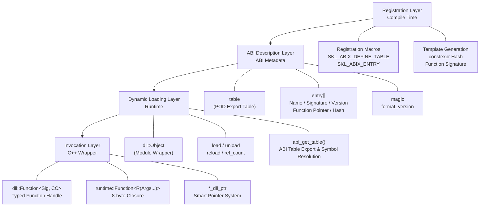

# ABIX API Reference

<p align="center">
  <a href="api_zh.md">中文</a> · English
</p>

<details>

<summary>Contents</summary>

- [Architecture Overview](#architecture-overview)
- [ABI Metadata Runtime and AMC](#abi-metadata-runtime-and-amc)
- [1. `SKL/ABIX/Util/Config.h` — Platform Detection & Core Enums](#1-abixutilconfigh--platform-detection--core-enums)
- [2. `SKL/ABIX/Runtime/Type.h` — Core Types](#2-abixruntimetypeh--core-types)
- [3. `SKL/ABIX/DLL/Export.h` — Registration Macros](#3-abixdllexporth--registration-macros)
- [4. `SKL/ABIX/DLL/Object.h` — DLL Module Wrapper](#4-abixdllobjecth--dll-module-wrapper)
- [5. `SKL/ABIX/DLL/Function.h` — Typed Function Handles](#5-abixdllfunctionh--typed-function-handles)
- [6. `SKL/ABIX/DLL/FnSig.h` — Compile-time Signature Hashing](#6-abixdllfnsigh--compile-time-signature-hashing)
- [7. `SKL/ABIX/Runtime/TypeSig.h` — Type Signature Hashing](#7-abixruntimetypesigh--type-signature-hashing)
- [8. `SKL/ABIX/Runtime/Search.h` — Table Search Functions](#8-abixruntimesearchh--table-search-functions)
- [9. `SKL/ABIX/Runtime/Function.h` — Cross-Boundary Closure](#9-abixruntimefunctionh--cross-boundary-closure)
- [10. Smart Pointers (`SKL/ABIX/DLL/DLLPtr.h`)](#10-smart-pointers-abixdlldllptrh)
- [11. `SKL/ABIX/Bridge/Refl.h` — Dynamic mics Integration](#11-abixbridgereflh--dynamic-mics-integration)
- [12. Complete Usage Example](#12-complete-usage-example)

</details>

This document covers the ABIX cross-DLL function calling library (`SKL/ABIX/`).

## Architecture Overview



## ABI Metadata Runtime and AMC

The POD DLL export table documented below remains ABIX's public call ABI. AMC metadata is separate from that table: it describes selected native C++ ABI surfaces in a `.abix` v4 artifact and can project those records as C++17 `constexpr` descriptors. The artifact contains type/layout, field, function, symbol, hash, compatibility, and map data. Its wire format is documented in [`.abix` format notes](abix.md).

### Build, inspect, and compare artifacts

```sh
amc build -c package.abic.toml -B build
amc validate build/build/package.abix
amc inspect build/build/package.abix
amc generate build/build/package.abix -l cpp -o package_metadata.hpp
amc diff old.abix new.abix -o compatibility.abix
amc compatibility old.abix new.abix
amc-dump diff old.abix new.abix
amc-dump diff old.abix new.abix --json compatibility.json
```

`amc diff` records identical, layout-compatible, map-compatible, or incompatible types. The generated `MapPrivate<A, B>` plan performs copy/default operations; integer and floating conversions require an explicit native converter and therefore do not silently reinterpret values.

`amc-dump diff` is the human/JSON inspection counterpart: it computes the same core compatibility report without writing an artifact, and prints both artifact identities plus compatibility records and Map operations. Plain `amc-dump` reflects every currently defined `.abix` v4 section, including the optional compatibility, map, and map-operation sections.

### `runtime::Registry`

Headers: `SKL/ABIX/Metadata/Descriptor.h`, `SKL/ABIX/Runtime/Registry.h`.

`ModuleDescriptor` is the generated, static view of one metadata module. `runtime::Registry<Capacity>::register_module()` first validates the entire module, including type references and duplicate IDs, then registers it atomically from the caller's perspective. The registry retains canonical `model::TypeDesc`/`TypeLayout` views alongside generated descriptors. Registration is keyed by `(TypeID, version)`: a repeated `TypeID` within the same version must carry an identical `LayoutHash` (Boundary #1), while a later version may carry a different layout and coexists as its own entry.

| API                                                                      | Result                                                                                       |
| ------------------------------------------------------------------------ | -------------------------------------------------------------------------------------------- |
| `register_module(const ModuleDescriptor&)`                               | `runtime::RegisterStatus`; rejects malformed, duplicate, oversized, or unresolved modules    |
| `register_module(const ModuleDescriptor&, uint32_t version)`             | Versioned registration; the same `TypeID` may coexist across versions with different layouts |
| `find_by_id(TypeId)` / `find_by_name(const char*)`                       | Generated `runtime::RegistryEntry`, or `nullptr`; `find_by_id` returns the newest version    |
| `find_type(TypeId, uint32_t version)`                                    | Entry for that exact `(TypeID, version)` pair, or `nullptr`                                  |
| `module_version(const ModuleDescriptor&)` / `parse_version(const char*)` | Leading decimal integer of a module version string (`"2.1"` → `2`)                           |
| `type_of<T>()`                                                           | Entry selected by generated `TypeTraits<T>::type_id`                                         |
| `canonical()`                                                            | Underlying bounded `metadata::Registry` view                                                 |

`type_of<T>()` is intentionally available only for types whose generated header defines `TypeTraits<T>`. Enable those specializations explicitly:

```cpp
#include "my_native_types.hpp"
#define AMC_GENERATED_DECLARE_NATIVE_TYPE_TRAITS
#include "package_metadata.hpp"

skl::abix::runtime::Registry<128> registry;
if (registry.register_module(amc_generated::amc_module) ==
    skl::abix::runtime::RegisterStatus::ok) {
    const auto *metadata = registry.type_of<my::NativeType>();
    // metadata is non-null after successful registration.
}
```

ABIX Runtime and AMC core metadata are covered by reproducible self-description tests. This is metadata self-hosting, not C++ compiler-source self-hosting: AMC's C++ provider continues to depend on Clang/LLVM semantic analysis.

## 1. `SKL/ABIX/Util/Config.h` — Platform Detection & Core Enums

**Namespace:** `skl::abix`

### Platform Macros

| Macro                   | Value                                           | Description                                                                                                                                             |
| ----------------------- | ----------------------------------------------- | ------------------------------------------------------------------------------------------------------------------------------------------------------- |
| `SKL_ABIX_WINDOWS`      | `1` or `0`                                      | Windows platform detection                                                                                                                              |
| `SKL_ABIX_CALL_CDECL`   | `__cdecl` or empty                              | `__cdecl` calling convention attribute                                                                                                                  |
| `SKL_ABIX_CALL_STDCALL` | `__stdcall` or empty                            | `__stdcall` calling convention attribute                                                                                                                |
| `SKL_ABIX_DLL_EXPORT`   | `__declspec(dllexport)` or visibility attribute | Provider-side export for fixed C module entries (`abi_get_table`, `abix_module_query_v1`, provider handles). ABIX has no shared core library to import. |
| `SKL_ABIX_MAGIC64`      | `0xFDFDFDFDFDFDFDFDULL`                         | Magic number for control blocks                                                                                                                         |

## 2. `SKL/ABIX/Runtime/Type.h` — Core Types

**Namespace:** `skl::abix::runtime`

### Type Aliases

| Symbol        | Type       | Description                                   |
| ------------- | ---------- | --------------------------------------------- |
| `sig_t`       | `uint64_t` | Function signature hash (FNV-1a 64-bit)       |
| `name_hash_t` | `uint32_t` | Function name hash (FNV-1a 32-bit)            |
| `version_t`   | `uint64_t` | Version token (FNV-1a hash of version string) |
| `index_t`     | `uint32_t` | Entry index within the table                  |

### Constants

| Constant                        | Value         | Description                       |
| ------------------------------- | ------------- | --------------------------------- |
| `SKL_ABIX_TABLE_MAGIC`          | `0xAB1E7A81U` | Table magic number for validation |
| `SKL_ABIX_TABLE_FORMAT_VERSION` | `1U`          | Table format version              |
| `SKL_ABIX_ENTRY_HOT`            | `0x1ULL`      | Hot entry flag                    |

### `runtime::Entry` — Function Table Entry

```cpp
struct Entry {
    const char *name;       // Function name (null-terminated C string)
    sig_t sig;              // Compile-time signature hash
    version_t version;      // Version token (0 = unversioned)
    uintptr_t fnptr;        // Function pointer (uintptr_t for portability)
    name_hash_t name_hash;  // 32-bit FNV-1a hash of name
    uint32_t flags;         // Bit flags (SKL_ABIX_ENTRY_HOT = 0x1)
};
```

### `runtime::Table` — Export Table

```cpp
struct Table {
    uint32_t count;          // Number of entries
    uint32_t magic;          // Must equal SKL_ABIX_TABLE_MAGIC
    uint32_t format_version; // Must equal SKL_ABIX_TABLE_FORMAT_VERSION
    uint32_t reserved;       // Reserved for future use
    const Entry *entries;    // Pointer to entry array (count elements)
};
```

### `runtime::make_table()`

```cpp
template<size_t N>
inline const Table *make_table(const Entry (&arr)[N]) noexcept;
```

Creates a static `Table` from a compile-time entry array. Used internally by `SKL_ABIX_DEFINE_TABLE`.

## 3. `SKL/ABIX/DLL/Export.h` — Registration Macros

**Namespace:** `skl::abix`

### Export Table Macros

| Macro                                               | Description                                                                                                  |
| --------------------------------------------------- | ------------------------------------------------------------------------------------------------------------ |
| `SKL_ABIX_DEFINE_TABLE(...)`                        | Define the export table with a comma-separated list of `SKL_ABIX_ENTRY*` macros. Generates `abi_get_table()` |
| `SKL_ABIX_ENTRY(name, func)`                        | Register a function with `Cdecl` calling convention and version `0`                                          |
| `SKL_ABIX_ENTRY_CC(name, func, cctype)`             | Register a function with a specific calling convention (`Cdecl` or `Stdcall`)                                |
| `SKL_ABIX_ENTRY_FULL(name, func, cctype, ver, flg)` | Register a function with all parameters: calling convention, version, and flags                              |
| `SKL_ABIX_VERSION("1.0")`                           | Create a version token from a version string (FNV-1a hash)                                                   |

### Calling Convention Pickers

| Macro                      | Expands To                      |
| -------------------------- | ------------------------------- |
| `SKL_ABIX_CCPICK(Cdecl)`   | `::skl::abix::cc::tag::Cdecl`   |
| `SKL_ABIX_CCPICK(Stdcall)` | `::skl::abix::cc::tag::Stdcall` |

### Memory Allocation

Internal allocator, declared in `SKL/ABIX/Util/Mem.h` (`skl::abix::mem`):

| Function                        | Description                                                     |
| ------------------------------- | --------------------------------------------------------------- |
| `mem::alloc(n)`                 | Allocate `n` bytes (`HeapAlloc` on Windows, `malloc` otherwise) |
| `mem::zalloc(n)`                | Zero-initialised allocation                                     |
| `mem::alloc_array(count, elem)` | Overflow-checked array allocation                               |
| `mem::alloc_aligned(n, align)`  | Aligned allocation (pair with `dealloc_aligned`)                |
| `mem::dealloc(p)`               | Free memory from `alloc` / `zalloc` / `alloc_array`             |
| `mem::dealloc_aligned(p)`       | Free memory from `alloc_aligned`                                |

## 4. `SKL/ABIX/DLL/Object.h` — DLL Module Wrapper

**Namespace:** `skl::abix::dll`

### `dll::CallError` Enum

| Value              | Description                                                                                                                                |
| ------------------ | ------------------------------------------------------------------------------------------------------------------------------------------ |
| `none`             | No error                                                                                                                                   |
| `not_loaded`       | DLL is not loaded                                                                                                                          |
| `not_found`        | Function name not found in the export table                                                                                                |
| `sig_mismatch`     | Signature hash does not match                                                                                                              |
| `version_mismatch` | Version token does not match                                                                                                               |
| `stale_handle`     | Cannot unload while live handles reference the module                                                                                      |
| `table_changed`    | Table content changed after handle was resolved                                                                                            |
| `invalid`          | Invalid handle or corrupted closure                                                                                                        |
| `load_failed`      | DLL load failed (missing file, bad table, etc.)                                                                                            |
| `unloading`        | DLL is currently unloading (RCU grace period)                                                                                              |
| `lock_timeout`     | The Control writer lock was not acquired within the configured reclaim timeout (only possible when `set_reclaim_timeout_ms()` is non-zero) |

### `last_error()`

```cpp
inline dll::CallError &last_error() noexcept;
```

Returns a reference to the thread-local last error code. Each thread has its own error state; because the function is defined in a header, each DSO may also have its own copy. Do not use `last_error()` as a cross-module error channel; pass an explicit return value or `[[error]]` contract instead.

### `dll::Object`

| Method                       | Returns                 | Description                                                                                                                                                                                                                          |
| ---------------------------- | ----------------------- | ------------------------------------------------------------------------------------------------------------------------------------------------------------------------------------------------------------------------------------ |
| `load(path)`                 | `bool`                  | Load a DLL/SO, resolve `abi_get_table()`, validate magic/version and build the hash index **with no lock held**, then publish the image under the writer lock. A failed load leaves the previous image in place (same as `reload()`) |
| `unload()`                   | `bool`                  | Refuses with `stale_handle` while any `Function` handle is alive (`ref_count() != 0`); otherwise swaps the image out and retires it for the domain to reclaim after a grace period                                                   |
| `force_unload()`             | `void`                  | Detach and free the image immediately, bypassing the grace period (the caller must already have excluded readers)                                                                                                                    |
| `reload(path)`               | `bool`                  | Load the new module and build its index with no lock held, swap it in atomically, then retire the previous image (EBR-protected, not a `force_unload` + `load`)                                                                      |
| `is_loaded()`                | `bool`                  | `state == rcu::State::active` and an image is published                                                                                                                                                                              |
| `get_table()`                | `const runtime::Table*` | The validated export table of the current image                                                                                                                                                                                      |
| `module()`                   | `module_handle`         | Raw OS module handle (`HMODULE` on Windows, `void*` on POSIX)                                                                                                                                                                        |
| `module_path()`              | `const char*`           | Path this object was loaded from (POSIX takes a second OS reference with it)                                                                                                                                                         |
| `resolve(name)`              | `void*`                 | Raw exported symbol lookup (fixed entry points such as `abi_get_table`); not the name+sig table, and no protection is held: valid only while the module stays loaded, so re-resolve after a reload instead of caching it             |
| `image_acquire()`            | `Image*`                | Current image pointer (used by the unload path)                                                                                                                                                                                      |
| `ref_count()`                | `uint32_t`              | Number of live `dll::Function` handles (strong references to the shared `Control`)                                                                                                                                                   |
| `enter_read()`               | `const runtime::Table*` | Enter a read-side critical section and return the current table, or `nullptr` (setting `CallError::unloading`) when nothing is loaded                                                                                                |
| `exit_read()`                | `void`                  | Leave the read-side critical section                                                                                                                                                                                                 |
| `set_reclaim_timeout_ms(ms)` | `void`                  | Bound how long an operation waits for a retired image's grace period; a _duration_, derived fresh per operation, 0 = unbounded. See "Bounding a Reclaim Wait"                                                                        |
| `reclaim_timeout_ms()`       | `uint64_t`              | The configured duration                                                                                                                                                                                                              |
| `reclaim_outcome()`          | `ReclaimOutcome`        | What happened to the image retired by the most recent operation                                                                                                                                                                      |

**Writer-lock scope.** `load`/`reload`/`unload` hold the per-`Object` Control writer lock **only for the image swap**: loading the module, building the index and waiting for a retired image's grace period all happen outside it (the image is retired after the lock is released). This keeps the wait for that lock O(one swap) instead of O(module load + index build + grace period). When `set_reclaim_timeout_ms()` is non-zero that duration also bounds the lock acquisition, which then reports `CallError::lock_timeout` and changes nothing; the default (0) waits indefinitely, as before.

**Usage Example:**

```cpp
dll::Object lib;
if (lib.load("my_plugin.dll")) {
    const runtime::Table *t = lib.get_table();
    // Use the table...
    lib.unload();  // Only succeeds if no live handles and no active readers
}
```

### RCU Non-Blocking Unload

ABIX implements RCU (Read-Copy-Update) with epoch-based reclamation (EBR) for thread-safe DLL unloading. The design uses compiler-builtin atomic operations (`_Interlocked*` on Windows, `__atomic_*` on POSIX) to avoid `<atomic>` ABI compatibility issues.

**Architecture:**

| Role   | Operation                                  | Notes                                                                                |
| ------ | ------------------------------------------ | ------------------------------------------------------------------------------------ |
| Reader | `enter_read()` -> `rcu::Domain::enter()`   | Records the current global epoch; lock-free, uncontended                             |
| Reader | `exit_read()` -> `rcu::Domain::exit()`     | Marks this thread quiescent (epoch = 0)                                              |
| Writer | `unload()` -> `retire()` + `synchronize()` | Pushes the old image onto the retired list, waits for readers to pass, then reclaims |
| Writer | `reload()` -> `retire()` + `synchronize()` | Atomically swaps in the new image, retires the old one asynchronously                |

**Design:**

- **Global EBR domain**: every `dll::Object` shares the same `rcu::Domain` singleton, so epoch advancement applies to all modules at once. There is no per-module reader counter.
- **Thread-local state**: each thread registers itself in TLS on its first `enter()`; `exit()` only writes its own cache line, so readers never contend.
- **Retire batching**: `retire()` accumulates up to 64 objects in a thread-local batch before publishing them to the global list, which keeps the writer lock out of the per-retire path.
- **Two reclaim classes**: `retire()` puts an object in the _batched_ class, which `synchronize()` reclaims only when it advances the epoch (once every `SKL_ABIX_RCU_EPOCH_BATCH` calls). `retire_eager()` puts an object in the _eager_ class, which `synchronize_eager()` reclaims on its next call without touching the batched schedule. Both share the same grace period but keep separate "reclaimed up to" watermarks. `Object::reload` uses the split so that a swapped-out index slot array is reusable by the very next `build`, while the module image keeps the batched delay (which is what keeps an alternating hot reload on the loader's already-resident path).
- **Zero `<atomic>` dependency**: atomics operate on plain integers and pointers via compiler builtins, so the layout does not vary across STL implementations.
- **`force_unload` bypasses the grace period**: it detaches and frees the image immediately, so the caller must already have excluded readers. `unload()` and `reload()` do _not_ bypass EBR; they retire the old image and let the domain reclaim it.

**Usage Example:**

```cpp
// Thread 1: Reader
auto add = dll::Function<int(int, int)>(lib, "add");
int result = add(2, 3);  // operator() auto-calls enter_read/exit_read

// Thread 2: Unloader
lib.unload();  // retires the old image -> synchronize -> reclaim
```

### `rcu::Domain` (`SKL/ABIX/RCU/Domain.h`)

**Namespace:** `skl::abix::rcu`

| Member                          | Returns                 | Description                                                                                                                                                                                                                                                                                                                                                                                                                                                             |
| ------------------------------- | ----------------------- | ----------------------------------------------------------------------------------------------------------------------------------------------------------------------------------------------------------------------------------------------------------------------------------------------------------------------------------------------------------------------------------------------------------------------------------------------------------------------- |
| `instance()`                    | `rcu::Domain&`          | Global singleton                                                                                                                                                                                                                                                                                                                                                                                                                                                        |
| `enter()`                       | `void`                  | Enter a read-side critical section: records the current global epoch; lock-free                                                                                                                                                                                                                                                                                                                                                                                         |
| `exit()`                        | `void`                  | Leave the critical section: marks the thread quiescent (epoch = 0)                                                                                                                                                                                                                                                                                                                                                                                                      |
| `retire(obj, reclaim)`          | `void`                  | Adds the object to the thread-local retired batch (**batched class**), published after 64 entries; reclaimed when `synchronize()` advances the epoch (every `SKL_ABIX_RCU_EPOCH_BATCH` calls, default 8)                                                                                                                                                                                                                                                                |
| `retire_eager(obj, reclaim)`    | `void`                  | Same, but the **eager class**: reclaimed by the next `synchronize_eager()`. For objects whose only value is becoming reusable soon (a swapped-out index buffer), without shortening the batched delay                                                                                                                                                                                                                                                                   |
| `retire_token(obj, reclaim)`    | `uint64_t`              | As `retire()`, but returns the epoch the object was queued at (0 when nothing was queued). Pair it with `reclaimed_through()` to ask "has the domain released it yet?" without observing the callback                                                                                                                                                                                                                                                                   |
| `reclaimed_through(token, cls)` | `bool`                  | Whether that class has been collected through `token`, i.e. every object retired at or before it has had its reclaim callback run. Monotonic per class, and only ever advanced after a proven grace period                                                                                                                                                                                                                                                              |
| `synchronize()`                 | `void`                  | Advances the global epoch (once every `SKL_ABIX_RCU_EPOCH_BATCH` calls), waits for every thread to pass, reclaims the safe **batched** objects                                                                                                                                                                                                                                                                                                                          |
| `synchronize_eager()`           | `void`                  | Advances the global epoch **immediately** and reclaims only the safe **eager** objects; the batched delay is unaffected. Cheap when there is nothing to collect                                                                                                                                                                                                                                                                                                         |
| `synchronize_until(deadline)`   | `bool`                  | Requests one grace period and waits at most until `Deadline`. `true` means the grace period **was proven** — nothing more: no promise that a collection scan ran or that any callback executed. `false` means it was **not proven** (the deadline expired, or another writer held the advancement): no reader is known to have left, no watermark moved, no callback ran. It always asks for a real grace period, so enabling it gives up the batched delay (see below) |
| `try_collect()`                 | `void`                  | Opportunistic reclaim: if the writer lock is free, scans and reclaims passed objects of both classes                                                                                                                                                                                                                                                                                                                                                                    |
| `global_epoch()`                | `uint64_t`              | Diagnostics: current global epoch                                                                                                                                                                                                                                                                                                                                                                                                                                       |
| `stats()`                       | `Stats`                 | Snapshot of the optional advancement diagnostics (see below). All-zero, and lock-free, when the build does not enable them                                                                                                                                                                                                                                                                                                                                              |
| `reset_stats()`                 | `void`                  | Zeroes the diagnostic counters; a no-op when diagnostics are compiled out                                                                                                                                                                                                                                                                                                                                                                                               |
| `stats_enabled()`               | `static constexpr bool` | Whether this build collects the diagnostics                                                                                                                                                                                                                                                                                                                                                                                                                             |

**Design notes**

- **Thread-local state**: the first `enter()` on a thread registers it in TLS; `exit()` writes only that cache line.
- **The reader registry only grows**: a thread that ever called `enter()` keeps its node with `epoch == 0`, and every grace-period poll walks all of them. This is deliberate — `readers_passed()` and `try_collect()` both walk the list _without_ the writer lock, so unlinking a node could be a use-after-free for a concurrent walker. The cost is bounded by the number of threads that _ever_ entered: measured ~**3.4 ns per registered node** (10 threads ≈ 12 ns, 1,000 ≈ 2 µs, 10,000 ≈ **34 µs per poll** — and the poll sits in a spin loop), plus one never-returned allocation per thread. Watch `stats().registered_threads` on a host that recreates threads; bounding the registry is a roadmap item.
- **Retire batching**: `SKL_ABIX_RCU_BATCH_PUBLISH` (default 64) objects accumulate locally to reduce global lock contention.
- **Two reclaim delays**: the batched class (default 8 synchronizations) keeps a swapped-out image mapped so that alternating hot reloads still hit the loader's already-resident path; the eager class (next synchronization) makes a swapped-out index buffer reusable by the next `build`. Each class has its own watermark, so one cannot swallow the other's safe epoch.
- **Advancement ownership**: a thread that takes the advancement owns `sync` and clears it on every path out; a thread that finds `sync` taken waits, retries, or times out, and never clears a `sync` it does not own.
- **Cache-line isolation**: the epoch block is `alignas(SKL_ABIX_RCU_CACHE_LINE_SIZE)` and sits apart from the writer lock.
- **Zero `<atomic>` dependency**: all atomics come from `SKL/ABIX/Util/Atomic.h`.

### Bounding a Grace-Period Wait

`rcu::Deadline` (`SKL/ABIX/RCU/Deadline.h`) says _how long_ to wait, never what to do when the wait runs out:

```cpp
namespace skl::abix::rcu {
class Deadline {
public:
    static constexpr Deadline never() noexcept;      // unbounded (the previous behaviour)
    static Deadline after_ms(uint64_t ms) noexcept;  // after_ms(0) is already expired
    constexpr bool bounded() const noexcept;
    bool expired() const noexcept;                   // reads the clock
};
}
```

`never()` is unbounded and never expired; `after_ms(0)` is a non-blocking probe that reports whether a grace period can be proven without waiting. The clock is monotonic and internal (QPC on Windows, `CLOCK_MONOTONIC` elsewhere), so ABIX takes no frame or wall-clock input from the host — a caller with a frame budget converts it to milliseconds itself. It is read only by a bounded wait, every 256 polls, so an unbounded wait costs nothing.

**What a bounded wait costs.** `synchronize_until()` always asks for a real grace period, so the epoch advances on every call instead of every `SKL_ABIX_RCU_EPOCH_BATCH` calls. That is the trade of enabling a bound: the batched deferral — which keeps recently retired modules mapped so an alternating hot reload hits the loader's already-resident path — is given up. Measured at 4.97x on `BM_Reload_AlternatingPaths` (17.3 us per iteration without a bound, 85.9 us with one). The default path, no bound configured, keeps the batched behaviour and its cost.

**What a deadline does not cover.** It bounds the wait only. Scheduling delay and the reclaim callbacks themselves (unmapping a module, freeing memory) can still take longer, so never read `after_ms(n)` as "this operation finishes within n ms".

**Who acts on a timeout.** Nobody automatically: a `false` result leaves the retired object in place — still mapped — and a later successful grace period reclaims it. There is deliberately no automatic forced unload, and no "never unmap" policy yet; see `dll::ReclaimOutcome` for what a `dll::Object` reports about its own retired image.

### Advancement Diagnostics

Advancement (who gets to run a grace period) is **preemptive and has no fairness guarantee**: a writer that cannot take the right retries, and there is no queue that would stop a later writer from overtaking it. Before designing such a mechanism it should be shown to be needed, so the domain can report what actually happens. The diagnostics are opt-in — define `SKL_ABIX_RCU_ENABLE_STATS` (CMake: `-DSKL_ABIX_RCU_ENABLE_STATS=ON`) — and compiled out entirely otherwise, leaving the reader path and the default advancement path untouched.

```cpp
auto s = skl::abix::rcu::Domain::instance().stats();
// s.advance_attempts, s.advance_contentions, s.advance_retries,
// s.advance_timeouts, s.advance_max_wait_ns, s.grace_period_timeouts,
// s.retired_backlog, s.retired_oldest_age_ns, s.registered_threads
```

The counters keep apart what a single "RCU timeout" number would conflate:

| Field                   | Meaning                                                                                                                                                                                                                                                                              |
| ----------------------- | ------------------------------------------------------------------------------------------------------------------------------------------------------------------------------------------------------------------------------------------------------------------------------------ |
| `advance_attempts`      | Times a thread tried to take the advancement right                                                                                                                                                                                                                                   |
| `advance_contentions`   | Attempts that found another writer already owned it (`sync` set)                                                                                                                                                                                                                     |
| `advance_retries`       | Failed attempts retried by `synchronize_until()`                                                                                                                                                                                                                                     |
| `advance_timeouts`      | Gave up waiting for the advancement right at the deadline — **never got to run a grace period**                                                                                                                                                                                      |
| `advance_max_wait_ns`   | Longest observed wait for the advancement right (0 if never contended)                                                                                                                                                                                                               |
| `grace_period_timeouts` | Owned the advancement but did not prove the grace period — **a reader held it open**                                                                                                                                                                                                 |
| `retired_backlog`       | Retired nodes published but not yet reclaimed, at the snapshot                                                                                                                                                                                                                       |
| `retired_oldest_age_ns` | Age of the oldest such node, at the snapshot                                                                                                                                                                                                                                         |
| `registered_threads`    | Threads that have **ever** entered a read-side section, at the snapshot. Monotonically non-decreasing: a thread that leaves keeps its `epoch == 0` node, and every grace-period poll walks all of them (see the registry note above). The gauge to watch on a host with thread churn |

`advance_timeouts` and `grace_period_timeouts` are the two distinct failures; `deferred_batched` (the normal batched schedule) is neither and is reported by the `dll::Object` layer as a `ReclaimOutcome`, not here. The last two fields are gauges sampled from the retired list under the writer lock, which is why `stats()` is a diagnostics endpoint, not a hot-loop call. See `Optimize-plan.md` (D-1) for why the plan is to measure first and only then decide whether a cancellable FIFO arbitration is warranted.

### Who Owns Validity

The grace period protects _calls_: `dll::Function::operator()` holds a read-side section for the whole call and revalidates the cached entry against the current image, so a reload can never make it call into a retired module. It does **not** protect a bare pointer that was copied out of the module, because nothing ties that pointer to a live image:| Way to reach module code | Protection across the call | What keeps it valid across a reload |
|---|---|---|
| `dll::Function::operator()` | read-side section, entry revalidated per call | the `dll::Function` handle (and `unload()` refuses while any handle is alive) |
| `dll::Function::raw()` | none | nothing: re-resolve after a reload |
| `Object::resolve(name)` | none | nothing: re-resolve after a reload |
| `runtime::Function` (closure) | none | nothing: keep the module loaded yourself |
| `UniqueInterfaceProxy::call` | its own **lease** model (`ModuleControl`, `pin`/`unpin`) | the lease: "the binding stays valid exactly as long as the caller holds a lease" |

So if a call target has to survive a reload, hold a handle or a lease — not a pointer.

### Grace Period and Reclamation Latency

A grace period waits in `while (!readers_passed(old_epoch)) {}` until every reader has left its critical section. By default it is **unbounded**, so a reader that stays inside (a stuck call, a leaked `enter_read()` without `exit_read()`, a thread blocked on something it holds the section across) **blocks `unload()` and `reload()` for as long as it stays there**; `force_unload()` is the escape hatch and requires the caller to have already excluded readers. A `dll::Object` can bound that wait — see "Bounding a Reclaim Wait" below — which converts the block into a reported deferral without unloading anything early.

There is no automatic policy on top of that: no forced unload on timeout (a timeout is not proof that no reader is inside), and no frame/clock input from the host. The earlier `TimeoutConfig` / `TimeoutPolicy` / starvation-guard surface was removed in 0.x rather than kept as an interface that promised behaviour it did not have.

**Read-side contract.** A read-side section must be balanced on every path:

- `dll::Function::operator()` releases the section after the call returns, so a callee must not let an exception escape — it would skip the release and leave that thread inside its section permanently, which stalls every later grace period in the process.
- Manual `enter_read()` / `exit_read()` pairs carry the same obligation; use `rcu::LockGuard` where the section spans anything that can throw or return early.
- A thread that has left is kept in the reader list with epoch 0 (never blocking), so leaving does not unregister anything; the list only grows with the number of threads that ever entered.

**State machine** (`SKL/ABIX/RCU/Config.h`, `rcu::State`):

```
control created            -> zombie   (is_loaded() == false, calls refused)
load() / reload() succeed  -> active   (image published, is_loaded() == true)
unload() / force_unload()  -> zombie   (image detached, later reclaimed)
```

`is_loaded()` is `state == active && image != nullptr`; `Function::valid()` and `Object::enter_read()` re-check both, so a handle from a previous image is refused rather than called.

### Bounding a Reclaim Wait (`dll::Object`)

| Method                       | Returns          | Description                                                                                                                                                                                                                                                 |
| ---------------------------- | ---------------- | ----------------------------------------------------------------------------------------------------------------------------------------------------------------------------------------------------------------------------------------------------------- |
| `set_reclaim_timeout_ms(ms)` | `void`           | Bounds how long a load/reload/unload waits for a retired image's grace period. The value is a **duration**: every operation derives a fresh deadline from it, so a configured timeout is never reused as an absolute instant. `0` (default) means unbounded |
| `reclaim_timeout_ms()`       | `uint64_t`       | The configured duration                                                                                                                                                                                                                                     |
| `reclaim_outcome()`          | `ReclaimOutcome` | What happened to the image retired by the most recent operation                                                                                                                                                                                             |

`ReclaimOutcome` describes the _retired image_, never the operation itself — a reload that swapped the module in is still successful when the previous image is deferred:

| Value              | Meaning                                                                                                 |
| ------------------ | ------------------------------------------------------------------------------------------------------- |
| `not_attempted`    | The operation retired nothing (nothing was loaded yet)                                                  |
| `reclaimed`        | The retired image was released                                                                          |
| `deferred_batched` | No timeout is configured and the batched schedule had not advanced yet; a later operation releases it   |
| `deferred_timeout` | A timeout is configured and the grace period was not proven in time; the image stays retired and mapped |

Enabling a bound is an explicit trade, as described under "Bounding a Grace-Period Wait": the wait then asks for a real grace period on every operation instead of sharing the batched one, so the alternating-reload cost of ~4.97x applies to the Objects that opt in. A deferral is not a leak: once a grace period can be proven, the next operation reclaims every pending image — the same pull-based mechanism that already expresses "reclaim later".

### Logging (`SKL/ABIX/Util/Log.h`)

**Namespace:** `skl::abix::util`

| Type / Function        | Description                                                                         |
| ---------------------- | ----------------------------------------------------------------------------------- |
| `LogLevel`             | Enum: `Debug`, `Info`, `Warning`, `Error`                                           |
| `log_sink_t`           | `void (*)(LogLevel level, const char *message)` — C-callback, ABI-safe              |
| `set_log_sink(sink)`   | Set the global log sink. Default: no-op (no output).                                |
| `log(level, fmt, ...)` | Internal formatter; formats via `vsnprintf` into a 1KB buffer, then calls the sink. |

**Macros:**

| Macro                        | When Active                                                       |
| ---------------------------- | ----------------------------------------------------------------- |
| `ABIX_LOG_DEBUG(fmt, ...)`   | Unless `ABIX_DISABLE_LOGGING` or `ABIX_DISABLE_LOG_LEVEL_DEBUG`   |
| `ABIX_LOG_INFO(fmt, ...)`    | Unless `ABIX_DISABLE_LOGGING` or `ABIX_DISABLE_LOG_LEVEL_INFO`    |
| `ABIX_LOG_WARNING(fmt, ...)` | Unless `ABIX_DISABLE_LOGGING` or `ABIX_DISABLE_LOG_LEVEL_WARNING` |
| `ABIX_LOG_ERROR(fmt, ...)`   | Unless `ABIX_DISABLE_LOGGING` or `ABIX_DISABLE_LOG_LEVEL_ERROR`   |

## 5. `SKL/ABIX/DLL/Function.h` — Typed Function Handles

**Namespace:** `skl::abix::dll`

### `dll::FunctionCC<C, Sig>`

The primary template for typed function handles. Template parameters:

- `C` — Calling convention tag (`cc::tag::Cdecl` or `cc::tag::Stdcall`)
- `Sig` — Function signature (e.g., `int(int, double)`)

| Method                    | Returns    | Description                                                                                                                                                                                                                |
| ------------------------- | ---------- | -------------------------------------------------------------------------------------------------------------------------------------------------------------------------------------------------------------------------- |
| `resolve(lib, name, ver)` | `void`     | Resolve a function by name and optional version                                                                                                                                                                            |
| `valid()`                 | `bool`     | Whether the handle is valid and the library is loaded                                                                                                                                                                      |
| `operator bool()`         | `bool`     | Same as `valid()`                                                                                                                                                                                                          |
| `index()`                 | `index_t`  | Entry index in the table                                                                                                                                                                                                   |
| `handle_id()`             | `uint64_t` | Opaque handle ID (stable across reload)                                                                                                                                                                                    |
| `raw()`                   | `fn_type`  | Raw function pointer. Handed out after the read-side section is released, so it is valid only while this handle's image is current: a reload invalidates it (re-resolve, or call `operator()`, which revalidates per call) |
| `operator()(Args...)`     | `R`        | Call the function with type safety                                                                                                                                                                                         |

**`operator()` behavior:**

- Fast path: enters the read-side critical section (`rcu::Domain::enter()`), then confirms the cached snapshot in one relaxed load — the current image must be the one `_index` was validated against, and that entry must still carry the resolved name hash and signature. Only then does it call; the `strcmp` stays on the slow path.
- Slow path (first call, after a reload, or on a stale snapshot): re-checks the state, revalidates the entry by index, name hash, signature and `strcmp`, and records the snapshot.
- Releases the critical section via `exit_read()` on all exit paths (including error paths).
- If nothing is loaded → sets `dll::CallError::not_loaded`, returns default `R{}`.
- If the index is out of bounds for the current table → sets `dll::CallError::table_changed`, returns default `R{}`.
- If the entry's signature/name hash/name changed → sets `dll::CallError::table_changed`, returns default `R{}`.
- If the function pointer is null → sets `dll::CallError::invalid`, returns default `R{}`.

### `dll::Function<Sig, C>`

Convenience alias for `dll::FunctionCC` with default calling convention `Cdecl`:

```cpp
template<typename Sig, cc::tag C = SKL_ABIX_CCPICK(Cdecl)>
class dll::Function : public dll::FunctionCC<C, Sig> { ... };
```

**Usage Example:**

```cpp
dll::Object lib;
lib.load("math_dll.dll");

// Resolve with default Cdecl
auto add = dll::Function<int(int, int)>(lib, "add");

// Resolve with explicit version
auto log = dll::Function<void(const char*)>(lib, "log", SKL_ABIX_VERSION("1.0"));

// Resolve with stdcall calling convention
auto proc = dll::Function<void(int), SKL_ABIX_CCPICK(Stdcall)>(lib, "process");

// Call
int result = add(2, 3);
if (!add.valid()) {
    // Check last_error()
}
```

## 6. `SKL/ABIX/DLL/FnSig.h` — Compile-time Signature Hashing

**Namespace:** `skl::abix::dll`

### `FnSig<Sig, C>`

```cpp
template<typename Sig, cc::tag C = SKL_ABIX_CCPICK(Cdecl)>
struct FnSig;
```

Compile-time function signature hash generator. The `value` member is a `sig_t` constant.

| Member  | Type              | Description                                  |
| ------- | ----------------- | -------------------------------------------- |
| `value` | `constexpr sig_t` | Unique FNV-1a hash of the function signature |

### `FnSigV<Sig, C>`

```cpp
template<typename Sig, cc::tag C = SKL_ABIX_CCPICK(Cdecl)>
inline constexpr auto FnSigV = FnSig<Sig, C>::value;
```

Convenience variable template for `FnSig::value`.

### `type_sig<T>()`

```cpp
template<typename T>
constexpr sig_t type_sig();
```

Returns the compile-time type signature hash for type `T`. Strips cv-qualifiers and resolves references.

**Usage Example:**

```cpp
constexpr sig_t add_sig = FnSig<int(int, int)>::value;
constexpr sig_t mul_sig = FnSigV<double(double, double)>;
constexpr sig_t int_sig = type_sig<int>();
```

## 7. `SKL/ABIX/Runtime/TypeSig.h` — Type Signature Hashing

**Namespace:** `skl::abix` (+ `skl::abix::runtime::detail`)

### `TypeSigImpl<T>`

Specialized for ABIX smart pointer types and `runtime::Function`:

| Type                            | Hash Formula                                        |
| ------------------------------- | --------------------------------------------------- |
| `dll::UniquePtr<T>`             | `mix(cstr64("abix::dll::UniquePtr"), type_hash<T>)` |
| `dll::RefPtr<T>`                | `mix(cstr64("abix::dll::RefPtr"), type_hash<T>)`    |
| `dll::ViewPtr<T>`               | `mix(cstr64("abix::dll::ViewPtr"), type_hash<T>)`   |
| `dll::SharedPtr<T>`             | `mix(cstr64("abix::dll::SharedPtr"), type_hash<T>)` |
| `dll::WeakPtr<T>`               | `mix(cstr64("abix::dll::WeakPtr"), type_hash<T>)`   |
| `runtime::Function<R(Args...)>` | Compound hash of return type and all argument types |
| All other types                 | Delegates to `Utils::type_hash<T>()`                |

### `SKL_ABIX_TYPE_TAG(T, tag)`

```cpp
#define SKL_ABIX_TYPE_TAG(T, tag) STATIC_TYPE_TAG(T, tag)
```

Register a custom type tag for user type `T`, enabling stable cross-compiler type hashing.

## 8. `SKL/ABIX/Runtime/Search.h` — Table Search Functions

**Namespace:** `skl::abix::runtime`

### `runtime::LookupResult` Enum

| Value              | Description                         |
| ------------------ | ----------------------------------- |
| `ok`               | Entry found with matching signature |
| `not_found`        | No entry with the given name        |
| `sig_mismatch`     | Name found but signature differs    |
| `version_mismatch` | Name found but version differs      |
| `bad_table`        | Invalid or corrupted table          |

### `find_index()`

```cpp
inline runtime::LookupResult find_index(const runtime::Table &t, const runtime::HashIndex &idx, const char *name, runtime::sig_t sig, version_t ver, index_t &out) noexcept;
```

Automatically selects the optimal lookup strategy based on whether `idx` is valid:

- If `idx.valid()` → uses HashIndex lookup (`find_hash`)
- Otherwise → uses linear scan (`find_linear`)

### `find_linear()`

```cpp
inline runtime::LookupResult find_linear(const runtime::Table &t, const char *name, runtime::sig_t sig, version_t ver, index_t &out) noexcept;
```

Full table linear scan. Used for small tables (< 64 entries).

**Search logic:**

1. Validate table magic
2. Compute 32-bit name hash (FNV-1a)
3. Linear scan: match name hash → strcmp → version check → sig check
4. Return `ok`, `sig_mismatch`, `version_mismatch`, or `not_found`

### `find_hash()`

```cpp
inline runtime::LookupResult find_hash(const runtime::Table &t, const runtime::HashIndex &idx, const char *name, runtime::sig_t sig, version_t ver, index_t &out) noexcept;
```

Open-addressing hash index lookup. Used for large tables (≥ 64 entries). O(1) average time.

### `lookup_linear()`

```cpp
inline const runtime::Entry *lookup_linear(const runtime::Table &t, const char *name, name_hash_t nh, runtime::sig_t sig) noexcept;
```

Direct linear lookup returning the entry pointer (or `nullptr`).

### `lookup_hash()`

```cpp
inline const runtime::Entry *lookup_hash(const runtime::Table &t, const runtime::HashIndex &idx, const char *name, name_hash_t nh, runtime::sig_t sig) noexcept;
```

Direct hash index lookup returning the entry pointer (or `nullptr`).

### `runtime::HashSlot`

```cpp
struct HashSlot {
    name_hash_t hash;
    index_t index;
};
```

A single slot in the hash index. Stores only the name hash and entry index — never copies `entry` data.

### `runtime::HashIndex`

```cpp
struct runtime::HashIndex {
    runtime::HashSlot *slots;
    uint32_t capacity;
    uint32_t mask;

    bool valid() const noexcept;
    void build(const runtime::Table &t) noexcept;
    void destroy() noexcept;
};
```

Runtime hash index for large tables. Built once at DLL load time.

| Member     | Type                 | Description                                           |
| ---------- | -------------------- | ----------------------------------------------------- |
| `slots`    | `runtime::HashSlot*` | Open-addressing slot array (power-of-two capacity)    |
| `capacity` | `uint32_t`           | Total number of slots (always `next_pow2(count * 2)`) |
| `mask`     | `uint32_t`           | `capacity - 1` for fast modulo                        |

| Method      | Description                                                                |
| ----------- | -------------------------------------------------------------------------- |
| `valid()`   | Whether the hash index has been built (slots != nullptr)                   |
| `build(t)`  | Build the hash index from a table. Inserts all entries with linear probing |
| `destroy()` | Free the slot array                                                        |

**Design notes:**

- **Load factor ~50%**: `capacity = next_pow2(count * 2)`
- **Open addressing**: Linear probing `pos = (pos + 1) & mask` on collision
- **Zero ABI impact**: `runtime::HashIndex` is runtime-only metadata; `table` and `entry` structs remain unchanged
- **Built at load time**: No runtime initialization races, no lazy initialization complexity

### Constants

| Constant                  | Value         | Description                                                                       |
| ------------------------- | ------------- | --------------------------------------------------------------------------------- |
| `SKL_ABIX_HASH_THRESHOLD` | `64`          | Tables with fewer entries use linear scan; tables with ≥ 64 entries use HashIndex |
| `SKL_ABIX_HASHSLOT_EMPTY` | `~index_t{0}` | Sentinel value for empty hash slots                                               |

## 9. `SKL/ABIX/Runtime/Function.h` — Cross-Boundary Closure

**Namespace:** `skl::abix::runtime`

### `runtime::Function<R(Args...)>`

An 8-byte (64-bit) closure type for passing callbacks across DLL boundaries. Similar to `std::function` but uses a stable ABI with manual memory management via `mem::alloc`/`mem::dealloc`.

**Design:**

- `sizeof(runtime::Function<R(Args...)>)` == 8 bytes (always, on 64-bit platforms)
- Stores a heap-allocated `closure_base` pointer as a `uint64_t` handle
- Closure contains invoke/destroy/clone function pointers
- `SKL_ABIX_CLOSURE_MAGIC` validates the closure at call time

**Lifetime:** invoking a closure takes no read-side protection and holds no reference to any module. A closure that captures a module's raw function pointer is therefore only valid while that module stays loaded — pair it with a `dll::Function` handle or an Interface lease if it has to outlive a reload.

**API:**

| Method                      | Returns              | Description                                                |
| --------------------------- | -------------------- | ---------------------------------------------------------- |
| `runtime::Function()`       | —                    | Default constructor, empty                                 |
| `runtime::Function(F f)`    | —                    | Construct from a callable (lambda, function pointer, etc.) |
| `runtime::Function(const&)` | —                    | Copy constructor (deep copy via clone handler)             |
| `runtime::Function(&&)`     | —                    | Move constructor                                           |
| `operator=(rhs)`            | `runtime::Function&` | Copy-and-swap assignment                                   |
| `operator()(Args...)`       | `R`                  | Invoke the stored callable                                 |
| `operator bool()`           | `bool`               | Whether the closure contains a callable                    |
| `empty()`                   | `bool`               | Whether the closure is empty                               |
| `handle()`                  | `uint64_t`           | Raw handle value                                           |
| `swap(other)`               | `void`               | Swap two closures                                          |

**Usage Example:**

```cpp
int captured = 100;
runtime::Function<void(int)> cb = [captured](int x) {
    printf("captured=%d, x=%d, sum=%d\n", captured, x, captured + x);
};

// Pass to DLL
auto reg = dll::Function<void(runtime::Function<void(int)>)>(lib, "register_callback");
reg(std::move(cb));
```

## 10. Smart Pointers (`SKL/ABIX/DLL/DLLPtr.h`)

**Namespace:** `skl::abix::dll`

### `dll::UniqueHandle<T>`

```cpp
template<typename T>
struct dll::UniqueHandle {
    T *ptr;
    void (*destroy)(T *);
};
```

Raw handle pair (pointer + deleter). Used as the return type of `release()` on smart pointers.

### `dll::UniquePtr<T>`

Exclusive-ownership smart pointer. Calls the DLL-side deleter on destruction.

| Method                 | Returns                 | Description                                 |
| ---------------------- | ----------------------- | ------------------------------------------- |
| `dll::UniquePtr(p, d)` | —                       | Construct with pointer and deleter function |
| `reset(p, d)`          | `void`                  | Release current and take new ownership      |
| `release()`            | `dll::UniqueHandle<T>*` | Release ownership without destroying        |
| `get()`                | `T*`                    | Raw pointer                                 |
| `operator->()`         | `T*`                    | Pointer access                              |
| `operator*()`          | `T&`                    | Dereference                                 |
| `operator bool()`      | `bool`                  | Whether non-null                            |

### `dll::FnDeleter<T>`

```cpp
template<typename T>
struct dll::FnDeleter {
    void (*d)(T *) = nullptr;
    void operator()(T *p) const noexcept;
};
```

Custom deleter for use with `std::unique_ptr<T, dll::FnDeleter<T>>`, wrapping a DLL destroy function.

### `dll::RefPtr<T>`

Non-atomic reference-counted shared pointer. Single-thread safe.

| Method              | Returns          | Description                             |
| ------------------- | ---------------- | --------------------------------------- |
| `dll::RefPtr(p, d)` | —                | Construct with pointer and deleter      |
| `get()`             | `T*`             | Raw pointer                             |
| `operator->()`      | `T*`             | Pointer access                          |
| `operator*()`       | `T&`             | Dereference                             |
| `use_count()`       | `uint32_t`       | Current reference count                 |
| `view_count()`      | `uint32_t`       | Current view count                      |
| `try_unique()`      | `bool`           | Whether `use_count() == 1`              |
| `from_unique(uhd)`  | `dll::RefPtr<D>` | Static factory from `dll::UniqueHandle` |

### `dll::ViewPtr<T>`

Non-owning observer for `dll::RefPtr<T>`. Does not prevent resource destruction.

| Method                                | Returns          | Description                                    |
| ------------------------------------- | ---------------- | ---------------------------------------------- |
| `dll::ViewPtr()`                      | —                | Default constructor, empty                     |
| `dll::ViewPtr(const dll::RefPtr<T>&)` | —                | Construct from a `dll::RefPtr`                 |
| `alive()`                             | `bool`           | Whether the referenced resource is still alive |
| `expired()`                           | `bool`           | Whether the resource has been destroyed        |
| `lock()`                              | `dll::RefPtr<T>` | Promote to a `dll::RefPtr` (if alive)          |
| `use_count()`                         | `uint32_t`       | Current ref count of the underlying resource   |

### `dll::SharedPtr<T>`

Atomic reference-counted shared pointer. Thread-safe.

| Method                 | Returns             | Description                             |
| ---------------------- | ------------------- | --------------------------------------- |
| `dll::SharedPtr(p, d)` | —                   | Construct with pointer and deleter      |
| `get()`                | `T*`                | Raw pointer                             |
| `use_count()`          | `uint32_t`          | Current strong reference count          |
| `weak_count()`         | `uint32_t`          | Current weak reference count            |
| `try_unique()`         | `bool`              | Whether `use_count() == 1`              |
| `from_unique(uhd)`     | `dll::SharedPtr<D>` | Static factory from `dll::UniqueHandle` |

### `dll::WeakPtr<T>`

Non-owning observer for `dll::SharedPtr<T>`. Does not prevent resource destruction.

| Method                                   | Returns             | Description                                     |
| ---------------------------------------- | ------------------- | ----------------------------------------------- |
| `dll::WeakPtr()`                         | —                   | Default constructor, empty                      |
| `dll::WeakPtr(const dll::SharedPtr<T>&)` | —                   | Construct from a `dll::SharedPtr`               |
| `alive()`                                | `bool`              | Whether the referenced resource is still alive  |
| `expired()`                              | `bool`              | Whether the resource has been destroyed         |
| `lock()`                                 | `dll::SharedPtr<T>` | Promote to a `dll::SharedPtr` (if alive)        |
| `use_count()`                            | `uint32_t`          | Current strong count of the underlying resource |

## 11. `SKL/ABIX/Bridge/Refl.h` — Dynamic mics Integration

**Namespace:** `skl::abix::bridge`

### Type Aliases

| Alias                  | Full Type              | Description                       |
| ---------------------- | ---------------------- | --------------------------------- |
| `DynamicAny`           | `DRefl::Any`           | Type-erased value container       |
| `DynamicRegistry`      | `DRefl::Registry`      | Global type registry singleton    |
| `DynamicTypeInfo`      | `DRefl::TypeInfo`      | Runtime type descriptor           |
| `DynamicFieldAccessor` | `DRefl::FieldAccessor` | Field accessor with getter/setter |
| `DynamicFieldInfo`     | `DRefl::FieldInfo`     | Field metadata                    |

### `make_pod_type_info<T>()`

```cpp
template<typename T>
inline DynamicTypeInfo make_pod_type_info(const char *name);
```

Creates a `TypeInfo` descriptor for a trivial/POD type `T`. Requires `std::is_trivial_v<T>`.

### `make_offset_field<T, MemberT, Offset>()`

```cpp
template<typename T, typename MemberT, size_t Offset>
inline DynamicFieldAccessor make_offset_field(const char *name);
```

Creates a `FieldAccessor` for a field at a known byte offset within a POD type. The getter returns `static_cast<char*>(obj) + Offset`, and the setter writes through `reinterpret_cast<MemberT*>`.

### `dll_func_call_any()`

```cpp
template<typename R, typename... Args>
inline DynamicAny dll_func_call_any(dll::Function<R(Args...)> &fn, Args... args);
```

Wraps a `dll::Function` call and returns the result as a `DynamicAny`. For `void` return types, returns an empty `DynamicAny`.

### `any_cast_val<T>()`

```cpp
template<typename T>
inline T any_cast_val(const DynamicAny &a);
```

Casts a `DynamicAny` to `T` by value. Returns `T{}` if the cast fails.

### `register_dll_table()`

```cpp
inline void register_dll_table(const runtime::Table *t, const char *dll_name);
```

Registers all entries from an ABIX export table into the dynamic mics registry.

### Compile-time mics Helpers (`bridge` namespace)

| Symbol                                | Description                                                                     |
| ------------------------------------- | ------------------------------------------------------------------------------- |
| `FnEntryTag<SigValue, NameHashValue>` | Tag type pairing a signature hash and name hash                                 |
| `HasUniqueSigs<TypeList>`             | Compile-time check: all `FnEntryTag` entries in the list have unique signatures |
| `FindBySig<TypeList, TargetSig>`      | Compile-time search: find the index of a `FnEntryTag` with matching `sig`       |

## 12. Complete Usage Example

```cpp
#include "SKL/ABIX/ABIX.h"

using namespace skl::abix;

// ============================================================
// DLL Side: math_dll.cpp
// ============================================================
extern "C" int add(int a, int b) { return a + b; }
extern "C" double multiply(double a, double b) { return a * b; }
extern "C" const char *get_version() { return "1.0.0"; }

SKL_ABIX_DEFINE_TABLE(
    SKL_ABIX_ENTRY("add", add),
    SKL_ABIX_ENTRY("multiply", multiply),
    SKL_ABIX_ENTRY("get_version", get_version),
)

// ============================================================
// Host Side
// ============================================================
void host_example() {
    // --- Load the DLL ---
    dll::Object lib;
    if (!lib.load("math_dll.dll")) {
        printf("Failed to load: error=%d\n", (int)last_error());
        return;
    }

    // --- Resolve typed function handles ---
    auto add = dll::Function<int(int, int)>(lib, "add");
    auto mul = dll::Function<double(double, double)>(lib, "multiply");
    auto ver = dll::Function<const char *()>(lib, "get_version");

    // --- Call with type safety ---
    if (add.valid()) {
        int result = add(10, 20);           // 30
        printf("add(10, 20) = %d\n", result);
    }

    if (mul.valid()) {
        double result = mul(2.5, 4.0);      // 10.0
        printf("multiply(2.5, 4.0) = %.1f\n", result);
    }

    if (ver.valid()) {
        printf("DLL version: %s\n", ver());
    }

    // --- Signature mismatch detection ---
    auto bad = dll::Function<void(double)>(lib, "add");  // Wrong signature!
    if (!bad.valid()) {
        printf("Signature mismatch detected (error=%d)\n", (int)last_error());
    }

    // --- Versioned functions ---
    // In version_dll.cpp:
    //   SKL_ABIX_ENTRY_FULL("log", log_v1, Cdecl, SKL_ABIX_VERSION("1.0"), 0),
    //   SKL_ABIX_ENTRY_FULL("log", log_v2, Cdecl, SKL_ABIX_VERSION("2.0"), 0),
    dll::Object vlib;
    vlib.load("version_dll.dll");
    auto log_v1 = dll::Function<void(const char *)>(vlib, "log", SKL_ABIX_VERSION("1.0"));
    auto log_v2 = dll::Function<void(const char *, int)>(vlib, "log", SKL_ABIX_VERSION("2.0"));
    log_v1("hello from v1 client");
    log_v2("hello from v2 client", 7);

    // --- Resource management with smart pointers ---
    dll::Object rlib;
    rlib.load("resource_dll.dll");
    auto create = dll::Function<Resource *(int)>(rlib, "create_resource");
    auto destroy = dll::Function<void(Resource *)>(rlib, "destroy_resource");

    {
        dll::UniquePtr<Resource> res(create(42), destroy.raw());
        // Resource automatically destroyed when res goes out of scope
    }

    // --- Cross-boundary callback ---
    dll::Object clib;
    clib.load("callback_dll.dll");
    auto reg = dll::Function<void(runtime::Function<void(int)>)>(clib, "register_callback");

    int captured = 100;
    runtime::Function<void(int)> cb = [captured](int x) {
        printf("Callback: captured=%d, x=%d\n", captured, x);
    };
    reg(std::move(cb));

    // --- Hot-reload ---
    lib.reload("math_dll_v2.dll");  // Handle IDs remain stable
}
```
