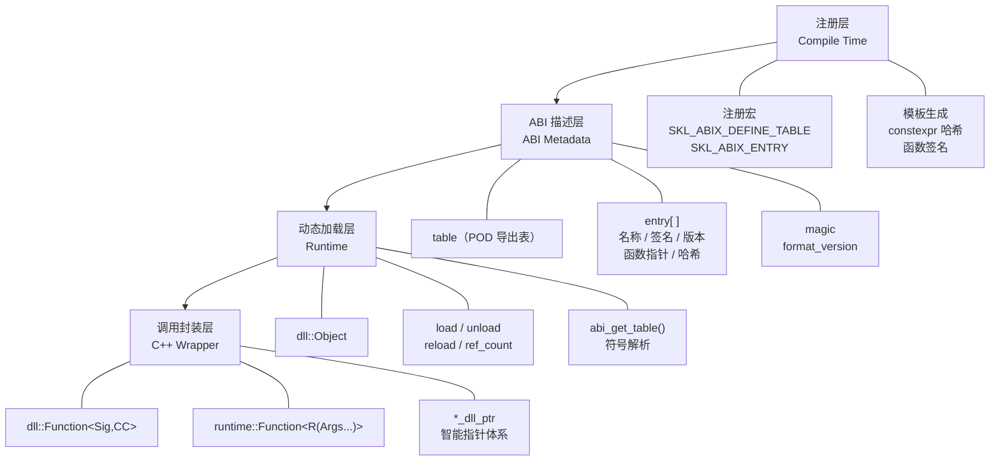

# ABIX API 参考文档

<p align="center">
  中文 · <a href="api.md">English</a>
</p>

<details>

<summary>目录</summary>

- [架构概览](#架构概览)
- [ABI 元数据运行时与 AMC](#abi-元数据运行时与-amc)
- [1. `SKL/ABIX/Util/Config.h` — 平台检测与核心枚举](#1-abixutilconfigh--平台检测与核心枚举)
- [2. `SKL/ABIX/Runtime/Type.h` — 核心类型](#2-abixruntimetypeh--核心类型)
- [3. `SKL/ABIX/DLL/Export.h` — 注册宏](#3-abixdllexporth--注册宏)
- [4. `SKL/ABIX/DLL/Object.h` — DLL 模块包装器](#4-abixdllobjecth--dll-模块包装器)
- [5. `SKL/ABIX/DLL/Function.h` — 类型化函数句柄](#5-abixdllfunctionh--类型化函数句柄)
- [6. `SKL/ABIX/DLL/FnSig.h` — 编译期签名哈希](#6-abixdllfnsigh--编译期签名哈希)
- [7. `SKL/ABIX/Runtime/TypeSig.h` — 类型签名哈希](#7-abixruntimetypesigh--类型签名哈希)
- [8. `SKL/ABIX/Runtime/Search.h` — 表查找函数](#8-abixruntimesearchh--表查找函数)
- [9. `SKL/ABIX/Runtime/Function.h` — 跨边界闭包](#9-abixruntimefunctionh--跨边界闭包)
- [10. 智能指针（`SKL/ABIX/DLL/DLLPtr.h`）](#10-智能指针abixdlldllptrh)
- [11. `SKL/ABIX/Bridge/Refl.h` — 动态反射集成](#11-abixbridgereflh--动态反射集成)
- [12. 完整使用示例](#12-完整使用示例)

</details>

本文档涵盖 ABIX 跨 DLL 函数调用库（`SKL/ABIX/`）。

## 架构概览



## ABI 元数据运行时与 AMC

下文的 POD DLL 导出表仍是 ABIX 的公共调用 ABI。AMC 元数据与该表分离：它将选定的原生 C++ ABI 接口描述为 `.abix` v4 artifact，并可将 record 投影为 C++17 `constexpr` descriptor。artifact 包含 type/layout、field、function、symbol、hash、compatibility 和 map 数据；wire format 见 [`.abix` 格式说明](abix.md)。

### 构建、检查与比较 artifact

```sh
amc build -c package.abic.toml -B build
amc validate build/build/package.abix
amc inspect build/build/package.abix
amc generate build/build/package.abix -l cpp -o package_metadata.hpp
amc diff old.abix new.abix -o compatibility.abix
amc compatibility old.abix new.abix
amc-dump diff old.abix new.abix
amc-dump diff old.abix new.abix --json compatibility.json
```

`amc diff` 为 type 记录 identical、layout-compatible、map-compatible 或 incompatible。生成的 `MapPrivate<A, B>` 计划执行 copy/default 操作；整数和浮点转换必须提供显式 native converter，绝不会静默重解释数值。

`amc-dump diff` 是面向人工/JSON 检查的对应命令：它复用 core 的 compatibility 计算而不写出 artifact，并同时打印两端 artifact identity、compatibility record 与 Map operation。普通 `amc-dump` 现已反映全部已定义的 `.abix` v4 section，包括可选的 compatibility、map 和 map-operation section。

### `runtime::Registry`

头文件：`SKL/ABIX/Metadata/Descriptor.h`、`SKL/ABIX/Runtime/Registry.h`。

`ModuleDescriptor` 是一个 metadata module 的生成静态视图。`runtime::Registry<Capacity>::register_module()` 会先校验完整 module（包括 type 引用和重复 ID），随后从调用者视角原子地完成注册。Registry 同时保留 canonical 的 `model::TypeDesc`/`TypeLayout` 视图和生成 descriptor。注册以 `(TypeID, version)` 为键：同一 version 内重复的 `TypeID` 必须具有相同的 `LayoutHash`（Boundary #1）；而更新的 version 可以携带不同 layout，作为独立 entry 共存。

| API                                                                      | 结果                                                                       |
| ------------------------------------------------------------------------ | -------------------------------------------------------------------------- |
| `register_module(const ModuleDescriptor&)`                               | `runtime::RegisterStatus`；拒绝格式错误、重复、超容量或未解析引用的 module |
| `register_module(const ModuleDescriptor&, uint32_t version)`             | 按版本注册；同一 `TypeID` 可跨版本以不同 layout 共存                       |
| `find_by_id(TypeId)` / `find_by_name(const char*)`                       | 生成的 `runtime::RegistryEntry`，或 `nullptr`；`find_by_id` 返回最新版本   |
| `find_type(TypeId, uint32_t version)`                                    | 精确匹配该 `(TypeID, version)` 的 entry，或 `nullptr`                      |
| `module_version(const ModuleDescriptor&)` / `parse_version(const char*)` | module version 字符串的前导十进制整数（`"2.1"` → `2`）                     |
| `type_of<T>()`                                                           | 由生成的 `TypeTraits<T>::type_id` 选中的 entry                             |
| `canonical()`                                                            | 底层有界 `metadata::Registry` 视图                                         |

`type_of<T>()` 只对生成头文件定义了 `TypeTraits<T>` 的类型可用，这是刻意设计。显式启用这些特化：

```cpp
#include "my_native_types.hpp"
#define AMC_GENERATED_DECLARE_NATIVE_TYPE_TRAITS
#include "package_metadata.hpp"

skl::abix::runtime::Registry<128> registry;
if (registry.register_module(amc_generated::amc_module) ==
    skl::abix::runtime::RegisterStatus::ok) {
    const auto *metadata = registry.type_of<my::NativeType>();
    // 注册成功后 metadata 非空。
}
```

ABIX Runtime 和 AMC core metadata 均有可重复的 self-description 测试。这是 metadata 自举，而非 C++ 编译器源码自举：AMC 的 C++ provider 仍依赖 Clang/LLVM 的语义分析。

## 1. `SKL/ABIX/Util/Config.h` — 平台检测与核心枚举

**命名空间：** `skl::abix`

### 平台宏

| 宏                      | 值                                   | 说明                                                                                                                              |
| ----------------------- | ------------------------------------ | --------------------------------------------------------------------------------------------------------------------------------- |
| `SKL_ABIX_WINDOWS`      | `1` 或 `0`                           | Windows 平台检测                                                                                                                  |
| `SKL_ABIX_CALL_CDECL`   | `__cdecl` 或空                       | `__cdecl` 调用约定属性                                                                                                            |
| `SKL_ABIX_CALL_STDCALL` | `__stdcall` 或空                     | `__stdcall` 调用约定属性                                                                                                          |
| `SKL_ABIX_DLL_EXPORT`   | `__declspec(dllexport)` 或可见性属性 | provider 侧固定 C 模块入口（`abi_get_table`、`abix_module_query_v1`、provider handle）的导出标记。ABIX 没有需要导入的共享核心库。 |
| `SKL_ABIX_MAGIC64`      | `0xFDFDFDFDFDFDFDFDULL`              | 控制块的魔数                                                                                                                      |

## 2. `SKL/ABIX/Runtime/Type.h` — 核心类型

**命名空间：** `skl::abix`

### 类型别名

| 符号          | 类型       | 说明                                 |
| ------------- | ---------- | ------------------------------------ |
| `sig_t`       | `uint64_t` | 函数签名哈希（FNV-1a 64 位）         |
| `name_hash_t` | `uint32_t` | 函数名哈希（FNV-1a 32 位）           |
| `version_t`   | `uint64_t` | 版本令牌（版本字符串的 FNV-1a 哈希） |
| `index_t`     | `uint32_t` | 表中条目索引                         |

### 常量

| 常量                            | 值            | 说明             |
| ------------------------------- | ------------- | ---------------- |
| `SKL_ABIX_TABLE_MAGIC`          | `0xAB1E7A81U` | 表魔数，用于校验 |
| `SKL_ABIX_TABLE_FORMAT_VERSION` | `1U`          | 表格式版本       |
| `SKL_ABIX_ENTRY_HOT`            | `0x1ULL`      | 热点条目标志     |

### `runtime::Entry` — 函数表条目

```cpp
struct Entry {
    const char *name;       // 函数名称（以 '\0' 结尾的 C 字符串）
    sig_t sig;              // 编译期签名哈希
    version_t version;      // 版本令牌（0 = 无版本号）
    uintptr_t fnptr;        // 函数指针（uintptr_t 以保证可移植性）
    name_hash_t name_hash;  // 32 位 FNV-1a 名称哈希
    uint32_t flags;         // 位标志（SKL_ABIX_ENTRY_HOT = 0x1）
};
```

### `runtime::Table` — 导出表

```cpp
struct Table {
    uint32_t count;          // 条目数量
    uint32_t magic;          // 必须等于 SKL_ABIX_TABLE_MAGIC
    uint32_t format_version; // 必须等于 SKL_ABIX_TABLE_FORMAT_VERSION
    uint32_t reserved;       // 预留，供未来使用
    const Entry *entries;    // 指向条目数组的指针（count 个元素）
};
```

### `runtime::make_table()`

```cpp
template<size_t N>
inline const Table *make_table(const Entry (&arr)[N]) noexcept;
```

从编译期条目数组创建静态 `Table`。由 `SKL_ABIX_DEFINE_TABLE` 内部使用。

## 3. `SKL/ABIX/DLL/Export.h` — 注册宏

**命名空间：** `skl::abix`

### 导出表宏

| 宏                                                  | 说明                                                                    |
| --------------------------------------------------- | ----------------------------------------------------------------------- |
| `SKL_ABIX_DEFINE_TABLE(...)`                        | 用逗号分隔的 `SKL_ABIX_ENTRY*` 宏列表定义导出表。生成 `abi_get_table()` |
| `SKL_ABIX_ENTRY(name, func)`                        | 以 `Cdecl` 调用约定和版本 `0` 注册函数                                  |
| `SKL_ABIX_ENTRY_CC(name, func, cctype)`             | 以指定调用约定（`Cdecl` 或 `Stdcall`）注册函数                          |
| `SKL_ABIX_ENTRY_FULL(name, func, cctype, ver, flg)` | 以全部参数注册函数：调用约定、版本和标志                                |
| `SKL_ABIX_VERSION("1.0")`                           | 从版本字符串创建版本令牌（FNV-1a 哈希）                                 |

### 调用约定选择器

| 宏                         | 展开为                          |
| -------------------------- | ------------------------------- |
| `SKL_ABIX_CCPICK(Cdecl)`   | `::skl::abix::cc::tag::Cdecl`   |
| `SKL_ABIX_CCPICK(Stdcall)` | `::skl::abix::cc::tag::Stdcall` |

### 内存分配

内部分配器，声明于 `SKL/ABIX/Util/Mem.h`（`skl::abix::mem`）：

| 函数                            | 说明                                                           |
| ------------------------------- | -------------------------------------------------------------- |
| `mem::alloc(n)`                 | 分配 `n` 字节（Windows 上使用 `HeapAlloc`，否则使用 `malloc`） |
| `mem::zalloc(n)`                | 清零分配                                                       |
| `mem::alloc_array(count, elem)` | 带溢出检查的数组分配                                           |
| `mem::alloc_aligned(n, align)`  | 对齐分配（需与 `dealloc_aligned` 配对）                        |
| `mem::dealloc(p)`               | 释放 `alloc` / `zalloc` / `alloc_array` 的内存                 |
| `mem::dealloc_aligned(p)`       | 释放 `alloc_aligned` 的内存                                    |

## 4. `SKL/ABIX/DLL/Object.h` — DLL 模块包装器

**命名空间：** `skl::abix`

### `dll::CallError` 枚举

| 值                 | 说明                                                                                  |
| ------------------ | ------------------------------------------------------------------------------------- |
| `none`             | 无错误                                                                                |
| `not_loaded`       | DLL 未加载                                                                            |
| `not_found`        | 导出表中未找到函数名                                                                  |
| `sig_mismatch`     | 签名哈希不匹配                                                                        |
| `version_mismatch` | 版本令牌不匹配                                                                        |
| `stale_handle`     | 存在活跃句柄引用模块时无法卸载                                                        |
| `table_changed`    | 句柄解析后表内容已变更                                                                |
| `invalid`          | 无效句柄或损坏的闭包                                                                  |
| `load_failed`      | DLL 加载失败（文件缺失、表损坏等）                                                    |
| `unloading`        | DLL 正在卸载中（RCU 宽限期）                                                          |
| `lock_timeout`     | 未能在配置的回收超时内取得 Control 写锁（仅在 `set_reclaim_timeout_ms()` 非零时可能） |

### `last_error()`

```cpp
inline dll::CallError &last_error() noexcept;
```

返回线程局部最近错误码的引用。每个线程拥有独立的错误状态；由于该函数定义在 header 中，每个 DSO 也可能持有自己的副本，因此不要把 `last_error()` 当作跨模块错误通道。需要跨模块传递错误时，使用显式的返回值/`[[error]]` 契约，而不是读取另一个模块的 `last_error()`。

### `dll::Object`

| 方法                         | 返回值                  | 说明                                                                                                                                                 |
| ---------------------------- | ----------------------- | ---------------------------------------------------------------------------------------------------------------------------------------------------- |
| `load(path)`                 | `bool`                  | 加载 DLL/SO，解析 `abi_get_table()`，校验魔数/版本并建索引——**全程不持锁**，最后在写锁下发布 image。加载失败时**保留**原 image（与 `reload()` 一致） |
| `unload()`                   | `bool`                  | 标记卸载 → 等待 RCU 读者 → 若 `ref_count() == 0` 则卸载；若有活跃句柄则返回 `false` 并设置 `stale_handle`                                            |
| `force_unload()`             | `void`                  | 无条件卸载，忽略引用计数（绕过 RCU，调用者需保证无并发读者）                                                                                         |
| `reload(path)`               | `bool`                  | 在锁外加载新模块并建索引，原子换入，再退休旧 image（受 EBR 保护，**不是** `force_unload()` + `load(path)`）                                          |
| `is_loaded()`                | `bool`                  | 模块当前是否已加载且未处于卸载中                                                                                                                     |
| `get_table()`                | `const runtime::Table*` | 获取已校验的导出表指针                                                                                                                               |
| `module()`                   | `module_handle`         | 原始操作系统模块句柄（Windows 上为 `HMODULE`，POSIX 上为 `void*`）                                                                                   |
| `ref_count()`                | `uint32_t`              | 当前活跃 `Function` 句柄数量（共享 Control 的强引用数）                                                                                              |
| `enter_read()`               | `const runtime::Table*` | 进入 RCU 读侧临界区（委托至全局 `rcu::Domain`），返回已验证的导出表指针；若模块未加载或已僵尸则返回 `nullptr` 并设置 `dll::CallError::unloading`     |
| `exit_read()`                | `void`                  | 退出 RCU 读侧临界区（委托至全局 `rcu::Domain`）                                                                                                      |
| `set_reclaim_timeout_ms(ms)` | `void`                  | 给"等待被换出 image 的宽限期"设上限；该值是**时长**，每个操作现算 deadline，0 = 无界。见"给回收等待设上限"                                           |
| `reclaim_timeout_ms()`       | `uint64_t`              | 当前配置的时长                                                                                                                                       |
| `reclaim_outcome()`          | `ReclaimOutcome`        | 最近一次操作中被换出 image 的处置结果                                                                                                                |

**写锁覆盖范围。** `load`/`reload`/`unload` 只在**镜像交换**期间持有每 `Object` 的 Control 写锁：加载模块、建索引、等待被换出 image 的宽限期都在锁外（image 在解锁之后才退休）。这样"等待该锁"从 O(加载 + 建索引 + 宽限期) 降为 O(一次交换)。`set_reclaim_timeout_ms()` 非零时，该时长**同样约束取锁**，超时以 `CallError::lock_timeout` 上报且不改动任何状态；默认（0）与以前一样无限等待。

**使用示例：**

```cpp
dll::Object lib;
if (lib.load("my_plugin.dll")) {
    const runtime::Table *t = lib.get_table();
    // 使用表...
    lib.unload();  // 仅当无活跃句柄且无活跃读者时成功
}
```

### RCU 非阻塞卸载

ABIX 使用全局 **`rcu::Domain`**（基于 Epoch-Based Reclamation）实现线程安全 DLL 卸载。`dll::Object` 通过 `rcu::Domain::instance()` 委托所有读写操作，自身不再维护独立的读者计数器。

**架构：**

| 角色 | 操作                                      | 说明                                                   |
| ---- | ----------------------------------------- | ------------------------------------------------------ |
| 读者 | `enter_read()` → `rcu::Domain::enter()`   | 记录当前全局 epoch，无锁、无竞争                       |
| 读者 | `exit_read()` → `rcu::Domain::exit()`     | 标记本线程为静止态（epoch=0）                          |
| 写者 | `unload()` → `retire()` + `synchronize()` | 将旧 image 推入 retired 列表 → 等待所有读者通过 → 回收 |
| 写者 | `reload()` → `retire()` + `synchronize()` | 原子交换新旧 image，旧 image 异步回收                  |

**设计要点：**

- **全局 EBR 域**：所有 `dll::Object` 实例共享同一个 `rcu::Domain` 单例，epoch 推进对所有模块生效。
- **线程局部状态**：每个线程首次调用 `enter()` 时自动注册，`exit()` 仅写本地 cache-line，无竞争。
- **Retire 批量化**：`retire()` 在本地累积 64 个对象后才发布到全局列表，减少锁竞争。
- **零 `<atomic>` 依赖**：原子操作使用编译器内建函数，避免跨 STL 实现的 ABI 兼容性问题。
- **`force_unload` 绕过宽限期**：它立即摘除并释放 image，因此调用者必须自行保证无并发读者。`unload()` 与 `reload()` **不走这条捷径**：它们把旧 image 推入 retired 列表，由域在读者通过后回收。

**使用示例：**

```cpp
// 线程 1：读者
auto add = dll::Function<int(int, int)>(lib, "add");
int result = add(2, 3);  // operator() 自动调用 enter_read/exit_read

// 线程 2：卸载者
lib.unload();  // retire 旧 image → synchronize → 回收
```

### 谁保证有效性

宽限期保护的是**调用**：`dll::Function::operator()` 在整个调用期间持有读侧临界区，并按当前 image 复核缓存条目，因此 reload 永远不会让它调进已退休的模块。它**不**保护从模块里拷出来的裸指针——没有任何东西把那个指针绑到活着的 image 上：

| 触达模块代码的方式           | 调用期间的保护                                        | 跨 reload 靠什么保持有效                                    |
| ---------------------------- | ----------------------------------------------------- | ----------------------------------------------------------- |
| `dll::Function::operator()`  | 读侧临界区 + 每次调用复核条目                         | `dll::Function` 句柄（且只要句柄存活，`unload()` 会被拒绝） |
| `dll::Function::raw()`       | 无                                                    | 无：reload 后必须重新解析                                   |
| `Object::resolve(name)`      | 无                                                    | 无：reload 后必须重新解析                                   |
| `runtime::Function`（闭包）  | 无                                                    | 无：需要调用者自己保证模块不被卸载                          |
| `UniqueInterfaceProxy::call` | 自带 **lease** 模型（`ModuleControl`、`pin`/`unpin`） | lease：只要调用者持有 lease，绑定就一直有效                 |

因此：**如果调用目标要跨越 reload，请持有句柄或 lease，而不是指针。**

### 宽限期与回收延迟

宽限期在 `while (!readers_passed(old_epoch)) {}` 中等待，直到所有读者离开临界区。**默认无界**，因此停留在临界区里的读者（卡住的调用、`enter_read()` 后忘了 `exit_read()`、把临界区跨在阻塞点上）会让 `unload()` 与 `reload()` **一直阻塞到它离开为止**；`force_unload()` 是逃生口，且要求调用者已自行排除读者。`dll::Object` 可以给这个等待**设上限**（见下节"给回收等待设上限"），把阻塞变成一次可上报的延迟回收，而**不会**提前卸载任何东西。

在此之上没有自动策略：**不会**因为超时而强制卸载（超时不是"没有读者在里面"的证明），ABIX 也不接受来自宿主的帧/时钟输入。此前的 `TimeoutConfig` / `TimeoutPolicy` / 饥饿防护配置面已在 0.x 阶段删除，而不是保留成一组"承诺了行为却并不存在"的接口。

**读侧契约。** 读侧临界区必须在**所有路径**上配平：

- `dll::Function::operator()` 在调用返回**之后**才退出临界区，因此被调方**不得让异常逃逸**——那会跳过退出、把该线程永久留在临界区，从而卡住进程内之后**每一次**宽限期。
- 手工的 `enter_read()` / `exit_read()` 对同样有此义务；临界区若跨越可能抛异常或提前返回的代码，请使用 `rcu::LockGuard`。
- 线程离开后会以 epoch = 0 留在读者链表中（永不阻塞宽限期），因此"退出"不会注销任何东西；链表只随"曾经进入过临界区的线程数"增长。

**状态机**（`SKL/ABIX/RCU/Config.h` 的 `rcu::State`）：

```
创建 Control            -> zombie   （is_loaded() == false，调用被拒）
load() / reload() 成功  -> active   （image 已发布，is_loaded() == true）
unload() / force_unload() -> zombie （image 已摘除，稍后回收）
```

`is_loaded()` = `state == active && image != nullptr`；`Function::valid()` 与 `Object::enter_read()` 都会复核这两者，因此来自旧 image 的句柄会被拒绝而不是被调用。

### 给回收等待设上限（`dll::Object`）

| 方法                         | 返回值           | 说明                                                                                                                                                                     |
| ---------------------------- | ---------------- | ------------------------------------------------------------------------------------------------------------------------------------------------------------------------ |
| `set_reclaim_timeout_ms(ms)` | `void`           | 给"load/reload/unload 等待被换出 image 的宽限期"设上限。该值是**时长**：每个操作都会据此现算一个 deadline，所以配置的超时**不会**被当成绝对时间点复用。`0`（默认）= 无界 |
| `reclaim_timeout_ms()`       | `uint64_t`       | 当前配置的时长                                                                                                                                                           |
| `reclaim_outcome()`          | `ReclaimOutcome` | 最近一次操作中被换出 image 的处置结果                                                                                                                                    |

`ReclaimOutcome` 描述的是**被换出的 image**，不是操作本身——一次成功换入新模块的 reload 依然算成功，即使旧 image 被延迟：

| 值                 | 含义                                                                |
| ------------------ | ------------------------------------------------------------------- |
| `not_attempted`    | 本次操作没有换出任何 image（此前未加载）                            |
| `reclaimed`        | 被换出的 image 已释放                                               |
| `deferred_batched` | 未配置超时，且批量节奏尚未推进；由后续操作释放                      |
| `deferred_timeout` | 配置了超时且宽限期未能在时限内被证明；image 保持退休状态且仍 mapped |

启用上限是一笔**显式取舍**（见上文"给宽限期设上限"）：此后每次操作都要求一次真实宽限期，而不是共享批量推进，因此 **~4.97×** 的交替重载成本会落在**主动启用**的 Object 上。延迟回收不是泄漏：一旦宽限期可被证明，下一次操作就会回收所有待回收 image——这正是既有的、拉取式的"稍后回收"机制。

### `rcu::Domain`（`SKL/ABIX/RCU/Domain.h`）

**命名空间：** `skl::abix::rcu`

全局 EBR（Epoch-Based Reclamation）域，为所有 `dll::Object` 实例提供线程安全的内存回收。

| 方法                            | 返回值                  | 说明                                                                                                                                                                                                                                                                                                         |
| ------------------------------- | ----------------------- | ------------------------------------------------------------------------------------------------------------------------------------------------------------------------------------------------------------------------------------------------------------------------------------------------------------ |
| `instance()`                    | `rcu::Domain&`          | 全局单例                                                                                                                                                                                                                                                                                                     |
| `enter()`                       | `void`                  | 进入读侧临界区：记录当前全局 epoch，无锁、无竞争                                                                                                                                                                                                                                                             |
| `exit()`                        | `void`                  | 退出读侧临界区：标记本线程为静止态（epoch=0）                                                                                                                                                                                                                                                                |
| `retire(obj, reclaim)`          | `void`                  | 将对象加入本地 retired 批次（**批量类**）；累积 64 个后自动发布到全局列表；由 `synchronize()` 每 `SKL_ABIX_RCU_EPOCH_BATCH` 次（默认 8）推进 epoch 时回收                                                                                                                                                    |
| `retire_eager(obj, reclaim)`    | `void`                  | 同上，但属于**即时类**：由下一次 `synchronize_eager()` 回收。用于"越早可复用越好"的对象（如换出的索引缓冲），而不缩短批量类的延迟                                                                                                                                                                            |
| `retire_token(obj, reclaim)`    | `uint64_t`              | 同 `retire()`，但返回该对象入队的 epoch（未能入队时为 0）。配合 `reclaimed_through()` 可回答"域是否已经释放它"，无需自己观测回调                                                                                                                                                                             |
| `reclaimed_through(token, cls)` | `bool`                  | 该类是否已回收至 `token`，即所有在该 epoch 或更早入队的对象都已执行回收回调。每类各自单调，且只在宽限期被证明后才推进                                                                                                                                                                                        |
| `synchronize()`                 | `void`                  | 推进全局 epoch（每 `SKL_ABIX_RCU_EPOCH_BATCH` 次调用才实际推进），等待所有线程通过，回收**批量类**安全对象                                                                                                                                                                                                   |
| `synchronize_eager()`           | `void`                  | **立即**推进全局 epoch 并只回收**即时类**安全对象；批量类的延迟不受影响。无对象可回收时很便宜                                                                                                                                                                                                                |
| `synchronize_until(deadline)`   | `bool`                  | 请求一次宽限期，最多等待到 `Deadline`。`true` 只表示**宽限期已被证明**——仅此而已：不承诺回收扫描已运行，也不承诺任何回调已执行。`false` 表示**未被证明**（截止时间到，或推进权在别的写者手里）：不知道有任何读者已离开、水位未推进、回调未运行。它总是要求一次真实宽限期，因此启用它就放弃了批量延迟（见下） |
| `try_collect()`                 | `void`                  | 尝试回收：若获取写锁成功，扫描并回收已通过的两类 retired 对象                                                                                                                                                                                                                                                |
| `global_epoch()`                | `uint64_t`              | 诊断用：返回当前全局 epoch 值                                                                                                                                                                                                                                                                                |
| `stats()`                       | `Stats`                 | 可选推进诊断的快照（见下）。未启用诊断的构建返回全零且不加锁                                                                                                                                                                                                                                                 |
| `reset_stats()`                 | `void`                  | 清零诊断计数器；诊断被编译掉时为空操作                                                                                                                                                                                                                                                                       |
| `stats_enabled()`               | `static constexpr bool` | 本构建是否采集诊断                                                                                                                                                                                                                                                                                           |

**设计要点：**

- **线程局部状态**：每个线程首次调用 `enter()` 时在 TLS 中注册 `rcu_thread`，`exit()` 仅写本地 cache-line，零竞争。
- **读者注册表只增不减**：曾经调用过 `enter()` 的线程会留下一个 `epoch == 0` 的节点，而**每一次**宽限期轮询都要遍历全部节点。这是刻意为之——`readers_passed()` 与 `try_collect()` **都**在不持有写锁的情况下遍历该链表，因此"摘链"对并发遍历者就是 use-after-free。代价以「**曾经**进入过的线程数」为上界：实测约 **3.4 ns/节点**（10 线程 ≈ 12 ns、1,000 ≈ 2 µs、10,000 ≈ **34 µs/次轮询**——而该轮询位于自旋循环内），另有每线程一次**永不归还**的分配。若宿主会反复创建线程，请观察 `stats().registered_threads`；把注册表变成有界的是路线图项。
- **Retire 批量化**：`BATCH_PUBLISH_SIZE = 64`，本地累积以减少全局锁竞争。
- **两类回收延迟**：批量类（默认 8 次同步）让换出的 image 保持 mapped，使 a/b 交替热重载仍走 loader 的"已驻留"快路径；即时类（下一次同步）让换出的索引缓冲立刻可被下一次 `build` 复用。两者各自维护"已回收至"水位，互不吞并对方的安全 epoch。
- **推进权归属**：取得推进权的线程拥有 `sync`，且**所有退出路径都必须清理它**；发现 `sync` 被占的线程只能等待、重试或超时返回，**绝不清除不属于自己的 `sync`**。
- **Cache-line 隔离**：`_epoch` 结构体与 `_writer_lock` 位于不同 cache line，避免 false sharing。
- **零 `<atomic>` 依赖**：全部使用编译器内建原子操作（`SKL/ABIX/Util/Atomic.h`）。

### 给宽限期设上限

`rcu::Deadline`（`SKL/ABIX/RCU/Deadline.h`）只说明**等待多久**，从不说明"等到超时要做什么"：

```cpp
namespace skl::abix::rcu {
class Deadline {
public:
    static constexpr Deadline never() noexcept;      // 无界（此前的行为）
    static Deadline after_ms(uint64_t ms) noexcept;  // after_ms(0) 已过期
    constexpr bool bounded() const noexcept;
    bool expired() const noexcept;                   // 读时钟
};
}
```

`never()` 无界且永不过期；`after_ms(0)` 是**非阻塞探测**（不等待即回答"宽限期能否被证明"）。时钟是内部的单调时钟（Windows QPC，其它平台 `CLOCK_MONOTONIC`），因此 ABIX 不接受任何来自宿主的帧/墙钟输入——有帧预算的调用者应自行换算成毫秒。时钟只在有界等待中读取（每 256 轮一次），所以无界等待零开销。

**有界等待的代价**：`synchronize_until()` 总是要求一次真实宽限期，即 epoch 每次调用都推进，而不是每 `SKL_ABIX_RCU_EPOCH_BATCH` 次才推进。这就是启用上限的取舍：放弃批量延迟（它让最近退休的模块保持 mapped，从而让 a/b 交替热重载命中 loader 的"已驻留"快路径）。实测 `BM_Reload_AlternatingPaths` **4.97×**（不设上限 17.3 µs / 设上限 85.9 µs，每轮）。默认路径（不配置上限）保持批量行为与其成本。

**deadline 不覆盖什么**：它只约束**等待**。调度延迟与回收回调本身（unmap 模块、释放内存）都可能超过截止时间，因此**不要**把 `after_ms(n)` 读成"这个操作一定在 n 毫秒内完成"。

**超时后谁处置**：没有谁会自动处置：`false` 之后退休对象原样留下（仍 mapped），由后续一次成功宽限期回收。这里**刻意没有**自动强制卸载，也还没有"永不 unmap"策略；对象自己的那次回收结果见 `dll::ReclaimOutcome`。

### 推进权诊断

推进权（谁有权跑一次宽限期）是**抢占式、无公平性保证**的：抢不到的写者只能重试，没有任何队列阻止后来的写者插队。在为此设计机制之前，应先证明它确有需要，因此域可以报告实际发生了什么。诊断是**可选开启**的——定义 `SKL_ABIX_RCU_ENABLE_STATS`（CMake：`-DSKL_ABIX_RCU_ENABLE_STATS=ON`）——否则完全编译掉，读者路径与默认推进路径不受影响。

```cpp
auto s = skl::abix::rcu::Domain::instance().stats();
// s.advance_attempts, s.advance_contentions, s.advance_retries,
// s.advance_timeouts, s.advance_max_wait_ns, s.grace_period_timeouts,
// s.retired_backlog, s.retired_oldest_age_ns, s.registered_threads
```

这些计数器把"一个 RCU 超时数"会混为一谈的情况分开：

| 字段                    | 含义                                                                                                                                                                             |
| ----------------------- | -------------------------------------------------------------------------------------------------------------------------------------------------------------------------------- |
| `advance_attempts`      | 线程尝试取得推进权的次数                                                                                                                                                         |
| `advance_contentions`   | 尝试时发现已有其他写者持有（`sync` 非零）的次数                                                                                                                                  |
| `advance_retries`       | `synchronize_until()` 中失败后重试的次数                                                                                                                                         |
| `advance_timeouts`      | 在截止时间放弃等待推进权的次数——**根本没轮到跑宽限期**                                                                                                                           |
| `advance_max_wait_ns`   | 等待推进权的最长观测时间（从未争用则为 0）                                                                                                                                       |
| `grace_period_timeouts` | 取得了推进权但未能证明宽限期——**读者卡住了它**                                                                                                                                   |
| `retired_backlog`       | 快照时刻：已发布但尚未回收的退休节点数                                                                                                                                           |
| `retired_oldest_age_ns` | 快照时刻：最老那个节点的等待时长                                                                                                                                                 |
| `registered_threads`    | 快照时刻：**曾经**进入过读侧临界区的线程数。单调不减——线程退出后会留下 `epoch == 0` 的节点，而每次宽限期轮询都会遍历全部节点（见上文的注册表说明）。宿主线程反复创建时该看这个值 |

`advance_timeouts` 与 `grace_period_timeouts` 是两种不同的失败；`deferred_batched`（正常的批量节奏）两者都不是，它由 `dll::Object` 层以 `ReclaimOutcome` 报告，不在这里。后两个字段是在写锁下从退休链表采样的**仪表值**，所以 `stats()` 是诊断端点，而非热路径调用。为何先测量、再决定是否需要可取消的 FIFO 仲裁，见 `Optimize-plan.md`（D-1）。

**使用示例：**

```cpp
rcu::Domain &domain = rcu::Domain::instance();

// 读者
domain.enter();
// ... 安全访问共享数据 ...
domain.exit();

// 写者
domain.retire(old_object, [](void *p) { delete static_cast<MyType *>(p); });
domain.synchronize();
```

### 日志系统（`SKL/ABIX/Util/Log.h`）

**命名空间：** `skl::abix::util`

日志是可选的诊断副作用。程序可判断的失败由错误码 / `CallError` 返回；日志不能替代错误处理。

| 类型 / 函数 | 说明 |
| --- | --- |
| `LogLevel` | `Debug`、`Info`、`Warning`、`Error`、`Off`（8-bit 枚举） |
| `log_sink_t` | 兼容回调：`void (*)(LogLevel, const char *)`；消息只在回调期间有效 |
| `LogRecord` | `{level, message, length, truncated}`，供需要长度/截断信息的消费者使用 |
| `log_record_sink_t` | `void (*)(const LogRecord *)`；消息只在回调期间有效 |
| `ThreadSafeLogState` | `LogStateT<true>`；使用 ABIX 原子配置存储 |
| `SingleThreadedLogState` | `LogStateT<false>`；普通存储，由宿主保证配置访问安全 |
| `LogState` | 由 `ABIX_LOG_THREAD_SAFE` 选择的别名（默认 `ThreadSafeLogState`） |
| `default_log_state()` | 便利状态；**每个 DSO/镜像一份**，不是进程级单例 |
| `set_log_sink(sink)` / `set_log_sink(state, sink)` | 设置/清除兼容 sink |
| `set_log_record_sink(sink)` / 重载 | 设置/清除带长度信息的 sink |
| `set_log_level(level)` / 重载 | 设置运行时阈值 |
| `get_log_sink()` / `get_log_level()` | 读取当前回调 / 阈值 |
| `log(level, fmt, ...)` / `log(state, ...)` | 格式化到固定 1 KiB 缓冲区并同步分发 |

配置存储使用 `SKL/ABIX/Util/Atomic.h` 的 plain-storage 原语，而不是 `std::atomic`，避免标准库实现在 DLL/CRT 边界上影响状态布局。`ABIX_LOG_THREAD_SAFE` 默认 `1`：对普通函数指针和 `uint8_t` 字段使用 acquire/release 读写。设为 `0` 表示固定 sink / 单线程配置，所有配置变更必须发生在工作线程启动之前。该策略是编译期契约；共享同一个 `LogState` 的模块必须使用相同策略。

sink 只观察诊断事件：它在调用线程执行，ABIX 不持有锁；回调不能抛异常，若需要异步入队必须在返回前复制 `message`。允许回调重入日志 API，但必须避免无界递归。`length` 不包含 NUL 终止符；`truncated` 表示消息是否超过 1 KiB 缓冲区。Quill/fmtlog 等外部后端自行负责队列/锁；ABIX 不增加第二层分派锁。

便利状态是 inline 的，因此每个编译 ABIX 的 DSO 各有一份。跨 DLL 共享状态时，应由宿主/运行时持有一个显式 `LogState`；不要把 `set_log_sink()` 当作进程级全局设置。

**宏：**

| 宏 | 生效条件 |
| --- | --- |
| `ABIX_LOG_DEBUG(fmt, ...)` | 除非定义 `ABIX_DISABLE_LOGGING` 或 `ABIX_DISABLE_LOG_LEVEL_DEBUG` |
| `ABIX_LOG_INFO(fmt, ...)` | 除非定义 `ABIX_DISABLE_LOGGING` 或 `ABIX_DISABLE_LOG_LEVEL_INFO` |
| `ABIX_LOG_WARNING(fmt, ...)` | 除非定义 `ABIX_DISABLE_LOGGING` 或 `ABIX_DISABLE_LOG_LEVEL_WARNING` |
| `ABIX_LOG_ERROR(fmt, ...)` | 除非定义 `ABIX_DISABLE_LOGGING` 或 `ABIX_DISABLE_LOG_LEVEL_ERROR` |
| `ABIX_LOG_*_TO(state, fmt, ...)` | 同上，但通过显式 `LogState` 分发 |

运行时过滤在 `vsnprintf` 之前执行；编译期级别关闭会完全移除调用。

## 5. `SKL/ABIX/DLL/Function.h` — 类型化函数句柄

**命名空间：** `skl::abix`

### `dll::FunctionCC<C, Sig>`

类型化函数句柄的主模板。模板参数：

- `C` — 调用约定标签（`cc::tag::Cdecl` 或 `cc::tag::Stdcall`）
- `Sig` — 函数签名（例如 `int(int, double)`）

| 方法                      | 返回值     | 说明                                                                                                                                                                  |
| ------------------------- | ---------- | --------------------------------------------------------------------------------------------------------------------------------------------------------------------- |
| `resolve(lib, name, ver)` | `void`     | 按名称和可选版本解析函数                                                                                                                                              |
| `valid()`                 | `bool`     | 句柄是否有效且库已加载                                                                                                                                                |
| `operator bool()`         | `bool`     | 同 `valid()`                                                                                                                                                          |
| `index()`                 | `index_t`  | 表中的条目索引                                                                                                                                                        |
| `handle_id()`             | `uint64_t` | 不透明句柄 ID（在重载中保持稳定）                                                                                                                                     |
| `raw()`                   | `fn_type`  | 原始函数指针。它在读侧临界区**退出之后**才交给调用者，因此只在该句柄的 image 仍是当前 image 时有效：一次 reload 即失效（请重新解析，或改用每次都复核的 `operator()`） |
| `operator()(Args...)`     | `R`        | 以类型安全方式调用函数                                                                                                                                                |

**`operator()` 的行为：**

- **快路径**：先进入读侧临界区（`rcu::Domain::enter()`），再用一次 relaxed 读确认缓存的快照——当前 image 必须是 `_index` 当初被校验的那个，且该条目仍带着解析时的名字哈希与签名；只有都满足才调用，`strcmp` 留在慢路径。
- **慢路径**（首次调用、重载之后、或快照失效时）：复核 state，再按索引、名字哈希、签名与 `strcmp` 重新校验条目，并记录快照。
- 所有退出路径（包括错误路径）均调用 `exit_read()` 退出临界区。
- 若未加载 → 设置 `dll::CallError::not_loaded`，返回默认 `R{}`。
- 若索引对当前表越界 → 设置 `dll::CallError::table_changed`，返回默认 `R{}`。
- 若条目的签名/名字哈希/名字已变更 → 设置 `dll::CallError::table_changed`，返回默认 `R{}`。
- 若函数指针为空 → 设置 `dll::CallError::invalid`，返回默认 `R{}`。

### `dll::Function<Sig, C>`

`dll::FunctionCC` 的便捷别名，默认调用约定为 `Cdecl`：

```cpp
template<typename Sig, cc::tag C = SKL_ABIX_CCPICK(Cdecl)>
class dll::Function : public dll::FunctionCC<C, Sig> { ... };
```

**使用示例：**

```cpp
dll::Object lib;
lib.load("math_dll.dll");

// 以默认 Cdecl 解析
auto add = dll::Function<int(int, int)>(lib, "add");

// 以显式版本解析
auto log = dll::Function<void(const char*)>(lib, "log", SKL_ABIX_VERSION("1.0"));

// 以 stdcall 调用约定解析
auto proc = dll::Function<void(int), SKL_ABIX_CCPICK(Stdcall)>(lib, "process");

// 调用
int result = add(2, 3);
if (!add.valid()) {
    // 检查 last_error()
}
```

## 6. `SKL/ABIX/DLL/FnSig.h` — 编译期签名哈希

**命名空间：** `skl::abix`

### `FnSig<Sig, C>`

```cpp
template<typename Sig, cc::tag C = SKL_ABIX_CCPICK(Cdecl)>
struct FnSig;
```

编译期函数签名哈希生成器。`value` 成员为 `sig_t` 常量。

| 成员    | 类型              | 说明                     |
| ------- | ----------------- | ------------------------ |
| `value` | `constexpr sig_t` | 函数签名唯一 FNV-1a 哈希 |

### `FnSigV<Sig, C>`

```cpp
template<typename Sig, cc::tag C = SKL_ABIX_CCPICK(Cdecl)>
inline constexpr auto FnSigV = FnSig<Sig, C>::value;
```

`FnSig::value` 的便捷变量模板。

### `type_sig<T>()`

```cpp
template<typename T>
constexpr sig_t type_sig();
```

返回类型 `T` 的编译期类型签名哈希。去除 cv 限定符并解析引用。

**使用示例：**

```cpp
constexpr sig_t add_sig = FnSig<int(int, int)>::value;
constexpr sig_t mul_sig = FnSigV<double(double, double)>;
constexpr sig_t int_sig = type_sig<int>();
```

## 7. `SKL/ABIX/Runtime/TypeSig.h` — 类型签名哈希

**命名空间：** `skl::abix`

### `TypeSigImpl<T>`

为 ABIX 智能指针类型和 `runtime::Function` 特化：

| 类型                            | 哈希公式                                            |
| ------------------------------- | --------------------------------------------------- |
| `dll::UniquePtr<T>`             | `mix(cstr64("abix::dll::UniquePtr"), type_hash<T>)` |
| `dll::RefPtr<T>`                | `mix(cstr64("abix::dll::RefPtr"), type_hash<T>)`    |
| `dll::ViewPtr<T>`               | `mix(cstr64("abix::dll::ViewPtr"), type_hash<T>)`   |
| `dll::SharedPtr<T>`             | `mix(cstr64("abix::dll::SharedPtr"), type_hash<T>)` |
| `dll::WeakPtr<T>`               | `mix(cstr64("abix::dll::WeakPtr"), type_hash<T>)`   |
| `runtime::Function<R(Args...)>` | 返回类型与所有参数类型的复合哈希                    |
| 所有其他类型                    | 委托给 `Utils::type_hash<T>()`                      |

### `SKL_ABIX_TYPE_TAG(T, tag)`

```cpp
#define SKL_ABIX_TYPE_TAG(T, tag) STATIC_TYPE_TAG(T, tag)
```

为用户类型 `T` 注册自定义类型标签，实现稳定的跨编译器类型哈希。

## 8. `SKL/ABIX/Runtime/Search.h` — 表查找函数

**命名空间：** `skl::abix`

### `runtime::LookupResult` 枚举

| 值                 | 说明                 |
| ------------------ | -------------------- |
| `ok`               | 找到条目且签名匹配   |
| `not_found`        | 未找到该名称的条目   |
| `sig_mismatch`     | 找到名称但签名不匹配 |
| `version_mismatch` | 找到名称但版本不匹配 |
| `bad_table`        | 无效或损坏的表       |

### `find_index()`

```cpp
inline runtime::LookupResult find_index(const runtime::Table &t, const runtime::HashIndex &idx, const char *name, runtime::sig_t sig, version_t ver, index_t &out) noexcept;
```

根据 `idx` 是否有效自动选择最优查找策略：

- 若 `idx.valid()` → 使用 HashIndex 查找（`find_hash`）
- 否则 → 使用线性扫描（`find_linear`）

### `find_linear()`

```cpp
inline runtime::LookupResult find_linear(const runtime::Table &t, const char *name, runtime::sig_t sig, version_t ver, index_t &out) noexcept;
```

全表线性扫描。用于小表（< 64 条目）。

**搜索逻辑：**

1. 校验表魔数
2. 计算 32 位名称哈希（FNV-1a）
3. 线性扫描：匹配名称哈希 → strcmp → 版本检查 → 签名检查
4. 返回 `ok`、`sig_mismatch`、`version_mismatch` 或 `not_found`

### `find_hash()`

```cpp
inline runtime::LookupResult find_hash(const runtime::Table &t, const runtime::HashIndex &idx, const char *name, runtime::sig_t sig, version_t ver, index_t &out) noexcept;
```

开放寻址哈希索引查找。用于大表（≥ 64 条目）。平均 O(1) 时间。

### `lookup_linear()`

```cpp
inline const runtime::Entry *lookup_linear(const runtime::Table &t, const char *name, name_hash_t nh, runtime::sig_t sig) noexcept;
```

直接线性查找，返回条目指针（或 `nullptr`）。

### `lookup_hash()`

```cpp
inline const runtime::Entry *lookup_hash(const runtime::Table &t, const runtime::HashIndex &idx, const char *name, name_hash_t nh, runtime::sig_t sig) noexcept;
```

直接哈希索引查找，返回条目指针（或 `nullptr`）。

### `runtime::HashSlot`

```cpp
struct HashSlot {
    name_hash_t hash;
    index_t index;
};
```

哈希索引中的单个槽位。仅存储名称哈希和条目索引——从不复制 `entry` 数据。

### `runtime::HashIndex`

```cpp
struct runtime::HashIndex {
    runtime::HashSlot *slots;
    uint32_t capacity;
    uint32_t mask;

    bool valid() const noexcept;
    void build(const runtime::Table &t) noexcept;
    void destroy() noexcept;
};
```

大表的运行时哈希索引。在 DLL 加载时一次性构建。

| 成员       | 类型                 | 说明                                      |
| ---------- | -------------------- | ----------------------------------------- |
| `slots`    | `runtime::HashSlot*` | 开放寻址槽位数组（容量为 2 的幂次方）     |
| `capacity` | `uint32_t`           | 槽位总数（始终为 `next_pow2(count * 2)`） |
| `mask`     | `uint32_t`           | `capacity - 1`，用于快速取模              |

| 方法        | 说明                                       |
| ----------- | ------------------------------------------ |
| `valid()`   | 哈希索引是否已构建（slots != nullptr）     |
| `build(t)`  | 从表构建哈希索引。使用线性探测插入所有条目 |
| `destroy()` | 释放槽位数组                               |

**设计要点：**

- **负载率 ~50%**：`capacity = next_pow2(count * 2)`
- **开放寻址**：冲突时线性探测 `pos = (pos + 1) & mask`
- **零 ABI 影响**：`runtime::HashIndex` 为纯运行时元数据；`table` 和 `entry` 结构体保持不变
- **加载时构建**：无运行时初始化竞争，无惰性初始化复杂性

### 常量

| 常量                      | 值            | 说明                                                      |
| ------------------------- | ------------- | --------------------------------------------------------- |
| `SKL_ABIX_HASH_THRESHOLD` | `64`          | 少于 64 条目的表使用线性扫描；≥ 64 条目的表使用 HashIndex |
| `SKL_ABIX_HASHSLOT_EMPTY` | `~index_t{0}` | 空哈希槽位的哨兵值                                        |

## 9. `SKL/ABIX/Runtime/Function.h` — 跨边界闭包

**命名空间：** `skl::abix`

### `runtime::Function<R(Args...)>`

一个 8 字节（64 位）的闭包类型，用于跨 DLL 边界传递回调。类似于 `std::function`，但使用稳定的 ABI 并通过 `mem::alloc`/`mem::dealloc` 进行手动内存管理。

**设计：**

- `sizeof(runtime::Function<R(Args...)>)` == 8 字节（在 64 位平台上始终成立）
- 将堆分配的 `closure_base` 指针存储为 `uint64_t` 句柄
- 闭包包含调用/销毁/克隆函数指针
- `SKL_ABIX_CLOSURE_MAGIC` 在调用时校验闭包

**API：**

| 方法                        | 返回值               | 说明                                   |
| --------------------------- | -------------------- | -------------------------------------- |
| `runtime::Function()`       | —                    | 默认构造函数，空闭包                   |
| `runtime::Function(F f)`    | —                    | 从可调用对象构造（lambda、函数指针等） |
| `runtime::Function(const&)` | —                    | 拷贝构造函数（通过克隆处理器深拷贝）   |
| `runtime::Function(&&)`     | —                    | 移动构造函数                           |
| `operator=(rhs)`            | `runtime::Function&` | 拷贝并交换赋值                         |
| `operator()(Args...)`       | `R`                  | 调用存储的可调用对象                   |
| `operator bool()`           | `bool`               | 闭包中是否包含可调用对象               |
| `empty()`                   | `bool`               | 闭包是否为空                           |
| `handle()`                  | `uint64_t`           | 原始句柄值                             |
| `swap(other)`               | `void`               | 交换两个闭包                           |

**使用示例：**

```cpp
int captured = 100;
runtime::Function<void(int)> cb = [captured](int x) {
    printf("捕获值=%d, 参数x=%d, 和=%d\n", captured, x, captured + x);
};

// 传递给 DLL
auto reg = dll::Function<void(runtime::Function<void(int)>)>(lib, "register_callback");
reg(std::move(cb));
```

## 10. 智能指针（`SKL/ABIX/DLL/DLLPtr.h`）

**命名空间：** `skl::abix`

### `dll::UniqueHandle<T>`

```cpp
template<typename T>
struct dll::UniqueHandle {
    T *ptr;
    void (*destroy)(T *);
};
```

原始句柄对（指针 + 删除器）。用作智能指针 `release()` 的返回类型。

### `dll::UniquePtr<T>`

独占所有权智能指针。析构时调用 DLL 端删除器。

| 方法                   | 返回值                  | 说明                   |
| ---------------------- | ----------------------- | ---------------------- |
| `dll::UniquePtr(p, d)` | —                       | 以指针和删除器函数构造 |
| `reset(p, d)`          | `void`                  | 释放当前并接管新所有权 |
| `release()`            | `dll::UniqueHandle<T>*` | 释放所有权但不销毁     |
| `get()`                | `T*`                    | 原始指针               |
| `operator->()`         | `T*`                    | 指针访问               |
| `operator*()`          | `T&`                    | 解引用                 |
| `operator bool()`      | `bool`                  | 是否非空               |

### `dll::FnDeleter<T>`

```cpp
template<typename T>
struct dll::FnDeleter {
    void (*d)(T *) = nullptr;
    void operator()(T *p) const noexcept;
};
```

自定义删除器，用于 `std::unique_ptr<T, dll::FnDeleter<T>>`，包装 DLL 释放函数。

### `dll::RefPtr<T>`

非原子引用计数共享指针。单线程安全。

| 方法                | 返回值           | 说明                            |
| ------------------- | ---------------- | ------------------------------- |
| `dll::RefPtr(p, d)` | —                | 以指针和删除器构造              |
| `get()`             | `T*`             | 原始指针                        |
| `operator->()`      | `T*`             | 指针访问                        |
| `operator*()`       | `T&`             | 解引用                          |
| `use_count()`       | `uint32_t`       | 当前引用计数                    |
| `view_count()`      | `uint32_t`       | 当前视图计数                    |
| `try_unique()`      | `bool`           | `use_count() == 1` 是否成立     |
| `from_unique(uhd)`  | `dll::RefPtr<D>` | 从 `dll::UniqueHandle` 静态创建 |

### `dll::ViewPtr<T>`

`dll::RefPtr<T>` 的非拥有观察者。不阻止资源销毁。

| 方法                                  | 返回值           | 说明                             |
| ------------------------------------- | ---------------- | -------------------------------- |
| `dll::ViewPtr()`                      | —                | 默认构造函数，空                 |
| `dll::ViewPtr(const dll::RefPtr<T>&)` | —                | 从 `dll::RefPtr` 构造            |
| `alive()`                             | `bool`           | 引用的资源是否仍然存活           |
| `expired()`                           | `bool`           | 资源是否已被销毁                 |
| `lock()`                              | `dll::RefPtr<T>` | 提升为 `dll::RefPtr`（若仍存活） |
| `use_count()`                         | `uint32_t`       | 底层资源的当前引用计数           |

### `dll::SharedPtr<T>`

原子引用计数共享指针。线程安全。

| 方法                   | 返回值              | 说明                            |
| ---------------------- | ------------------- | ------------------------------- |
| `dll::SharedPtr(p, d)` | —                   | 以指针和删除器构造              |
| `get()`                | `T*`                | 原始指针                        |
| `use_count()`          | `uint32_t`          | 当前强引用计数                  |
| `weak_count()`         | `uint32_t`          | 当前弱引用计数                  |
| `try_unique()`         | `bool`              | `use_count() == 1` 是否成立     |
| `from_unique(uhd)`     | `dll::SharedPtr<D>` | 从 `dll::UniqueHandle` 静态创建 |

### `dll::WeakPtr<T>`

`dll::SharedPtr<T>` 的非拥有观察者。不阻止资源销毁。

| 方法                                     | 返回值              | 说明                                |
| ---------------------------------------- | ------------------- | ----------------------------------- |
| `dll::WeakPtr()`                         | —                   | 默认构造函数，空                    |
| `dll::WeakPtr(const dll::SharedPtr<T>&)` | —                   | 从 `dll::SharedPtr` 构造            |
| `alive()`                                | `bool`              | 引用的资源是否仍然存活              |
| `expired()`                              | `bool`              | 资源是否已被销毁                    |
| `lock()`                                 | `dll::SharedPtr<T>` | 提升为 `dll::SharedPtr`（若仍存活） |
| `use_count()`                            | `uint32_t`          | 底层资源的当前强引用计数            |

## 11. `SKL/ABIX/Bridge/Refl.h` — 动态反射集成

**命名空间：** `skl::abix::refl`（反射辅助工具），`skl::abix`（便捷类型）

### 类型别名

| 别名                   | 完整类型               | 说明                          |
| ---------------------- | ---------------------- | ----------------------------- |
| `DynamicAny`           | `DRefl::Any`           | 类型擦除的值容器              |
| `DynamicRegistry`      | `DRefl::Registry`      | 全局类型注册表单例            |
| `DynamicTypeInfo`      | `DRefl::TypeInfo`      | 运行时类型描述符              |
| `DynamicFieldAccessor` | `DRefl::FieldAccessor` | 带 getter/setter 的字段访问器 |
| `DynamicFieldInfo`     | `DRefl::FieldInfo`     | 字段元数据                    |

### `make_pod_type_info<T>()`

```cpp
template<typename T>
inline DynamicTypeInfo make_pod_type_info(const char *name);
```

为平凡/POD 类型 `T` 创建 `TypeInfo` 描述符。要求 `std::is_trivial_v<T>`。

### `make_offset_field<T, MemberT, Offset>()`

```cpp
template<typename T, typename MemberT, size_t Offset>
inline DynamicFieldAccessor make_offset_field(const char *name);
```

为 POD 类型中已知字节偏移量的字段创建 `FieldAccessor`。getter 返回 `static_cast<char*>(obj) + Offset`，setter 通过 `reinterpret_cast<MemberT*>` 写入。

### `dll_func_call_any()`

```cpp
template<typename R, typename... Args>
inline DynamicAny dll_func_call_any(dll::Function<R(Args...)> &fn, Args... args);
```

包装 `dll::Function` 调用并将结果作为 `DynamicAny` 返回。对于 `void` 返回类型，返回空的 `DynamicAny`。

### `any_cast_val<T>()`

```cpp
template<typename T>
inline T any_cast_val(const DynamicAny &a);
```

按值将 `DynamicAny` 转换为 `T`。若转换失败返回 `T{}`。

### `register_dll_table()`

```cpp
inline void register_dll_table(const runtime::Table *t, const char *dll_name);
```

将 ABIX 导出表中的所有条目注册到动态反射注册表中。

### 编译期反射辅助工具（`refl` 命名空间）

| 符号                                  | 说明                                                   |
| ------------------------------------- | ------------------------------------------------------ |
| `FnEntryTag<SigValue, NameHashValue>` | 将签名哈希和名称哈希配对的标签类型                     |
| `HasUniqueSigs<TypeList>`             | 编译期检查：列表中所有 `FnEntryTag` 条目的签名是否唯一 |
| `FindBySig<TypeList, TargetSig>`      | 编译期搜索：查找具有匹配 `sig` 的 `FnEntryTag` 的索引  |

## 12. 完整使用示例

```cpp
#include "SKL/ABIX/ABIX.h"

using namespace skl::abix;

// ============================================================
// DLL 端：math_dll.cpp
// ============================================================
extern "C" int add(int a, int b) { return a + b; }
extern "C" double multiply(double a, double b) { return a * b; }
extern "C" const char *get_version() { return "1.0.0"; }

SKL_ABIX_DEFINE_TABLE(
    SKL_ABIX_ENTRY("add", add),
    SKL_ABIX_ENTRY("multiply", multiply),
    SKL_ABIX_ENTRY("get_version", get_version),
)

// ============================================================
// 宿主端
// ============================================================
void host_example() {
    // --- 加载 DLL ---
    dll::Object lib;
    if (!lib.load("math_dll.dll")) {
        printf("加载失败：error=%d\n", (int)last_error());
        return;
    }

    // --- 解析类型化函数句柄 ---
    auto add = dll::Function<int(int, int)>(lib, "add");
    auto mul = dll::Function<double(double, double)>(lib, "multiply");
    auto ver = dll::Function<const char *()>(lib, "get_version");

    // --- 以类型安全方式调用 ---
    if (add.valid()) {
        int result = add(10, 20);           // 30
        printf("add(10, 20) = %d\n", result);
    }

    if (mul.valid()) {
        double result = mul(2.5, 4.0);      // 10.0
        printf("multiply(2.5, 4.0) = %.1f\n", result);
    }

    if (ver.valid()) {
        printf("DLL 版本：%s\n", ver());
    }

    // --- 签名不匹配检测 ---
    auto bad = dll::Function<void(double)>(lib, "add");  // 签名错误！
    if (!bad.valid()) {
        printf("检测到签名不匹配（error=%d）\n", (int)last_error());
    }

    // --- 版本化函数 ---
    // 在 version_dll.cpp 中：
    //   SKL_ABIX_ENTRY_FULL("log", log_v1, Cdecl, SKL_ABIX_VERSION("1.0"), 0),
    //   SKL_ABIX_ENTRY_FULL("log", log_v2, Cdecl, SKL_ABIX_VERSION("2.0"), 0),
    dll::Object vlib;
    vlib.load("version_dll.dll");
    auto log_v1 = dll::Function<void(const char *)>(vlib, "log", SKL_ABIX_VERSION("1.0"));
    auto log_v2 = dll::Function<void(const char *, int)>(vlib, "log", SKL_ABIX_VERSION("2.0"));
    log_v1("来自 v1 客户端的问候");
    log_v2("来自 v2 客户端的问候", 7);

    // --- 使用智能指针管理资源 ---
    dll::Object rlib;
    rlib.load("resource_dll.dll");
    auto create = dll::Function<Resource *(int)>(rlib, "create_resource");
    auto destroy = dll::Function<void(Resource *)>(rlib, "destroy_resource");

    {
        dll::UniquePtr<Resource> res(create(42), destroy.raw());
        // res 超出作用域时资源自动销毁
    }

    // --- 跨边界回调 ---
    dll::Object clib;
    clib.load("callback_dll.dll");
    auto reg = dll::Function<void(runtime::Function<void(int)>)>(clib, "register_callback");

    int captured = 100;
    runtime::Function<void(int)> cb = [captured](int x) {
        printf("回调：捕获值=%d, 参数x=%d\n", captured, x);
    };
    reg(std::move(cb));

    // --- 热重载 ---
    lib.reload("math_dll_v2.dll");  // 句柄 ID 保持稳定
}
```
