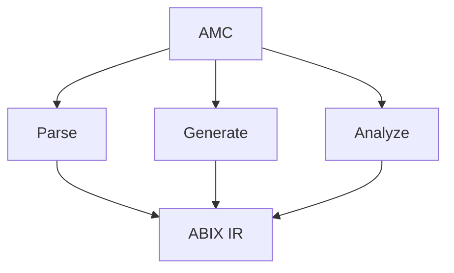

# AMC — ABI Meta Compiler

<p align="center">
  <a href="amc_zh.md">中文</a> · English
</p>

<details>

<summary>Contents</summary>

- [Configuration](#configuration)
- [Commands](#commands)
- [Structured errors](#structured-errors)
- [Other tools](#other-tools)

</details>

AMC is the ABIX toolchain entry point. It extracts ABI information from a language AST, projects it into ABIX IR, and provides inspection, comparison, verification, generation and distribution tooling.



AMC is an extensible toolchain, not a language-specific compiler: language frontends extract ABI, ABIX IR stays the common representation.

## Configuration

Builds are described by an `.abic.toml` file:

```toml
[package]
name = "math_api"
version = "1.0"

[[import]]
language = "cpp"
flags = ["-std=c++17"]
files = ["math_api.hpp"]
symbols = ["math::add", "math::Point"]

[[export]]
output = "build/math_api.abix"
```

A module may also declare optional **contracts**. They are semantic contracts, not layout facts, and never change `TypeID`/`LayoutHash`:

```toml
# Release policy: how an owned value is created and released.
[[owned]]
type = "Vec2"
create = "vec2_create"
destroy = "vec2_destroy"

# Per-interaction ownership mode (borrowed / owned / copy).
[[contract]]
function = "vec2_create"
returns = "owned"
release = "vec2_destroy"

[[contract]]
function = "scale"
params = ["borrowed"]

# Error boundary: where a function reports its status and carries the value.
[[error]]
function = "div"
success = 0
value = 2

# Target platform facts, for runtime verification.
[target]
arch = 1
os = 1
abi = 1
pointer_bits = 64
endianness = "little"
```

See [`abic.md`](../ABIX/abic.md) for the complete reference.

## Commands

### `amc build`

Runs the configured frontend, projects the requested symbols and writes the `.abix` artifact (plus a `.abix.meta` indexing sidecar):

```bash
amc build -c package.abic.toml [-B <build_dir>]
```

### `amc inspect` / `amc validate`

```bash
amc inspect  file.abix      # one-line summary
amc validate file.abix      # structural + hash validation
amc inspect  libfoo.so      # decode the embedded Metadata Region
```

### `amc query`

Structured queries for humans and agents. Accepts `.abix` or a compiled binary.

```bash
amc query file.abix --type Foo --layout          # type + field offsets
amc query file.abix --function Foo::bar          # signature, params, return
amc query file.abix --compatible other.abix      # strict ABI comparison
amc query file.abix --type Foo --format json     # abix.query/1 JSON
```

`--type`/`--function` accept exact names, `Owner::name`, substrings, or a `0x`-prefixed `TypeID`.

### `amc context`

Dense ABI context for LLMs: types/fields/functions are indexed (`T0/F0/P0`) so cross references stay short instead of repeating 128-bit hashes.

```bash
amc context file.abix --format llm
amc context file.abix --format json --no-names
```

### `amc diff` / `amc compatibility`

```bash
amc diff v1.abix v2.abix [-o report.abix]
amc compatibility v1.abix v2.abix        # exit 1 when incompatible
```

### `amc verify`

Compares a frozen contract against a regenerated implementation, or two artifacts directly.

```bash
amc verify -c package.abic.toml [-B <build_dir>]
amc verify contract.abix implementation.abix
amc verify contract.abix implementation.abix --format diagnostics
```

`--format diagnostics` emits `file:line:column: error: ABI <kind> ...` lines using the contract's Source Origin, for editors and CI annotations.

Verification also reports calling-convention, ownership-contract and error-boundary drift (`calling_convention_changed`, `ownership_changed`, `error_boundary_changed`). These are contract-level changes: they never enter `TypeID`/`LayoutHash`, and ownership/error differences are not folded into the layout compatibility classification.

### `amc target`

Prints the target platform recorded in an artifact (or embedded in a binary), or verifies it against an expected target — the static, CI-side counterpart to the runtime reader verification.

```bash
amc target file.abix                                          # describe
amc target file.abix --expect arch=1,os=1,abi=1,pointer_bits=64,endianness=1
amc target libfoo.so --expect arch=1 --format json
```

`platform`, `layout` and `calling_convention` are reported independently; an unknown fact is `unverifiable`, never `compatible`. The exit status is `1` when any checked dimension is `incompatible`.

### `amc generate`

```bash
amc generate file.abix -l cpp  -o generated.hpp    # native C++17 projection
amc generate file.abix -l rust -o generated.rs     # Rust `repr(C)` projection
amc generate file.abix -l zig  -o generated.zig    # Zig `extern` projection
amc generate file.abix -l lua  -o aue_contract.hpp # Aue contract (header)
amc generate file.abix -l lua  -o conformance.lua  # generated Lua test case
```

The C++ provider writes `amc_generated.hpp` (the projection) and, next to it, `amc_abi_check.hpp` — a compile-time ABI check that turns layout drift into an ordinary compiler/clangd diagnostic while editing, with no clangd plugin:

```cpp
#include "my_native_types.hpp"   // declares ns::Foo
#include "amc_abi_check.hpp"     // static_asserts sizeof/alignof/offsetof
```

Include the check header *after* the native declarations it names. It asserts `sizeof`, `alignof`, per-field `offsetof` **and per-field width** (`sizeof(static_cast<T *>(nullptr)->field)`) for every type whose ABIX name is a valid C++ qualified name, so a mismatch such as an inserted field is reported at the point of inclusion instead of at runtime. The width assertion catches a field whose type changed to another type of a different size without moving the following offsets or the total size — the part of the LayoutHash comparison the offset checks miss. Bit-fields are skipped because `offsetof`/`sizeof` are not defined for them, and types AMC names implicitly (`struct Foo *`, anonymous enums) are skipped.

The Rust provider (`amc-rust`) writes `amc_generated.rs`: `#[repr(C)]` aggregates, `extern "C"` declarations, associated `ABIX_*` constants and `const _: () = assert!(...)` size/align/offset checks. C-ABI scalars project to their `core::ffi::c_*` aliases (`c_int`, `c_double`, ...) derived from the ABI-normalised primitive identity, rather than to fixed-width spellings, so the alias encodes the target's C ABI. Because the Rust provider reads the language IR directly, `[[import]] language = "rust"` accepts `#[repr(C)]` structs/enums and `extern "C"` functions from `.rs` files without build flags.

The Zig provider (`amc-zig`) is a **backend-only** consumer of the same IR: `amc generate -l zig` writes `amc_generated.zig` with `extern struct` types, `extern fn` declarations, `[*c]` typed pointers and `comptime` `@sizeOf` / `@alignOf` / `@offsetOf` assertions. It carries no Zig-specific model, so the same `.abix` that drives the Rust projection drives the Zig projection; see `AMC/tests/interop/`, where both consumers link the same native library.

### Language providers

```bash
amc --list-languages              # cpp, lua, rust, zig
amc --describe-language rust      # rust frontend backend protocol=jsonl-v1
amc --describe-language zig       # zig backend protocol=jsonl-v1
```

The list and descriptions come from `AMC/providers.toml`, copied next to the
built `amc` as `amc-providers.toml`. `AMC_PROVIDERS_FILE` overrides the
manifest path. Each entry declares its language, executable, roles, protocol
and optional feature set; `AMC_DEFAULT_PROVIDERS_FILE` is the source-tree
fallback compiled into the driver. `cmake --install` keeps `amc`, the providers
and the manifest together in the install `bin` directory.

Every `amc-<language>` executable is a standalone provider; `amc` dispatches to
the one named by the manifest, the `.abic.toml` `language` field, or `-l` for
`generate` / `frontend`. A new language is a separate provider process and does
not change ABIX IR — see [`LANGUAGE-PLUGIN.md`](../../.agents/LANGUAGE-PLUGIN.md).

Providers speak the `abix.plugin/1` JSONL protocol: `HELLO`/`READY`,
`QUERY_CAPABILITIES`, `DESCRIBE`, `ANALYZE` for frontend extraction and
`PROJECT` for backend projection. The driver correlates `id`s, validates the
advertised capability, captures capability stderr into `diagnostics`, and
supports `CANCEL` plus `AMC_PROVIDER_TIMEOUT_MS` (disabled when unset) for a
stuck provider.

### `amc adapter`

Generates a standalone C++ ABI adapter from the mapping between two artifacts: a raw-memory `apply(source, target)` per compatible type, plus an entry table. The target buffer is zero-initialised, so `add_default`/`skip_field` need no code, and `convert_int`/`convert_float` are emitted as widening/narrowing casts. Unsignedness is not tracked by the model, so conversions go through signed intermediates.

```bash
amc adapter foo_v1.abix foo_v2.abix -o adapter_foo.hpp
```

```cpp
const auto *entry = abix_adapter::find("ns::Foo", "ns::Foo");
if (entry) entry->apply(&foo_v1, &foo_v2);
```

With `--typed`, it also emits an `abix::adapter<Source, Target>` specialization over the generated C++ projection types (`<namespace>::<type>_ABIX`). Include the projection header, define `ABIX_ADAPTER_TYPED`, then include the adapter:

```cpp
#define ABIX_ADAPTER_TYPED 1
#include "amc_generated.hpp"   // amc_generated::ns_Foo_ABIX
#include "adapter_foo.hpp"
abix::adapter<amc_generated::ns_Foo_v2_ABIX,
              amc_generated::ns_Foo_v2_ABIX>::apply(&v2, &v1);
```

`--typed-namespace <ns>` overrides the projection namespace (default `amc_generated`).

`--shim` emits the adapter as a translation unit with a C ABI, so it can be compiled into a standalone shim shared library:

```bash
amc adapter foo_v1.abix foo_v2.abix --shim -o shim.cpp
clang++ -std=c++17 -shared -fPIC shim.cpp -o libabix_shim.so
```

```c
/* host side */
void *h = dlopen("./libabix_shim.so", RTLD_NOW);
bool (*apply)(const char *, const char *, const void *, void *) =
    dlsym(h, "abix_adapter_apply");
apply("ns::Foo", "ns::Foo", &foo_v1, &foo_v2);
```

### `amc metadata`

The self-describing Metadata Region (manifest + desc + hash + names), emitted, verified and scanned offline.

```bash
amc metadata file.abix -o region.abixmeta [--no-names] [--build-id 0x...]
amc metadata --verify region.abixmeta
amc metadata --from-elf libfoo.so --format json
amc metadata --verify libfoo.so --format json
```

### `amc publish` / `amc fetch`

A local symbol server keyed by the ELF GNU BuildID:

```bash
amc publish libfoo.so --root ~/.abix/symbols
amc publish file.abix --root ~/.abix/symbols --build-id 0x...
amc fetch libfoo.so -o libfoo.abixmeta
amc fetch --build-id 0x... -o libfoo.abix
```

Store layout: `{root}/{build_id[0:2]}/{build_id[2:]}.{abix|abixmeta}` plus `.meta`. Remote fallback is not implemented yet.

## Structured errors

Every AMC tool can emit one error envelope on stderr:

```bash
amc validate missing.abix --error-format json
```

```json
{"schema":"abix.error/1","error":{"code":"AMC-IO","category":"io",
 "stage":"read_abix","message":"cannot open input: missing.abix",
 "file":"missing.abix","detail":null}}
```

`--format json` on a command also switches errors to JSON.

## Other tools

| Tool | Purpose |
|------|---------|
| `amc-cpp` | C++ frontend/backend provider (JSON-lines IPC) |
| `amc-rust` | Rust frontend/backend provider (JSON-lines IPC); no Clang/LLVM dependency |
| `amc-zig` | Zig backend-only provider (JSON-lines IPC); consumes the same IR, no Clang/LLVM dependency |
| `amc-dump` | raw `.abix` dump (text / JSON) |
| `amc-mcp` | MCP server exposing ABIX tools; indexes multiple artifacts as a knowledge base ([MCP.md](../ai/MCP.md)) |
| `libabix_lldb.so` | native LLDB command plugin (`abix ...`) linked against `libabix-*` ([`tools/lldb_abix.cpp`](../../tools/lldb_abix.cpp)) |
| `abix-conformance` | Aue L0/L1 differential runner (when Lua is present) |
