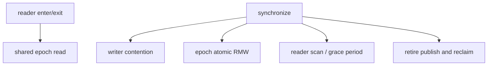

# ABIX Benchmark & Performance Analysis

<p align="center">
  <a href="benchmark_zh.md">中文</a> · English
</p>

<details>

<summary>Contents</summary>

- [1. Scope and Overview](#1-scope-and-overview)
- [2. What Is Measured](#2-what-is-measured)
- [3. Workload Semantics](#3-workload-semantics)
- [4. Measurement Environment and Reproduction](#4-measurement-environment-and-reproduction)
- [5. Representative Results (Cross-Platform)](#5-representative-results-cross-platform)
- [6. Where the Cross-Platform Differences Come From](#6-where-the-cross-platform-differences-come-from)
- [7. Analysis Method](#7-analysis-method)
- [8. Configuration Guidance](#8-configuration-guidance)
- [9. Limitations](#9-limitations)
- [10. Full Benchmark Suite](#10-full-benchmark-suite)
- [11. References](#11-references)

</details>

> This document records the benchmark scope, method, and conclusions that can be checked against the current source tree.
> Section 5 compares **Windows and Linux**, which run on **the same physical machine** (dual boot), so the differences come
> from the operating system, toolchain, and build only — not from hardware. Every throughput value is a platform-specific
> observation, not a cross-machine guarantee, and must not be quoted without its platform, compiler, and workload model.

Agent-efficiency benchmarking (TROI) is a separate concern and is documented in [troi.md](../ai/troi.md).

## 1. Scope and Overview

- ABIX targets **read-mostly** workloads: many readers execute short read-side critical sections while a small number of writers perform `retire()` and `synchronize()`.
- `bench_all` covers atomics, calls, lookup, plugin reload, EBR fast paths, grace periods, false sharing, and EBR workloads.
- `BM_EBR_SyncPhase` isolates synchronization cost. `BM_EBR_Workload/role_based` is the more representative N-readers/one-writer model.
- AMC extraction, `.abix` serialization, compatibility analysis, and generated metadata registration are build/control-plane
  operations. They are not included in these DLL-call or EBR hot-path measurements, and this document makes no latency claim
  for them.
- `synthetic_mixed` keeps total work fixed across thread counts and is suitable for scalability comparisons. `role_based`
  changes the writer operation count as readers are added; it models role separation, but is not a fixed-work scaling curve.
- **Measurement protocol**: the numbers here come from `tools/run_bench.py` — **one process per family** with
  `--benchmark_repetitions=5`, reported as mean ± sd. The EBR/RCU families share the process-wide `rcu::Domain`, and a family
  measured after the others reads several times slower (`BM_EBR_SyncPhase/1T` spans roughly 6 ns alone in a process to ~1 µs
  after a full run), so isolating each family in its own process is the only form that is comparable across platforms and
  commits.
- **The qualitative cross-platform result**: ABIX hot-path costs (atomic load/store/inc, the EBR bracket, `Domain`
  enter/exit, call overhead, false sharing) land within ±10% on both platforms and are decided by the chip and cache
  coherence; **plugin loading and reload** are decided by the operating system loader, where the same ABIX code is 3–21×
  faster on Linux than on Windows (section 5.4). Quoting either class without saying which one it is will mislead.

## 2. What Is Measured

### EBR / Micro-RCU

| Layer | Benchmarks | Purpose |
|---|---|---|
| Fast path | `BM_EBR_EnterExit`, `BM_EBR_ProtectedLoad` | Basic reader entry/exit and protected-load cost |
| Synchronization | `BM_EBR_SyncPhase` | Contention and scaling of `synchronize()` |
| Reclamation | `BM_EBR_GracePeriod`, `BM_EBR_ReclaimBatch` | Grace-period and reclamation costs |
| Role workload | `BM_EBR_Workload/synthetic_mixed` | Same complete schedule on every thread; fixed total work |
| Role workload | `BM_EBR_Workload/role_based` | N readers plus one writer; target usage model |
| Microarchitecture | False-sharing and atomic-contention tests | Evidence for shared writes, atomic RMW, and cache-line isolation |

### ABIX other paths

`bench_all` also contains call overhead, linear-vs-HashIndex lookup crossover, ABI resolve, reload, and DLL benchmarks. Their metrics are different and should not be merged into one overall ranking; the two platforms are compared per category in section 5.

## 3. Workload Semantics

`workload_runner` defines `read_heavy`, `balanced`, and `write_heavy` schedules. `synthetic_mixed` uses 10,000,000 total operations for every tested thread count, comprising 9,000,000 reads, 900,000 retires, and 100,000 synchronizations:

```text
synthetic_mixed: 10,000,000 total ops at every thread count
read_heavy:      9,000,000 reads + 900,000 retires + 100,000 syncs
```

In `role_based`, only thread 0 performs retire/sync work and the other threads perform reads. A decreasing retire/sync count as the thread count increases is therefore expected behavior, not a benchmark failure. Use `synthetic_mixed` for fixed-work scaling and `role_based` for the real role split. Running `bench_all` directly prints a workload validation table first, and the `synthetic_mixed` block ends with `✓ All counts match — synthetic mixed is truly fixed-work.`, which is the self-check for that semantic.

## 4. Measurement Environment and Reproduction

### 4.1 Platforms

Both platforms are **the same physical machine** (dual boot), with identical CPU, memory, and mainboard:

| Item | Windows 11 | CachyOS Linux |
|---|---|---|
| OS | Windows 11 Pro `10.0.26300` | CachyOS (Arch-based), kernel `7.2.9-2-cachyos` |
| CPU | Intel Core i7-14700K (Raptor Lake-S) | same |
| Cores | 8 P-core + 12 E-core, **hyper-threading off** → 20 logical / 20 physical | same |
| Max frequency | P-core 5500 MHz / E-core 4300 MHz | same |
| Caches | L2 28 MiB, L3 33 MiB | same |
| Memory | 64 GiB DDR5 | same |
| Mainboard | MSI PRO Z790-P WIFI (MS-7E06) | same |
| NUMA | 1 node | same |
| Compiler | g++ 16.2.0 (MSYS2 UCRT64) | g++ 16.2.1 |
| Frequency policy | High-performance power plan | `intel_pstate`, governor `performance`, Turbo on |
| Benchmark | Google Benchmark v1.9.5 (release) | same |
| Build | Release (`-O3 -DNDEBUG`), Ninja | same |
| ABIX options | `SKL_ABIX_DEVELOPMENT=OFF` | same |
| RCU layout | `sizeof(rcu_domain)=192` (3 cache lines), `epoch alignas=64`, `epoch_batch=8` | same |

Both platforms are **x86-64**. ABIX's binary capability layer already covers AArch64 — ELF `EM_AARCH64`,
Mach-O `CPU_TYPE_ARM64` and PE `0xaa64` all map to `Architecture::arm64`, and the `.abix` `arch` field includes
aarch64 (see [`docs/abix/abix.md`](../abix/abix.md)) — but **this document contains no ARM data**. Measuring on ARM
is follow-up work: the "where the differences come from" table in section 6 then has to be re-confirmed per
architecture, in particular the allocator slope of `BM_EBR_ReclaimBatch` and the memory-order cost of the atomic
paths.

### 4.2 Measurement preconditions

Confirm these three before quoting anything from section 5:

1. **Fixed frequency**: on Linux the governor must be `performance`. Otherwise Google Benchmark prints
   `***WARNING*** CPU scaling is enabled`, and short-run coefficients of variation reach 29–44%, which cannot establish any
   percentage claim. With a fixed frequency and `repetitions=5`, almost every entry below has sd under 1% of its mean.
2. **Hyper-threading off, load taken on physical cores**: 20 logical CPUs = 8 P-cores + 12 E-cores. `threads:32` and the
   20T workload entries already fill or exceed the physical core count, and `threads:32` is oversubscription — read it as
   degradation only, not as a scalability ceiling.
3. **Explicit CPU affinity**: `tools/run_bench.py --pin` controls the child processes' CPU set:
   - `--pin auto` (the default): restrict them to the 8 P-cores (identified by `cpufreq/cpuinfo_max_freq`);
   - `--pin off`: leave the scheduler alone;
   - `--pin <list>`: pin explicitly.
   **Note that `--pin 0-20` is equivalent to `--pin off`**: only CPUs 0–19 are online and the kernel ignores
   non-existent CPUs in the mask; do not pin to fewer cores than the thread count when comparing scalability.

### 4.3 Reproduction command

```bash
python tools/build.py --build-bench          # build (skip when reusing an existing Release build)

# Full run: one process per family, 5 repetitions, JSON per family under build/bench/
python tools/run_bench.py --repetitions 5

# One family, with and without P-core pinning
python tools/run_bench.py BM_EBR_SyncPhase --pin auto --repetitions 5
python tools/run_bench.py BM_EBR_SyncPhase --pin off  --repetitions 5
```

`run_bench.py` discovers families through `bench_all --benchmark_list_tests` and additionally runs the three standalone
executables that are not part of `bench_all` (`abix_resolve_bench`, `abix_lookup_cross_bench`, `interface_dispatch_bench`).
Each family JSON carries a `context` block (`cpu_scaling_enabled`, `aslr_enabled`, `load_avg`, `mhz_per_cpu`, cache topology) that can be checked against the preconditions above.

### 4.4 Epoch Batch: B8 / B16, and B8 / B1

`SKL_ABIX_RCU_EPOCH_BATCH=8` and `SKL_ABIX_RCU_EPOCH_BATCH=16` builds both run the 20T role-based workloads.
**That measurement was taken with CPU scaling enabled, and repeated short runs showed coefficients of variation of roughly 29–44%** — not enough to establish which is faster, or a fixed percentage gain. A fixed-frequency re-measurement is needed before making that claim.

`SKL_ABIX_RCU_EPOCH_BATCH=1` was measured separately, because it decides **how quickly a swapped-out module image is reclaimed** (Windows, Defender real-time protection off, warm page cache, the two builds interleaved, 5 rounds × 3 repetitions):

| Benchmark | batch 8 | batch 1 | |
|---|---:|---:|---|
| `BM_Reload_AlternatingPaths` | 17.3 µs | 85.9 µs | **4.97×** |
| `BM_Reload_SamePath` | 3.62 µs | 3.47 µs | unchanged |
| `BM_Reload_LoadFreeA` (loader primitive; identical code in both builds) | 41.3 µs | 41.1 µs | identical |
| `BM_EBR_Synchronize` | 7 ns | 15 ns | +8 ns per call |
| `BM_EBR_TryCollect_Empty` | 10 ns | 10 ns | unchanged |
| `BM_EBR_ReclaimBatch/10000` | 239–259 µs | 236–238 µs | same total work |

`BM_Reload_LoadFreeA` runs identical code in both builds, so the `AlternatingPaths` gap can only come from **unload timing**: with batch=8 the other module stays mapped and the next `LoadLibrary` is just a reference-count bump (8.6 µs/reload); with batch=1 it is unmapped, so every reload pays a full map (43 µs/reload ≈ that 41 µs primitive). `BM_EBR_GracePeriod/*` changes **shape, not cost**: with batch=8 only every 8th `synchronize()` advances the epoch, so the benchmark mostly measures `retire`; with batch=1 it measures the full in-place grace period (1M retired objects ≈ 1 ms). The total reclamation work is the same either way.

**Conclusion for the default**: epoch batch is a **module-unload-delay** policy, not just an amortization knob, so the default stays at 8. Index-slot array reclamation no longer depends on it: `Domain::retire_eager()` + `synchronize_eager()` reclaim that class on the next call (see "two reclamation latencies" in [ABIX API](../abix/api.md)), so a reload can reuse its predecessor's index buffer while the module keeps its batched delay.

## 5. Representative Results (Cross-Platform)

All values are the 5-repetition aggregate mean of `cpu_time` (ns/op unless noted), one process per family. The "ratio" column is Windows ÷ Linux, so **a value above 1 means Linux is faster**.

### 5.1 EBR fast path, synchronization, and reclamation

| Benchmark | Windows 11 | CachyOS Linux | Ratio |
|---|---:|---:|---:|
| `BM_EBR_EnterExit` (1T) | 0.527 | 0.477 | 1.10× |
| `BM_EBR_ProtectedLoad` | 0.569 | 0.473 | 1.20× |
| `BM_EBR_Synchronize` | 6.390 | 6.692 | 0.95× |
| `BM_EBR_TryCollect_Empty` | 4.801 | 4.729 | 1.02× |
| `BM_EBR_ReaderScalability/threads:1` | 0.544 | 0.474 | 1.15× |
| `BM_EBR_ReaderScalability/threads:20` | 0.739 | 0.699 | 1.06× |
| `BM_EBR_ReaderScalability/threads:32` (oversubscribed) | 0.793 | 0.737 | 1.08× |
| `BM_EBR_GracePeriod/1000000` | 125,000 | 124,723 | 1.00× |
| `BM_EBR_ReclaimBatch/1` | 77.009 | 37.585 | 2.05× |
| `BM_EBR_ReclaimBatch/10000` | 322,323 | 163,129 | 1.98× |

`BM_EBR_SyncPhase` per thread count (ns/op):

| Threads | 1T | 2T | 4T | 8T | 10T | 20T |
|---|---:|---:|---:|---:|---:|---:|
| Windows 11 | 6.445 | 89.460 | 267.334 | 771.659 | 1,104.911 | 2,831.283 |
| CachyOS Linux | 6.410 | 71.771 | 245.918 | 848.761 | 979.485 | 3,135.634 |

Observations:

- **The 1T entry matches bare synchronization** (Linux 6.410 vs `BM_EBR_Synchronize` 6.692), which is the evidence that with one process per family the 1T `SyncPhase` carries almost no reader-slot overhead. 1T→20T grows by roughly **440× (Windows) to 489× (Linux)**, near-linear and slightly super-linear: the cost of `synchronize()` grows with the number of participating threads, not with the amount of work.
- The Linux per-step marginal cost (added time per extra thread) is 65 ns for 1T→2T, 87 ns/thread for 2T→4T, 151 ns/thread for 4T→8T, 65 ns/thread for 8T→10T, and **216 ns/thread for 10T→20T**. The last segment is the largest, consistent with threads landing on E-cores once the 8 P-cores are used up, and with extra cross-cluster cache-line migration.
- `BM_EBR_GracePeriod` settles at **0.125 ns per item** from 10K upward, identical on both platforms — that branch is ABIX's own linear traversal/reclamation cost with no platform calls in it. The non-monotonic 10/100 entries (fixed overhead dominates at small batches) do not change that conclusion.
- `BM_EBR_ReclaimBatch` costs per item: Linux settles at **16.3 ns/item** for batches ≥ 100, Windows oscillates between **24 and 32 ns/item**. Each item is one `new int(42)` plus a deferred `delete`, so the slope is essentially the platform allocator's path cost. **Linearity** is a property of ABIX (both platforms are linear); the **slope** is the platform's.

### 5.2 Atomics and call overhead

| Benchmark | Windows 11 | CachyOS Linux | Ratio |
|---|---:|---:|---:|
| `BM_Raw_Load_U32` | 0.095 | 0.093 | 1.02× |
| `BM_StdAtomic_Load_U32` | 0.186 | 0.186 | 1.00× |
| `BM_ABIX_Atomic_Load_U32` | 0.191 | 0.186 | 1.03× |
| `BM_Raw_Inc_U32` | 1.350 | 1.367 | 0.99× |
| `BM_StdAtomic_Inc_U32` | 3.325 | 3.351 | 0.99× |
| `BM_ABIX_Atomic_Inc_U32` | 3.391 | 3.354 | 1.01× |
| `BM_DirectCall` | 0.093 | 0.093 | 1.00× |
| `BM_FunctionPointerCall` | 0.092 | 0.093 | 0.99× |
| `BM_StdFunctionCall` | 0.757 | 0.935 | 0.81× |
| `BM_ABIX_Call` | 2.763 | 3.069 | 0.90× |
| `BM_ABIX_Call_Raw` | 1.551 | 1.121 | 1.38× |
| `BM_ABIX_Call_Stamped` | 2.396 | 2.102 | 1.14× |
| `BM_ABIX_HandleRcuBracket` | 1.641 | 1.676 | 0.98× |
| `BM_Domain_EnterExit_Instance` | 0.539 | 0.482 | 1.12× |

The atomic abstraction layer (`raw` / `std::atomic` / ABIX `util::atomic`) costs nothing extra, and all three land in the same band on both platforms; call-path costs are likewise consistent. The remaining differences (`StdFunctionCall`, `ABIX_Call`, `ABIX_Call_Raw`) are in the 0.2–0.4 ns range, i.e. compiler and code-layout variation, not a platform result.

Multi-threaded contention (16T, ns/op):

| Benchmark | Windows 11 | CachyOS Linux |
|---|---:|---:|
| `BM_Atomic_Inc_Contention` | 113.351 | 108.714 |
| `BM_Atomic_IncShared` | 97.461 | 129.875 |
| `BM_Atomic_PerThread_Inc` (unpadded) | 88.675 | 113.228 |
| `BM_Atomic_Load_Contention` | 0.193 | 0.211 |

`Inc_Contention` (contending on one variable) agrees on both platforms, while `IncShared` and `PerThread_Inc` are 28–34% slower on Linux at 8T/16T. This is **not yet resolved**; the two candidates are core placement (the Windows Thread Director tends to keep such threads on P-cores, while Linux does not distinguish P/E) and cross-core round trips on a shared cache line. Core placement alone cannot explain it: `IncShared` is already 34% slower at 8T, before the thread count exceeds the P-core count, while `PerThread_Inc` is level at 8T. Re-running the two families with `--pin auto` versus `--pin off` separates the two.

### 5.3 Lookup and resolution

| Benchmark | Windows 11 | CachyOS Linux | Ratio |
|---|---:|---:|---:|
| `BM_FindIndex_Only` | 7.010 | 4.929 | 1.42× |
| `BM_Resolve_WithEBR` | 7.282 | 5.920 | 1.23× |
| `BM_Resolve_Linear` | 206.055 | 203.585 | 1.01× |
| `BM_Resolve_Linear_80_20` | 206.055 | 211.948 | 0.97× |
| `BM_Resolve_Linear_Random` | 110.491 | 107.428 | 1.03× |
| `BM_Hash_Name_6ch` / `16ch` | 1.959 / 5.218 | 2.384 / 6.202 | 0.82× / 0.84× |
| `BM_HashIndex_Build/1K` | 945.870 | 817.695 | 1.16× |
| `BM_HashIndex_Build/16K` | 49,517.368 | 47,796.133 | 1.04× |

`abix_lookup_cross_bench` (standalone executable), hash index versus linear scan:

| Distribution / table size | Windows hash | Windows linear | Linux hash | Linux linear |
|---|---:|---:|---:|---:|
| uniform 16K | 14.753 | 1,569.475 | 13.872 | 1,549.567 |
| uniform 1K | 9.452 | 110.910 | 9.252 | 110.415 |
| uniform 64 | 7.917 | 22.810 | 7.883 | 22.161 |
| zipf 16K | 6.313 | 36.663 | 6.544 | 35.924 |
| zipf 64 | 6.348 | 18.583 | 6.066 | 17.722 |

The ratios agree across platforms (uniform 16K about 106×/112×, zipf 16K about 5.8×/5.5×, uniform 64 about 2.9×/2.8×), with the same direction and order of magnitude: the HashIndex advantage concentrates in large uniform tables and narrows under a zipf distribution where the hot set is small.

**A protocol correction that matters**: `BM_FindIndex_Only` and `BM_Resolve_WithEBR` used to call `snprintf` every iteration to build the name, which polluted them by about 14 ns (the two benchmarks read nearly identical, about 21 ns). After pre-formatting they dropped to **7.0 / 7.3 ns** (Windows) and **4.9 / 5.9 ns** (Linux), which is what made the EBR bracket marginal cost visible at all. Historical numbers (about 21 ns, and about 218 ns for `BM_Resolve_Linear`) must not be used as lookup-cost baselines; the same 16K ratio (`BM_Resolve_Linear` ÷ `BM_FindIndex_Only`) moved from about 10× to **29× (Windows) / 41× (Linux)**. The cost of the EBR bracket should be quoted from **direct measurement** (`BM_ABIX_HandleRcuBracket` ≈ 1.6–1.7 ns standalone; `abix_resolve_bench`'s `rcu_on − rcu_off` marginal is about 1.0 ns on Windows and about 0.6 ns on Linux), never back-derived from the `WithEBR` minus `FindIndex_Only` difference.

### 5.4 Reload and plugin loading (decided by the OS loader)

| Benchmark | Windows 11 | CachyOS Linux | Ratio |
|---|---:|---:|---:|
| `BM_Reload_SamePath` | 3,652.350 | 172.089 | **21.2×** |
| `BM_Reload_SamePath_BoundedReclaim` | 3,716.511 | 182.745 | 20.3× |
| `BM_Reload_AlternatingPaths` | 18,499.049 | 2,817.197 | 6.6× |
| `BM_Reload_AlternatingPaths_WithPathLookup` | 18,582.755 | 3,396.309 | 5.5× |
| `BM_Reload_AlternatingPaths_BoundedReclaim` | 92,071.783 | 21,075.295 | 4.4× |
| `BM_Reload_LoadOnly` | 39,006.000 | 8,560.285 | 4.6× |
| `BM_Reload_FreeOnly` | 6,194.196 | 2,275.568 | 2.7× |
| `BM_Reload_LoadFreeA` | 43,504.791 | 10,393.826 | 4.2× |
| `BM_Reload_RetireSync` | 47.942 | 17.314 | 2.8× |
| `BM_Object_LoadUnload` | 11,927.960 | 3,374.650 | 3.5× |

This is the largest cross-platform difference in the suite, and the ABIX code on that path is identical (`Object::load` → platform load primitive → build index → publish → grace period). Only the platform primitive changes:

- Linux uses `dlopen`/`dlclose`, and **reopening the same path hits ld.so's already-loaded fast path** — which is exactly what `BM_Reload_SamePath` measures (repeatedly reloading one `.so`);
- Windows uses `LoadLibrary`/`FreeLibrary`, which walks the full loader path every time (relocations, TLS, image section handling) while holding the Loader Lock.

The gap narrows with how much the run can stay on the already-loaded fast path: 21× for the same path, 6.6× for alternating two modules, 4.4× for bounded reclaim on alternating paths (the grace-period portion is platform-independent, so the larger its share, the smaller the overall ratio). Consequences:

- The absolute values of `reload` and `Object::load/unload` **must state their platform**; cross-platform comparisons should use same-platform relative values instead (the `SamePath`-to-`AlternatingPaths` ratio, or the `_BoundedReclaim` overhead multiplier).
- "Reload cost is dominated by mapping" and "moving the write lock out of load/grace-period removes a latency spike rather than improving throughput" both hold on either platform: on Linux `LoadOnly` (8.56 µs) is 82% of `LoadFreeA` (10.39 µs), again dominated by loading.

### 5.5 False sharing

| Benchmark | 1T | 16T | Platform |
|---|---:|---:|---|
| `BM_FalseSharing_Padded` | 3.346 | 3.817 | Linux |
| `BM_FalseSharing_Padded` | 3.422 | 3.633 | Windows |
| `BM_FalseSharing_Adjacent` | 3.371 | 118.126 | Linux |
| `BM_FalseSharing_Adjacent` | 3.340 | 111.719 | Windows |
| `BM_FalseSharing_WritePacked` | 0.186 | 0.284 | Linux |
| `BM_FalseSharing_WriteAligned` | 0.186 | 0.281 | Linux |

- Increment (RMW) case: at 16T, adjacent 118.126 versus padded 3.817, about **31×** — padding works (Windows is also 31×).
- Write case: at 16T, packed 0.284 versus aligned 0.281, **no distinguishable penalty**. The same holds on Windows, so it is not a platform-specific scheduling or cache effect; it is more likely that the benchmark does not construct actual cross-core contention on one cache line. **This entry stays "under investigation" on both platforms** and must not be read as "padding is unnecessary for writes".

### 5.6 EBR workload throughput (items/s)

| Model / threads | 1T | 8T | 20T |
|---|---:|---:|---:|
| `synthetic_mixed/read_heavy` (Linux) | 293.6 M | 164.8 M | 137.7 M |
| `synthetic_mixed/read_heavy` (Windows) | 194.0 M | 165.9 M | 133.9 M |
| `synthetic_mixed/balanced` (Linux) | 207.9 M | 157.7 M | 152.7 M |
| `synthetic_mixed/balanced` (Windows) | 173.5 M | 180.6 M | 156.4 M |
| `synthetic_mixed/write_heavy` (Linux) | 182.0 M | 140.6 M | 157.0 M |
| `synthetic_mixed/write_heavy` (Windows) | 162.3 M | 179.3 M | 156.3 M |
| `role_based/read_heavy` (Linux) | 163.3 M | 4,495.5 M | 13,145.4 M |
| `role_based/read_heavy` (Windows) | 155.1 M | 4,850 M | 15,800 M |
| `role_based/balanced` (Linux) | 140.1 M | 4,146.0 M | 12,802.8 M |
| `role_based/balanced` (Windows) | 132.7 M | 4,720 M | 13,910 M |

- **`synthetic_mixed` gains nothing from parallelism at fixed work**: 20T is slightly *slower* than 1T (Linux read_heavy 293.6 → 137.7 M). The bottleneck is retire/sync contention, not available cores — **adding threads to a fixed-work EBR load only adds coordination cost**. The 20T entries agree across platforms (within 3%); at 8T Windows is up to 28% faster (`write_heavy` 140.6 versus 179.3 M, `balanced` 157.7 versus 180.6 M; `read_heavy` is level), the same direction as the contention difference in section 5.2 (Windows is faster when exactly the 8 P-cores are used), and is likewise unresolved.
- **`role_based` scales with read threads**: 1T→20T is about 80–100×, the same order as the thread count (readers only do enter/exit, with no coordination). Windows is 8–17% faster at 20T, from the same source as the contention difference in section 5.2 (at 20T some threads necessarily land on E-cores).
- **One unexplained difference**: the 1T entries of `synthetic_mixed` are 12–51% faster on Linux, while the 20T entries agree (within 3%). Every other 1T benchmark in the same collection is within ±10%, so "higher frequency" cannot explain it uniformly. **Compare workload 1T absolute values within one platform only**; sd is tiny (1T read_heavy totals 0.43 M), so this is not noise.

## 6. Where the Cross-Platform Differences Come From

| Category | Behaviour | Quoting rule |
|---|---|---|
| Chip and cache coherence | Atomic load/store/inc, EBR bracket, `Domain` enter/exit, call overhead, false sharing: within ±10% on both platforms | Direction and order of magnitude are portable; absolute ns should still name the platform |
| OS loader | `Reload` / `Object::load-unload` / path resolution: Linux is 2.7–21× faster | **Must name the platform**; cross-platform use same-platform relative values only |
| OS allocator | `BM_EBR_ReclaimBatch` slope (Linux 16.3 ns/item versus Windows 24–32 ns/item) | Linearity belongs to ABIX, the slope belongs to the platform |
| Platform-independent (ABIX itself) | `BM_EBR_GracePeriod` at 0.125 ns/item (identical on both platforms); the near-linear growth of `SyncPhase` | Portable across platforms |
| Unresolved | Multi-threaded increments at 8T/16T (Linux 28–34% slower), `synthetic_mixed` 1T | Same-platform relative comparison only; needs a `--pin` A/B and a re-measurement |

This is why the document gives no combined ranking: the same benchmark can differ by 1.0× (chip-dominated) or 21× (OS-dominated), and sorting both columns together produces a meaningless ordering.

## 7. Analysis Method

Work through these in order rather than reasoning from a single anomalous number:

1. Confirm the Release build, the workload counts, and the benchmark filter; when using `run_bench.py`, check the JSON `context` (`cpu_scaling_enabled` should be `false`, and `load_avg` should show no external load).
2. Use `SyncPhase` to see whether the synchronization path degrades with thread count.
3. Use `synthetic_mixed` to compare scalability at fixed total work.
4. Use `role_based` to judge the real throughput of the target read-mostly scenario.
5. Sweep the neighbourhood of B8, B16 (and B1 when unload latency matters) and the threshold, rather than testing only the round numbers 8, 16, 32.
6. Repeat at least 10 times and record median, p90, standard deviation, and CV; when CV is high, report only "the result is inconclusive".
7. Conclusions about loading/reloading must be taken on the **target platform** (section 5.4), and conclusions about thread scaling must fix CPU affinity.

The bottlenecks worth watching:



`alignas`, epoch batching, and publish batching should only be kept when the measurements of the corresponding path support them. Global padding can reduce cache utilization and batching can increase reclamation latency; neither is an unconditional optimization.

## 8. Configuration Guidance

| Parameter | Effect |
|---|---|
| `SKL_ABIX_RCU_CACHE_LINE_SIZE` | Cache-line isolation size for contended fields |
| `SKL_ABIX_RCU_EPOCH_BATCH` | Reclamation latency of batched classes: how many `synchronize()` calls advance an epoch, and therefore how long a swapped-out module image stays mapped |
| `SKL_ABIX_RCU_BATCH_PUBLISH` | Batch size before retired objects are published to the global list |

The current default is epoch batch 8. Treat it as a conservative default, not as optimal for every CPU and workload. Two things to keep in mind before changing it:

- it is also the **deferred-unload** control, not just an amortization knob: lowering it buys "retired objects (and reusable index buffers) released sooner" at the cost of paying a fresh module map on every alternating reload;
- `synchronize_eager()` is **not** affected by it — immediate reclamation always happens on the next call — so index-buffer reuse does not depend on this value.

Before changing the default, re-measure on the target platform with a Release build, fixed CPU affinity, a stable frequency (governor `performance`), and enough repetitions, and **run the `Reload` family too** (not just EBR): the effect shows up as loader degradation first.

## 9. Limitations

- These results describe ABIX under a given implementation and a given load; they do not generalize to RCU or concurrent containers in general.
- The two platforms here are dual boots of **the same machine**, so "cross-platform" means across operating systems and toolchains, **not across hardware or architectures**; absolute throughput on different CPU topologies (core count, P/E ratio, NUMA) and on different architectures (x86-64 / AArch64) cannot be ranked directly. ABIX already covers AArch64, but no ARM data has been collected yet (see section 4.1).
- Absolute throughput varies with platform, compiler, frequency policy, and background load. Historical numbers outside `docs/benchmark` cannot be independently checked without raw output and full environment information.
- CPU scaling, thread migration, Turbo, temperature, NUMA, ASLR, and background tasks all affect short benchmarks; the data here rests on the three preconditions in section 4.2.
- The contention difference in section 5.2 and the 1T difference in section 5.6 are unresolved and marked as such.
- Performance testing does not replace correctness testing; run the full test suite after changing reclamation or synchronization logic.

## 10. Full Benchmark Suite

### Execution

Prefer `tools/run_bench.py` (one process per family, automatic family discovery, standalone executables included, JSON output):

```bash
python tools/run_bench.py --repetitions 5                 # everything
python tools/run_bench.py BM_EBR_SyncPhase --pin auto     # one family, pinned to the P-cores
python tools/run_bench.py --list                          # list what would run
```

To run a single binary by hand (for example to see the diagnostics the runner captures), start it from `build/Release/bin` with `LD_LIBRARY_PATH=.`:

```bash
cd build/Release/bin && LD_LIBRARY_PATH=. ./bench_all \
  --benchmark_filter='BM_EBR_Workload/role_based/(read_heavy|balanced|write_heavy)/20T' \
  --benchmark_min_time=1s \
  --benchmark_repetitions=10 \
  --benchmark_report_aggregates_only=true
```

`bench_all` is the unity entry point (`bench/bench_all.cpp` pulls in the individual `*_bench.cpp` files) and its `main()` comes from `bench/ebr/profile_bench.cpp`, so every run **first prints the CPU topology, the `rcu_domain` layout, and the workload validation tables** before handing over to Google Benchmark; those lines are part of the result (the fixed-work self-check in section 3 is one of them). `bench/CMakeLists.txt` also builds `abix_resolve_bench`, `abix_lookup_cross_bench`, `interface_dispatch_bench`, and `ebr_profile_bench`, which are not part of `bench_all` and must be run separately (`run_bench.py` already covers the first three).

### Result files

`run_bench.py` writes one JSON per family (`build/bench/<family>.json`) containing the `context` (environment snapshot), the per-repetition `iteration` rows, and the `mean`/`median`/`stddev` aggregate rows. Every number in section 5 is taken from those aggregate rows, with the same definition as the runner's own summary table.

## 11. References

- [ABIX README](../../README.md)
- [Google Benchmark User Guide](https://github.com/google/benchmark)
- [User-Level Implementations of Read-Copy Update](https://doi.org/10.1109/TPDS.2011.159)
