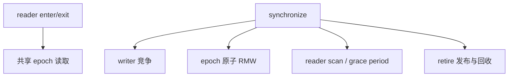

# ABIX 基准测试与性能分析

<p align="center">
  中文 · <a href="benchmark.md">English</a>
</p>

<details>

<summary>目录</summary>

- [1. 范围与概述](#1-范围与概述)
- [2. 测试对象](#2-测试对象)
- [3. 工作负载语义](#3-工作负载语义)
- [4. 测试环境与复现](#4-测试环境与复现)
- [5. 代表性结果（跨平台对照）](#5-代表性结果跨平台对照)
- [6. 跨平台差异的来源](#6-跨平台差异的来源)
- [7. 性能分析方法](#7-性能分析方法)
- [8. 配置与建议](#8-配置与建议)
- [9. 局限性](#9-局限性)
- [10. 完整基准套件](#10-完整基准套件)
- [11. 参考](#11-参考)

</details>

> 本文记录基准套件的范围、方法，以及可以由当前源码复核的结论。第 5 节给出 **Windows 与 Linux 两个平台的对照**，
> 两个平台是**同一台物理机**（双系统），因此差异只来自操作系统、工具链与构建，不含硬件差异。
> 所有吞吐量都是特定平台上的观测值，不是跨机器承诺，也不应脱离平台、编译器与负载模型单独引用。

Agent 效率基准（TROI）是另一项独立的关注，记录在 [troi_zh.md](../ai/troi_zh.md) 中。

## 1. 范围与概述

- ABIX 的主要目标是 **read-mostly** 场景：多个 reader 执行短读临界区，少数 writer 执行 `retire()` 和 `synchronize()`。
- `bench_all` 当前包含原子操作、函数调用、查找、插件 reload、EBR fast path、grace period、false sharing 以及 EBR workload 等多组测试。
- 对 EBR 扩展性，`BM_EBR_SyncPhase` 和 `BM_EBR_Workload/role_based` 比单一 microbench 更有参考价值；前者隔离同步成本，后者模拟真实 reader/writer 角色。
- AMC 提取、`.abix` 序列化、兼容性分析和生成 metadata 的注册属于构建/控制平面操作，不包含在本文件的 DLL 调用或 EBR 热路径测量中；本文不对这些操作作延迟承诺。
- `synthetic_mixed` 是固定工作量测试，适合比较线程数的扩展性；`role_based` 的 writer 操作量会随线程数变化，适合模拟实际角色分工，但不适合直接当作固定工作量 scaling 曲线。
- **测量口径**：本文数据由 `tools/run_bench.py` 采集——**每个家族各占一个进程**、`--benchmark_repetitions=5`，报告 mean ± sd。EBR/RCU 各家族共享进程级 `rcu::Domain`，同一家族在别的家族跑完之后再测会慢数倍（`BM_EBR_SyncPhase/1T` 从「进程里只有它」的约 6 ns 到「全量跑之后」的约 1 µs），因此隔离到每家族一个进程是跨平台、跨提交可比较的唯一形式。
- **平台差异的定性结论**：ABIX 的热路径成本（原子 load/store/inc、EBR 括号、`Domain` enter/exit、调用开销、伪共享）在两个平台上落在 ±10% 内，由芯片与缓存一致性决定；而**插件加载与重载**由操作系统的 loader 机制，决定，同一份 ABIX 代码在 Linux 上比 Windows 快 3～21 倍（第 5.4 节）。引用这两类数字时必须区分。

## 2. 测试对象

### EBR / Micro-RCU

| 层次      | 测试                                        | 用途                                                    |
| --------- | ------------------------------------------- | ------------------------------------------------------- |
| fast path | `BM_EBR_EnterExit`、`BM_EBR_ProtectedLoad`  | reader 进入/退出和受保护读取的基本开销                  |
| 同步      | `BM_EBR_SyncPhase`                          | 多线程 `synchronize()` 的竞争与扩展性                   |
| 回收      | `BM_EBR_GracePeriod`、`BM_EBR_ReclaimBatch` | grace period 和批量回收成本                             |
| 角色负载  | `BM_EBR_Workload/synthetic_mixed`           | 所有线程执行同一完整 schedule，固定总工作量             |
| 角色负载  | `BM_EBR_Workload/role_based`                | N 个 reader + 1 个 writer，接近目标使用方式             |
| 微架构    | false sharing / atomic contention           | 判断共享写、原子 RMW 和 cache-line 隔离是否可能成为瓶颈 |

### ABIX 其他路径

`bench_all` 还覆盖调用方式、线性查找与 HashIndex 交叉点、ABI resolve、reload 和 DLL 场景。这些测试的指标不同，不能与 EBR 吞吐量混成一张"总排名"表。两个平台的对照同样按类别分开给出（第 5 节）。

## 3. 工作负载语义

`workload_runner` 定义了 `read_heavy`、`balanced` 和 `write_heavy` 三类 schedule，其中 `synthetic_mixed` 在每个线程数下均为 10,000,000 total ops，由 9,000,000 次 read、900,000 次 retire 和 100,000 次 sync 组成：

```text
synthetic_mixed: 每个线程数均为 10,000,000 total ops
read_heavy:      9,000,000 reads + 900,000 retires + 100,000 syncs
```

`role_based` 中只有 thread 0 执行 retire/sync，其他线程只执行 read。因此线程数增加时，retire 和 sync 数量下降是设计行为，不是 benchmark 失败。需要比较固定工作量时使用 `synthetic_mixed`；需要模拟真实读写角色时使用 `role_based`。直接运行 `bench_all` 时它会先打印一张工作量校验表，`synthetic_mixed` 一节会以 `✓ All counts match — synthetic mixed is truly fixed-work.` 结尾，可作为该语义的自检。

## 4. 测试环境与复现

### 4.1 平台

两个平台是**同一台物理机**（双系统），CPU、内存、主板一致：

| 项目      | Windows 11                                                                       | CachyOS Linux                                   |
| --------- | -------------------------------------------------------------------------------- | ----------------------------------------------- |
| 操作系统  | Windows 11 专业版 `10.0.26300`                                                   | CachyOS（Arch 系），内核 `7.2.9-2-cachyos`      |
| CPU       | Intel Core i7-14700K（Raptor Lake-S）                                            | 同                                              |
| 核心      | 8 P-core + 12 E-core，**超线程关闭** → 20 逻辑核 / 20 物理核                     | 同                                              |
| 最高频率  | P-core 5500 MHz / E-core 4300 MHz                                                | 同                                              |
| 缓存      | L2 28 MiB、L3 33 MiB                                                             | 同                                              |
| 内存      | 64 GiB DDR5                                                                      | 同                                              |
| 主板      | MSI PRO Z790-P WIFI（MS-7E06）                                                   | 同                                              |
| NUMA      | 1 个节点                                                                         | 同                                              |
| 编译器    | g++ 16.2.0（MSYS2 UCRT64）                                                       | g++ 16.2.1                                      |
| 频率策略  | 高性能电源方案                                                                   | `intel_pstate` governor=`performance`，Turbo 开 |
| 基准框架  | Google Benchmark v1.9.5（release）                                               | 同                                              |
| 构建      | Release（`-O3 -DNDEBUG`），Ninja                                                 | 同                                              |
| ABIX 选项 | `SKL_ABIX_DEVELOPMENT=OFF`                                                       | 同                                              |
| RCU 布局  | `sizeof(rcu_domain)=192`（3 条 cache line）、`epoch alignas=64`、`epoch_batch=8` | 同                                              |

两个对照平台都是 **x86-64**。ABIX 的二进制能力层已经适配 AArch64——ELF `EM_AARCH64`、Mach-O `CPU_TYPE_ARM64`、PE `0xaa64` 都映射到 `Architecture::arm64`，`.abix` 的 `arch` 字段也包含 aarch64（见 [`docs/abix/abix_zh.md`](../abix/abix_zh.md)）。AArch64 构建与完整基准套件已在 Apple Silicon 笔记本上验证可端到端运行（**MacBook Air M4，16 GB，无主动散热**），即**可移植性已确认**；但**本文不给出 ARM 性能数字**：

> 该机器的操作系统、内存容量和散热预算与第 5 节对照的两个 x86-64 平台差距过大，其绝对吞吐量没有参考意义。

ARM 数据采集是后续工作，计划为：- (a) 在专用 ARM 与 x86 Linux 服务器上做 AArch64 与 x86-64 的吞吐量对照，这样的比较才成立；- (b) 在 **M4 Max 32 GB** 平台上跑一轮基准性能测试。采集后，§6 的"平台差异来源"要按架构重新确认，尤其是 `BM_EBR_ReclaimBatch` 的分配器斜率与原子路径的内存序成本。

### 4.2 采集前提

引用第 5 节任何数字前，先确认这三条：

1. **频率固定**：Linux 侧 governor 必须是 `performance`。否则 Google Benchmark 会打印`***WARNING*** CPU scaling is enabled`，且短跑变异系数可达 29%～44%，无法判定任何百分比收益。在固定频率、`repetitions=5` 下，本文绝大多数条目的 sd 小于均值的 1%。
2. **超线程关闭，按物理核心取负载**：20 逻辑核 = 8 P-core + 12 E-core。`threads:32` 与 workload 的 20T 均已用满或超过物理核数，其中 `threads:32` 属超额订阅，只用于看退化，不作扩展性上限解读。
3. **显式 CPU 亲和性**：`tools/run_bench.py --pin` 控制子进程的 CPU 集合：
    - `--pin auto`（默认）：限制到 8 个 P-core（按 `cpufreq/cpuinfo_max_freq` 分级识别）；
    - `--pin off`：不做限制；
    - `--pin <列表>`：指定集合。
    > **注意 `--pin 0-20` 与 `--pin off` 等价**：在线 CPU 只有 0–19，内核会忽略掩码中不存在的 CPU；跨线程数比较伸缩曲线时不要绑定到少于线程数的核。

### 4.3 执行命令

```bash
python tools/run_build.py                    # 构建（复用已有 Release 构建时可跳过）

# 全量采集：每家族一个进程、5 次重复，产物为 build/bench/<家族>.json
python tools/run_bench.py --repetitions 5

# 单个家族 + P-core 绑定对照
python tools/run_bench.py BM_EBR_SyncPhase --pin auto --repetitions 5
python tools/run_bench.py BM_EBR_SyncPhase --pin off  --repetitions 5
```

`run_bench.py` 用 `bench_all --benchmark_list_tests` 自动发现家族，并额外运行三个未并入 `bench_all` 的独立可执行文件（`abix_resolve_bench`、`abix_lookup_cross_bench`、`interface_dispatch_bench`）。每个家族的 JSON 里含 `context` 字段（`cpu_scaling_enabled`、`aslr_enabled`、`load_avg`、`mhz_per_cpu`、缓存拓扑），可直接用于核对采集前提。

### 4.4 Epoch Batch：B8 / B16 与 B8 / B1

`SKL_ABIX_RCU_EPOCH_BATCH=8` 和 `SKL_ABIX_RCU_EPOCH_BATCH=16` 两种构建均可运行 20T role-based 负载。**当时的测量在 CPU scaling 开启的条件下进行，重复短跑的变异系数约为 29%～44%**，不足以判定哪一个更快，也不足以支持固定的百分比收益；需要在固定频率下重测才能给出结论。

`SKL_ABIX_RCU_EPOCH_BATCH=1` 另作单独测量，因为它决定的是**换出的模块 image 多快被回收**（Windows、关闭 Defender 实时防护、预热页缓存、两种构建交错运行、5 轮 × 3 repetitions）：

| 基准                                                       |    batch 8 |    batch 1 |              |
| ---------------------------------------------------------- | ---------: | ---------: | ------------ |
| `BM_Reload_AlternatingPaths`                               |    17.3 µs |    85.9 µs | **4.97×**    |
| `BM_Reload_SamePath`                                       |    3.62 µs |    3.47 µs | 不变         |
| `BM_Reload_LoadFreeA`（loader 原语；两种构建代码完全相同） |    41.3 µs |    41.1 µs | 一致         |
| `BM_EBR_Synchronize`                                       |       7 ns |      15 ns | 每调用 +8 ns |
| `BM_EBR_TryCollect_Empty`                                  |      10 ns |      10 ns | 不变         |
| `BM_EBR_ReclaimBatch/10000`                                | 239–259 µs | 236–238 µs | 总工作量不变 |

`BM_Reload_LoadFreeA` 在两种构建里跑的是同一份代码，因此 `AlternatingPaths` 的差距只可能来自**卸载时机**：batch=8 时另一个模块保持 mapped，下次 `LoadLibrary` 只是引用计数 +1（8.6 µs/reload）；batch=1 时它被 unmap，每次 reload 都要付一次完整 map（43 µs/reload ≈ 那 41 µs 的原语）。`BM_EBR_GracePeriod/*` 变化的是**形态而非成本**：batch=8 时每 8 次 `synchronize()` 才推进一次 epoch，该基准大多只量到 `retire`；batch=1 时它量到完整的就地宽限期（100 万个退休对象 ≈ 1 ms）。两种情况下总回收工作量相同。

**对默认值的结论**：epoch batch 是**模块卸载延迟**策略，不只是摊薄手段，因此默认维持 8。索引槽数组的回收已不再依赖它：`Domain::retire_eager()` + `synchronize_eager()` 会在下一次调用回收该类（见 [ABIX API](../abix/api_zh.md) 的"两类回收延迟"），于是 reload 可以复用前任的索引缓冲，而模块仍保留批量延迟。

## 5. 代表性结果（跨平台对照）

以下均为 `cpu_time` 的 5 次重复聚合 mean（ns/op，标注除外），每家族一个进程。"倍数"列 = Windows ÷ Linux，**大于 1 表示 Linux 更快**。

### 5.1 EBR fast path、同步与回收

| 基准                                          | Windows 11 | CachyOS Linux |  倍数 |
| --------------------------------------------- | ---------: | ------------: | ----: |
| `BM_EBR_EnterExit`（1T）                      |      0.527 |         0.477 | 1.10× |
| `BM_EBR_ProtectedLoad`                        |      0.569 |         0.473 | 1.20× |
| `BM_EBR_Synchronize`                          |      6.390 |         6.692 | 0.95× |
| `BM_EBR_TryCollect_Empty`                     |      4.801 |         4.729 | 1.02× |
| `BM_EBR_ReaderScalability/threads:1`          |      0.544 |         0.474 | 1.15× |
| `BM_EBR_ReaderScalability/threads:20`         |      0.739 |         0.699 | 1.06× |
| `BM_EBR_ReaderScalability/threads:32`（超订） |      0.793 |         0.737 | 1.08× |
| `BM_EBR_GracePeriod/1000000`                  |    125,000 |       124,723 | 1.00× |
| `BM_EBR_ReclaimBatch/1`                       |     77.009 |        37.585 | 2.05× |
| `BM_EBR_ReclaimBatch/10000`                   |    322,323 |       163,129 | 1.98× |

`BM_EBR_SyncPhase` 的逐档对照（ns/op）：

| 线程          |    1T |     2T |      4T |      8T |       10T |       20T |
| ------------- | ----: | -----: | ------: | ------: | --------: | --------: |
| Windows 11    | 6.445 | 89.460 | 267.334 | 771.659 | 1,104.911 | 2,831.283 |
| CachyOS Linux | 6.410 | 71.771 | 245.918 | 848.761 |   979.485 | 3,135.634 |

要点：

- **1T 档与裸同步同量级**（Linux 6.410 vs `BM_EBR_Synchronize` 6.692），说明"每家族一个进程"下 1T 的`SyncPhase` 几乎没有读者槽位开销；1T→20T 放大约 **440×（Windows）～489×（Linux）**，近线性且略超线性，即 `synchronize()` 的成本随参与线程数增长，而非随工作量增长。
- Linux 侧逐档边际（每新增一个线程的增量）为：1T→2T 65 ns、2T→4T 87 ns/线程、4T→8T 151 ns/线程、8T→10T 65 ns/线程、10T→20T **216 ns/线程**。最后一段最大，与 8 个 P-core 用完之后线程落到 E-core、且跨簇 cache line 迁移增加相符。
- `BM_EBR_GracePeriod` 从 10K 起每项稳定在 **0.125 ns**，两个平台完全一致——这一支是 ABIX 自身的线性遍历/回收成本，不含平台调用。10/100 档的非单调（小批量下固定开销主导）不改变该结论。
- `BM_EBR_ReclaimBatch` 的每项成本：Linux 在批量 ≥ 100 后稳定在 **16.3 ns/项**，Windows 在 **24～32 ns/项**之间波动。每个 item 是一次 `new int(42)` + 一个延迟 `delete`，所以斜率基本就是平台分配器的路径成本。**线性性**是 ABIX 的性质（两平台都线性），**斜率**由平台分配器决定。

### 5.2 原子操作与调用开销

| 基准                           | Windows 11 | CachyOS Linux |  倍数 |
| ------------------------------ | ---------: | ------------: | ----: |
| `BM_Raw_Load_U32`              |      0.095 |         0.093 | 1.02× |
| `BM_StdAtomic_Load_U32`        |      0.186 |         0.186 | 1.00× |
| `BM_ABIX_Atomic_Load_U32`      |      0.191 |         0.186 | 1.03× |
| `BM_Raw_Inc_U32`               |      1.350 |         1.367 | 0.99× |
| `BM_StdAtomic_Inc_U32`         |      3.325 |         3.351 | 0.99× |
| `BM_ABIX_Atomic_Inc_U32`       |      3.391 |         3.354 | 1.01× |
| `BM_DirectCall`                |      0.093 |         0.093 | 1.00× |
| `BM_FunctionPointerCall`       |      0.092 |         0.093 | 0.99× |
| `BM_StdFunctionCall`           |      0.757 |         0.935 | 0.81× |
| `BM_ABIX_Call`                 |      2.763 |         3.069 | 0.90× |
| `BM_ABIX_Call_Raw`             |      1.551 |         1.121 | 1.38× |
| `BM_ABIX_Call_Stamped`         |      2.396 |         2.102 | 1.14× |
| `BM_ABIX_HandleRcuBracket`     |      1.641 |         1.676 | 0.98× |
| `BM_Domain_EnterExit_Instance` |      0.539 |         0.482 | 1.12× |

结论：原子抽象层（`raw` / `std::atomic` / ABIX `util::atomic`）不额外收费，且三者在两个平台上完全同档；调用路径的成本也基本一致。差异（`StdFunctionCall`、`ABIX_Call`、`ABIX_Call_Raw`）在 0.2～0.4 ns 量级，属编译器与代码布局差异，不构成平台结论。

多线程争用（16T，ns/op）：

| 基准                                | Windows 11 | CachyOS Linux |
| ----------------------------------- | ---------: | ------------: |
| `BM_Atomic_Inc_Contention`          |    113.351 |       108.714 |
| `BM_Atomic_IncShared`               |     97.461 |       129.875 |
| `BM_Atomic_PerThread_Inc`（未补位） |     88.675 |       113.228 |
| `BM_Atomic_Load_Contention`         |      0.193 |         0.211 |

`Inc_Contention`（同一变量争用）两平台一致，而 `IncShared` 与 `PerThread_Inc` 在 8T/16T 上 Linux 慢28%～34%。这是**尚未定论**的差异，两个候选解释是落核差异（Windows 的 Thread Director 倾向把线程留在P-core，Linux 侧不区分 P/E）与共享 cache line 的跨核往返；`IncShared` 在 8T（未超出 P-core 数量）就已慢34%，而 `PerThread_Inc` 在 8T 基本持平，因此落核不足以解释全部。用 `--pin auto` 与 `--pin off` 对照重跑即可分离。

### 5.3 查找与解析

| 基准                        |    Windows 11 | CachyOS Linux |          倍数 |
| --------------------------- | ------------: | ------------: | ------------: |
| `BM_FindIndex_Only`         |         7.010 |         4.929 |         1.42× |
| `BM_Resolve_WithEBR`        |         7.282 |         5.920 |         1.23× |
| `BM_Resolve_Linear`         |       206.055 |       203.585 |         1.01× |
| `BM_Resolve_Linear_80_20`   |       206.055 |       211.948 |         0.97× |
| `BM_Resolve_Linear_Random`  |       110.491 |       107.428 |         1.03× |
| `BM_Hash_Name_6ch` / `16ch` | 1.959 / 5.218 | 2.384 / 6.202 | 0.82× / 0.84× |
| `BM_HashIndex_Build/1K`     |       945.870 |       817.695 |         1.16× |
| `BM_HashIndex_Build/16K`    |    49,517.368 |    47,796.133 |         1.04× |

`abix_lookup_cross_bench`（独立可执行文件）的 hash index 与线性扫描交叉点：

| 分布 / 表大小 | Windows hash | Windows linear | Linux hash | Linux linear |
| ------------- | -----------: | -------------: | ---------: | -----------: |
| uniform 16K   |       14.753 |      1,569.475 |     13.872 |    1,549.567 |
| uniform 1K    |        9.452 |        110.910 |      9.252 |      110.415 |
| uniform 64    |        7.917 |         22.810 |      7.883 |       22.161 |
| zipf 16K      |        6.313 |         36.663 |      6.544 |       35.924 |
| zipf 64       |        6.348 |         18.583 |      6.066 |       17.722 |

两个平台的比值一致（uniform 16K 约 106×/112×、zipf 16K 约 5.8×/5.5×、uniform 64 约 2.9×/2.8×），方向与量级相同：HashIndex 的优势集中在 uniform 大表，zipf 分布下因热点集中而收窄。

**口径修正（重要）**：`BM_FindIndex_Only` 与 `BM_Resolve_WithEBR` 曾因每轮调用 `snprintf` 生成名字而被污染约 14 ns（两条基准测值几乎相同，约 21 ns）。改为预格式化后两条同时降到 **7.0 / 7.3 ns**（Windows）与 **4.9 / 5.9 ns**（Linux），EBR 括号的边际成本这才显现。历史数字（约 21 ns、`BM_Resolve_Linear`的约 218 ns）不应再用作查找成本的基线；同一组 16K（`BM_Resolve_Linear` ÷ `BM_FindIndex_Only`）的比值由约 10× 修正为 **29×（Windows）/ 41×（Linux）**。EBR 括号的成本以**直接测量**为准（`BM_ABIX_HandleRcuBracket` ≈ 1.6～1.7 ns 独立；`abix_resolve_bench` 的 `rcu_on − rcu_off` 边际：Windows 约 1.0 ns、Linux 约 0.6 ns），不要从 `WithEBR` 与 `FindIndex_Only` 的差里反推。

### 5.4 热重载与插件加载（由 OS loader 机制主导）

| 基准                                        | Windows 11 | CachyOS Linux |      倍数 |
| ------------------------------------------- | ---------: | ------------: | --------: |
| `BM_Reload_SamePath`                        |  3,652.350 |       172.089 | **21.2×** |
| `BM_Reload_SamePath_BoundedReclaim`         |  3,716.511 |       182.745 |     20.3× |
| `BM_Reload_AlternatingPaths`                | 18,499.049 |     2,817.197 |      6.6× |
| `BM_Reload_AlternatingPaths_WithPathLookup` | 18,582.755 |     3,396.309 |      5.5× |
| `BM_Reload_AlternatingPaths_BoundedReclaim` | 92,071.783 |    21,075.295 |      4.4× |
| `BM_Reload_LoadOnly`                        | 39,006.000 |     8,560.285 |      4.6× |
| `BM_Reload_FreeOnly`                        |  6,194.196 |     2,275.568 |      2.7× |
| `BM_Reload_LoadFreeA`                       | 43,504.791 |    10,393.826 |      4.2× |
| `BM_Reload_RetireSync`                      |     47.942 |        17.314 |      2.8× |
| `BM_Object_LoadUnload`                      | 11,927.960 |     3,374.650 |      3.5× |

这是两个平台之间最显著的差异，而 ABIX 在这条路径上的代码完全相同（`Object::load` → 平台加载原语 → 建索引 → 发布 → 宽限期）。唯一变化的是平台原语：

- Linux 侧是 `dlopen`/`dlclose`，**同一路径重复打开会命中 ld.so 的已加载映像快速路径**——这正是 `BM_Reload_SamePath` 的定义（反复重载同一个 `.so`）；
- Windows 侧是 `LoadLibrary`/`FreeLibrary`，每次都要走 loader 的完整路径（重定位、TLS、映像节处理），并持有 Loader Lock。

差距随"是否命中已加载快速路径"而收窄：同路径 21×、两模块交替 6.6×、有界回收的交替路径 4.4×（宽限期那部分成本与 OS 无关，占比越大、总倍率越小）。结论与建议：

- `reload` 与 `Object::load/unload` 的**绝对值必须注明平台**；跨平台引用应改用同平台内的相对值（如 `SamePath` 与 `AlternatingPaths` 之比、`_BoundedReclaim` 的开销倍率）。
- "重载成本由映射主导"与"写锁移出加载/宽限期消除的是延迟尖峰而非吞吐"这两条结论方向在两个平台都成立：Linux 侧 `LoadOnly`（8.56 µs）占 `LoadFreeA`（10.39 µs）的 82%，同样是加载主导。

### 5.5 伪共享

| 基准                               |    1T |     16T | 平台    |
| ---------------------------------- | ----: | ------: | ------- |
| `BM_FalseSharing_Padded`（补位）   | 3.346 |   3.817 | Linux   |
| `BM_FalseSharing_Padded`（补位）   | 3.422 |   3.633 | Windows |
| `BM_FalseSharing_Adjacent`（相邻） | 3.371 | 118.126 | Linux   |
| `BM_FalseSharing_Adjacent`（相邻） | 3.340 | 111.719 | Windows |
| `BM_FalseSharing_WritePacked`      | 0.186 |   0.284 | Linux   |
| `BM_FalseSharing_WriteAligned`     | 0.186 |   0.281 | Linux   |

- 自增（RMW）场景：16T 下相邻 118.126 vs 补位 3.817，约 **31×**，padding 有效（Windows 同为 31×）。
- 写场景：16T 下 packed 0.284 vs aligned 0.281，**没有可分辨的惩罚**。该现象在 Windows 上同样存在，因此不是某一平台特有的调度/缓存行为，更可能是基准本身没有构造出跨核写同一 cache line 的争用。**该条目在两个平台上都保留"待查"状态**，不应据此得出"写场景不需要 padding"的结论。

### 5.6 EBR workload 吞吐（items/s）

| 模型 / 线程                              |      1T |        8T |        20T |
| ---------------------------------------- | ------: | --------: | ---------: |
| `synthetic_mixed/read_heavy`（Linux）    | 293.6 M |   164.8 M |    137.7 M |
| `synthetic_mixed/read_heavy`（Windows）  | 194.0 M |   165.9 M |    133.9 M |
| `synthetic_mixed/balanced`（Linux）      | 207.9 M |   157.7 M |    152.7 M |
| `synthetic_mixed/balanced`（Windows）    | 173.5 M |   180.6 M |    156.4 M |
| `synthetic_mixed/write_heavy`（Linux）   | 182.0 M |   140.6 M |    157.0 M |
| `synthetic_mixed/write_heavy`（Windows） | 162.3 M |   179.3 M |    156.3 M |
| `role_based/read_heavy`（Linux）         | 163.3 M | 4,495.5 M | 13,145.4 M |
| `role_based/read_heavy`（Windows）       | 155.1 M |   4,850 M |   15,800 M |
| `role_based/balanced`（Linux）           | 140.1 M | 4,146.0 M | 12,802.8 M |
| `role_based/balanced`（Windows）         | 132.7 M |   4,720 M |   13,910 M |

- **`synthetic_mixed` 在固定工作量下没有并行收益**：20T 相对 1T 反而略降（Linux read_heavy 293.6 → 137.7 M）。瓶颈是 retire/sync 争用，不是可用核心数——**固定工作量的 EBR 负载加线程只增加协调成本**。20T 档两个平台一致（差异 ≤ 3%）；8T 档 Windows 偏高最多 28%（`write_heavy` 140.6 vs 179.3 M、`balanced` 157.7 vs 180.6 M；`read_heavy` 两者持平），方向与 5.2 节的多线程争用差异相同（恰好用满 8 个 P-core 时 Windows 更快），同属待查项。
- **`role_based` 随读线程数增长**：1T→20T 约 80～100×，与线程数同阶（读侧只做 enter/exit，无协调）。Windows 的 20T 比 Linux 高 8%～17%，与 5.2 节的多线程争用差异同源（20T 必然有线程落在 E-core 上）。
- **一处未解释的差异**：`synthetic_mixed` 的 1T 档 Linux 比 Windows 快 12%～51%，而 20T 档两者一致（≤ 3%）。同批采集里其它 1T 基准差异都在 ±10% 内，因此不能用"频率更高"统一解释。**引用 workload 的 1T 绝对值时请在同一平台内比较**；sd 很小（1T read_heavy 合计 0.43 M），这不是噪声。

## 6. 跨平台差异的来源

| 类别                  | 表现                                                                                 | 引用规则                                            |
| --------------------- | ------------------------------------------------------------------------------------ | --------------------------------------------------- |
| 芯片与缓存一致性决定  | 原子 load/store/inc、EBR 括号、`Domain` enter/exit、调用开销、伪共享：两平台 ±10% 内 | 可跨平台引用方向与量级；绝对 ns 仍应注明平台        |
| OS loader 决定        | `Reload` / `Object::load-unload` / 路径解析：Linux 快 2.7～21×                       | **必须注明平台**；跨平台只用同平台内的相对值        |
| OS 分配器决定         | `BM_EBR_ReclaimBatch` 的斜率（Linux 16.3 ns/项 vs Windows 24～32 ns/项）             | 线性性是 ABIX 的，斜率是平台的                      |
| 平台无关（ABIX 自身） | `BM_EBR_GracePeriod` 每项 0.125 ns（两平台一致）；`SyncPhase` 的近线性放大           | 可跨平台引用                                        |
| 尚未定论              | 多线程自增 8T/16T（Linux 慢 28～34%）、`synthetic_mixed` 1T 档                       | 只作同平台内的相对比较；待用 `--pin` 对照与重测定位 |

因此本文不提供"两平台总排名"：同一个基准在两列里可能相差 1.0×（芯片主导）或 21×（OS 主导），把两列混在一起排序会得到无意义的结论。

## 7. 性能分析方法

建议按以下顺序分析，而不是先从单个异常数字推导原因：

1. 先确认 Release 构建、工作量计数和 benchmark filter 正确；用 `run_bench.py` 时检查 JSON 的 `context`（`cpu_scaling_enabled` 应为 `false`、`load_avg` 不应有外部负载）。
2. 使用 `SyncPhase` 判断同步路径是否随线程数退化。
3. 使用 `synthetic_mixed` 比较固定总工作量的扩展性。
4. 使用 `role_based` 判断目标 read-mostly 场景下的实际吞吐量。
5. 对 B8、B16（当回收延迟重要时还包括 B1）与 threshold 做邻域扫描，而不是只测 8、16、32 这些整齐数字。
6. 至少重复 10 次，记录 median、p90、标准差和 CV；CV 较高时只报告"结果不确定"。
7. 涉及加载/重载的结论必须在**目标平台**上取数（第 5.4 节），涉及线程扩展性的结论必须固定 CPU 亲和性。

需要重点关注的潜在瓶颈包括：



`alignas`、epoch batching 和 publish batching 只能在对应路径的测量结果支持时保留。全局 padding 可能降低 cache 利用率，批处理则可能增加回收延迟；它们都不是无条件优化。

## 8. 配置与建议

| 参数                           | 作用                                                                                                 |
| ------------------------------ | ---------------------------------------------------------------------------------------------------- |
| `SKL_ABIX_RCU_CACHE_LINE_SIZE` | 竞争字段的 cache-line 隔离大小                                                                       |
| `SKL_ABIX_RCU_EPOCH_BATCH`     | 批量类的回收延迟：多少次 `synchronize()` 推进一次 epoch，因而也决定换出的模块 image 保持 mapped 多久 |
| `SKL_ABIX_RCU_BATCH_PUBLISH`   | retire 对象发布到全局列表前的批量大小                                                                |

当前默认值为 epoch batch 8。它应被视为保守默认值，而不是对所有 CPU 和负载都最优。改动前需要记住两点：

- 它同时是**延后卸载**的控制量，不只是摊薄手段：调低它换来"退休对象（与可复用的索引缓冲）更早释放"，代价是每次交替重载都要付一次全新模块 map；
- `synchronize_eager()` **不受**它影响——即时回收总在下一次调用发生——所以索引缓冲复用不依赖这个值。

修改默认值前，应在目标平台上以 Release 构建、固定 CPU 亲和性、稳定频率（governor=`performance`）和足够重复次数重新测量，并且**同时跑 `Reload` 家族**（不只是 EBR 家族）：该效应最先表现为 loader 退化。

## 9. 局限性

- 当前结果只说明 ABIX 在给定实现和给定负载下的行为，不能推广为通用 RCU 或通用并发容器结论。
- 本文的两个平台是**同一台机器**的双系统，所以"跨平台"指的是跨操作系统与工具链，**不是跨硬件或跨架构**；不同 CPU 拓扑（核数、P/E 比例、NUMA）与不同架构（x86-64 / AArch64）的绝对吞吐量都不可直接排名；ABIX 已适配 AArch64，且基准套件可在 Apple Silicon 上运行（见 §4.1），但本文尚未给出 ARM 性能数据。
- 绝对吞吐量随平台、编译器、频率策略与后台负载变化；`docs/benchmark` 之外的历史数字若无原始输出与完整环境信息，无法独立复核。
- CPU scaling、线程迁移、Turbo、温度、NUMA、ASLR 和后台任务都会影响短 benchmark；本文数据的前提是第 4.2 节的三条。
- 第 5.2 节的多线程争用差异与第 5.6 节的 1T 差异仍未定论，已按"待查"标注。
- 性能测试不能替代正确性测试；修改回收和同步逻辑后应先运行完整测试套件。

## 10. 完整基准套件

### 执行方式

推荐用 `tools/run_bench.py`（每家族一个进程、自动发现家族、同批覆盖独立可执行文件、输出 JSON）：

```bash
python tools/run_bench.py --repetitions 5                 # 全量
python tools/run_bench.py BM_EBR_SyncPhase --pin auto     # 只跑指定家族，绑定 P-core
python tools/run_bench.py --list                          # 列出将要运行的内容
```

需要手工运行单个二进制时（例如为了看到被 runner 捕获的诊断输出），必须从 `build/Release/bin` 启动并设置
`LD_LIBRARY_PATH=.`：

```bash
cd build/Release/bin && LD_LIBRARY_PATH=. ./bench_all \
  --benchmark_filter='BM_EBR_Workload/role_based/(read_heavy|balanced|write_heavy)/20T' \
  --benchmark_min_time=1s \
  --benchmark_repetitions=10 \
  --benchmark_report_aggregates_only=true
```

`bench_all` 是 unity 入口（`bench/bench_all.cpp` 引入各 `*_bench.cpp`），其 `main()` 来自 `bench/ebr/profile_bench.cpp`，因此每次运行都会**先打印 CPU 拓扑、`rcu_domain` 布局与 workload 校验表**，再交给 Google Benchmark 执行；这些行是结果的一部分（第 3 节的 fixed-work 自检就在其中）。`bench/CMakeLists.txt` 另外生成 `abix_resolve_bench`、`abix_lookup_cross_bench`、`interface_dispatch_bench`、`ebr_profile_bench` 等独立可执行文件，它们不在 `bench_all` 内，需单独运行（`run_bench.py` 已自动纳入前三个）。

### 结果文件

`run_bench.py` 为每个家族写一个 JSON（`build/bench/<家族>.json`），内含 `context`（环境快照）、每次重复的 `iteration` 行与 `mean`/`median`/`stddev` 聚合行。本文第 5 节的所有数字都取自这些聚合行，口径与 runner 的终端汇总表一致。

## 11. 参考

- [ABIX README](../../README_ZH.md)
- [Google Benchmark User Guide](https://github.com/google/benchmark)
- [User-Level Implementations of Read-Copy Update](https://doi.org/10.1109/TPDS.2011.159)
- [ABIX 与主流插件 / 运行时框架对比](competitors_zh.md) —— 按成本层级对比 COM、Qt、Unity、Unreal,以及 ABIX 不适用的地方
