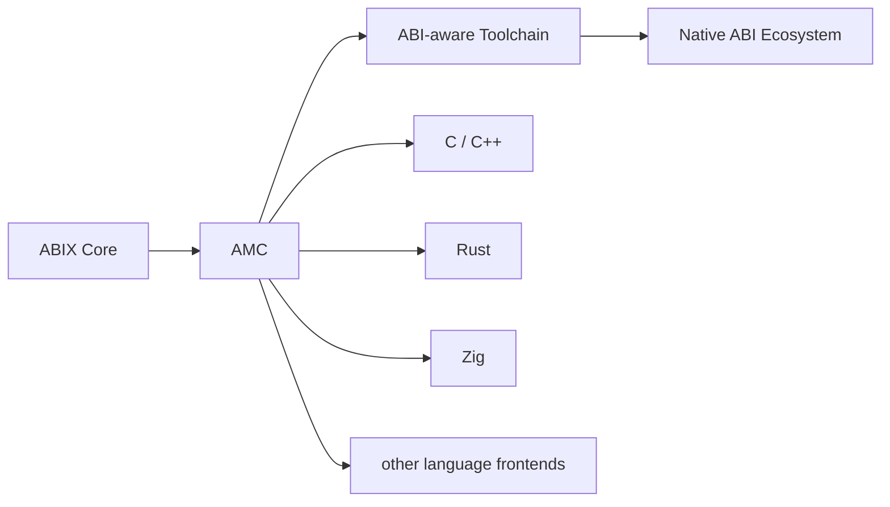

# Roadmap

<p align="center">
  English · <a href="roadmap_zh.md">中文</a>
</p>

<details>

<summary>Contents</summary>

- [Version Roadmap](#version-roadmap)
- [Direction](#direction)
- [Near-term](#near-term)
- [AI-native ABI toolchain](#ai-native-abi-toolchain)
- [Research / experimental](#research--experimental)
- [Release History](#release-history)
- [Explicitly out of scope](#explicitly-out-of-scope)

</details>

> The authoritative version is [`ROADMAP.md`](../../.agents/ROADMAP.md). This file is the English companion to the Chinese edition.

The roadmap prioritises interoperability and real-world usage over adding runtime features.

## Version Roadmap

ABIX releases are project stages, not feature lists. Each major version marks a phase, so the version number itself carries the product story.

```text
ABIX 0.1.0 — Foundation + Toolchain  the ABI foundation exists and ABIX is usable in real engineering
ABIX 0.2.0 — Cross-language          Rust / Zig frontends and cross-language bindings
ABIX 0.3.0 — Ecosystem               others build on top of ABIX
```

### ABIX 0.1.0 — Foundation, self-hosting and toolchain (current, pre-1.0/unstable)

* ABI specification, metadata format, core runtime.
* Bootstrap and self-hosting: ABIX describes and verifies its own public ABI.
* ABI stability: the external contract stays explicit while internals evolve.
* Complete core ABI workflow: inspection, diff, compatibility classification.
* ABI adapter generation and the metadata modes (Debug / Release / RelWithDebInfo).
* ELF / Mach-O binary inspection.
* Build-system and CI integration, runtime stability, benchmark baseline.

### ABIX 0.2.0 — Cross-language (next)

The main line: ABIX IR as the common ABI representation across languages.

* language plugin API and producer/consumer protocol.
* a second language prototype beyond C++ — Rust, then Zig.
* cross-language type projection on the ABI-normalised primitive identity (for example C `double` → Rust `core::ffi::c_double`).
* cross-language bindings and a C++ ↔ Rust interoperability demo.

Delivered: the `amc-rust` provider (`frontend` + `backend`) and the C++ → ABIX → Rust closed loop — a real C++ library → `.abix` → generated Rust that links and runs, with ownership, error-boundary and target contracts carried in a versioned metadata-region extension directory. Also a minimal `amc-zig` **backend-only** provider, so the same `.abix` drives both the Rust and the Zig projection and both consumers link the same native library (`AMC/tests/interop/`).

Build-system / package-manager integration and deeper debugger integration are post-0.2.0 goals, tracked with the 0.3.0 ecosystem work; they are not part of the 0.2.0 release gate.

### ABIX 0.3.0 — Ecosystem (future)

Target areas, not hard commitments:

* AI / Agent integration (MCP, TROI).
* LSP, plugin ecosystem, package management and build-system integration.
* Deeper debugger / editor integration (LLDB go-to-definition, Source Origin).
* Application areas.

### Version independence

The ABIX specification version, the AMC toolchain version, and application versions are independent dimensions. Toolchain features (Rust, AI, Agent, LSP) never require a format version change by themselves. See [`ABI-SPEC.md`](../../.agents/ABI-SPEC.md) §14.1.

## Direction



## Near-term

* **Specification** — strengthen the ABIX IR and `.abix` spec, keeping the model language-agnostic.
* **AMC usability** — clearer diagnostics, better error messages, editor/ and CI-friendly output.
* **Language / toolchain integration** — expand frontends beyond C++ (Rust, Zig); ABIX IR stays the common representation.
* **ABI compatibility analysis** — diff, compatibility classification and automatic adapter generation.
* **Documentation and examples** — quick-start material and real case studies.
* **External validation** — adopt ABIX in real projects and feed back results.

## AI-native ABI toolchain

One direction for ABIX is an AI-native ABI toolchain: an explicit ABI model is the durable, machine-readable interface AI coding agents need.

Current and planned work:

* `amc context --format llm` — compact, token-friendly ABI context.
* Unified structured JSON errors across all tools.
* `amc verify` — contract-vs-implementation consistency checking.
* ABIX Metadata Region — versioned, mappable metadata image.
* `amc query` and the `amc-mcp` server — agent-facing ABI queries.
* Aue (experimental) — Lua boundary layer with L0/L1 diff consistency.

## Research / experimental

* Runtime materialization of the metadata image.
* ABI adaptation / shimming.
* Dynamic-language boundary layers with differential semantic verification.
* **Bounded reader registry** — replace the reader list that only grows with a fixed-capacity per-thread slot array plus slot reuse (liburcu's `rcu_register_thread`/`unregister` shape). Today a thread that ever called `enter()` keeps a node with `epoch == 0`, and `readers_passed()` walks all of them on **every** grace-period poll: measured ~3.4 ns per registered node (10 threads ≈ 12 ns, 1,000 ≈ 2 µs, 10,000 ≈ 34 µs per poll), plus one never-returned allocation per thread. A host with thread churn pays both without bound. Slots are never freed, so the "unlink versus a concurrent lock-free walker" hazard disappears by construction; the cost is a documented maximum thread count and a slot allocator on the register path. *Not* the obvious alternative: unlink plus deferred free is not clearly simpler, because **two** walkers are lock-free (`readers_passed()` and `try_collect()`), so freeing would need either the writer lock held across a walk — which would block the advancement spin — or a second published epoch for scanners. Trigger: a host that recreates threads (thread-per-request servers, rebuilt worker pools). Until then `stats().registered_threads` makes the growth observable, and this is on no release line.

## Release History

ABIX uses standard SemVer tags, starting from the unstable `v0.1.0` line. The project stage is named in the release title (for example, `ABIX 0.1.0 — Foundation, self-hosting and toolchain`).

* `v0.1.0` — Foundation, self-hosting and toolchain (pre-1.0, unstable)

## Explicitly out of scope

ABIX is not a VM, an RPC framework, a universal object model, a debug-info format or a C-ABI wrapper. See [What ABIX Is Not](../../README.md#what-abix-is-not).
