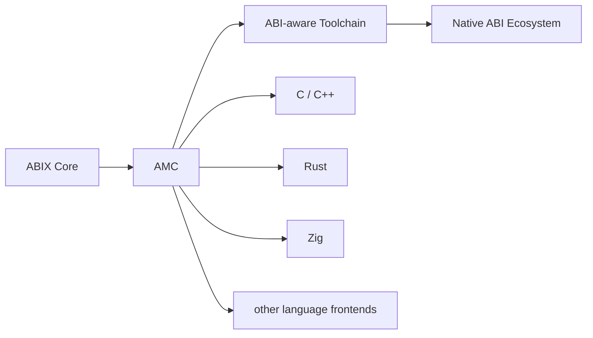

# Roadmap

<p align="center">
  English · <a href="roadmap_zh.md">中文</a>
</p>

<details>

<summary>Contents</summary>

- [Version Roadmap](#version-roadmap)
- [Direction](#direction)
- [Near-term](#near-term)
- [AI-native ABI toolchain](#ai-native-abi-toolchain)
- [Research / experimental](#research--experimental)
- [Release History](#release-history)
- [Explicitly out of scope](#explicitly-out-of-scope)

</details>

> The authoritative version is [`ROADMAP.md`](../../.agents/ROADMAP.md). This file is the English companion to the Chinese edition.

The roadmap prioritises interoperability and real-world usage over adding runtime features.

## Version Roadmap

ABIX releases are project stages, not feature lists. Each release stage carries the product story; patch releases are for stabilization and preparation.

```text
ABIX 0.1.0 — Foundation + Toolchain  the ABI foundation exists and ABIX is usable in real engineering
ABIX 0.2.0 — Cross-language          Rust / Zig frontends and cross-language bindings
ABIX 0.2.1 — Maintenance             fix existing behavior, add tests/docs; no public ABI change
ABIX 0.2.2 — Built-in type IDs       predefined canonical primitive TypeId constants
ABIX 0.2.3 — Runtime-only package    installable runtime without AMC/LLVM/fmt
ABIX 0.3.0 — Ecosystem               others build on top of ABIX
```

### ABIX 0.1.0 — Foundation, self-hosting and toolchain (released, pre-1.0/unstable)

* ABI specification, metadata format, core runtime.
* Bootstrap and self-hosting: ABIX describes and verifies its own public ABI.
* ABI stability: the external contract stays explicit while internals evolve.
* Complete core ABI workflow: inspection, diff, compatibility classification.
* ABI adapter generation and the metadata modes (Debug / Release / RelWithDebInfo).
* ELF / Mach-O binary inspection.
* Build-system and CI integration, runtime stability, benchmark baseline.

### ABIX 0.2.0 — Cross-language (released, pre-1.0/unstable)

The main line: ABIX IR as the common ABI representation across languages.

* language plugin API and producer/consumer protocol.
* a second language prototype beyond C++ — Rust, then Zig.
* cross-language type projection on the ABI-normalised primitive identity (for example C `double` → Rust `core::ffi::c_double`).
* cross-language bindings and a C++ ↔ Rust interoperability demo.

Delivered: the `amc-rust` provider (`frontend` + `backend`) and the C++ → ABIX → Rust closed loop — a real C++ library → `.abix` → generated Rust that links and runs, with ownership, error-boundary and target contracts carried in a versioned metadata-region extension directory. Also a minimal `amc-zig` **backend-only** provider, so the same `.abix` drives both the Rust and the Zig projection and both consumers link the same native library (`AMC/tests/interop/`). The 0.2.0 cross-language rules are frozen in [`ABI-SPEC.md` §20](../../.agents/ABI-SPEC.md#20-020-cross-language-freeze).

Build-system / package-manager integration and deeper debugger integration are post-0.2.0 goals, tracked with the 0.3.0 ecosystem work; they are not part of the 0.2.0 release gate.

### ABIX 0.2.1 — Maintenance

This release only fixes existing behavior and adds tests/documentation; it does not change the public ABI or error protocol.

* Fix the thread-local implementation of `last_error()` and document its per-thread / per-DSO scope.
* Add explicit numeric values and stable `to_string()` for existing error-status enums; do not renumber.
* Add thread-isolation, error-string, cross-language error-propagation and `[[error]]` negative tests.
* Document that Zig does not project error sets / error unions yet.
* The `.abix` format, `[[error]]` v1, `abix.error/1`, `TypeID` / `LayoutHash` / `ABIHash` are unchanged.

Release notes: [`CHANGELOG.md`](../../CHANGELOG.md).

### ABIX 0.2.2 — Built-in type IDs

Adds predefined `TypeId` constants for the canonical primitive ABI descriptors:

* void/bool and every fixed-width signed/unsigned integer;
* pointer-width `isize` / `usize`;
* IEEE binary16/32/64/128, x87 80-bit, PowerPC double-double and bf16;
* `long double` mapped by `LDBL_MANT_DIG`;
* target-defined plain `char` / `wchar_t` signedness, plus `schar` / `uchar` /
  `char8` / `char16` / `char32`;
* `wint_t` resolved to its underlying integer descriptor; there is no
  `prim:wint`.

These constants are compile-time entry points to existing canonical
descriptors. They do not change any `TypeID`, `.abix` format or public ABI.

### ABIX 0.2.3 — Runtime-only package

Makes the header-only runtime and its CMake package independent of the AMC
toolchain:

* `ABIX::runtime` and the ABIX package metadata are installed without AMC,
  LLVM/Clang or fmt.
* `ABIX_BUILD_RUNTIME_ONLY=ON` skips AMC, tests, benchmarks and DLLs.
* `ABIXConfig.cmake` resolves fmt only for the optional format/ABI/metadata/
  tools components or the full aggregate.
* Subproject defaults no longer enable tests, benchmarks, AMC, DLL variants or
  bundled MICS installation, and `MICS_INSTALL` is not forced.
* A runtime-only package consumer test covers `ABIX::runtime` without fmt.

The `.abix` format, `TypeID` values and public ABI are unchanged.

### ABIX 0.3.0 — Ecosystem (future)

Target areas, not hard commitments:

* **Under discussion: AI / Agent integration (advanced MCP tools, TROI, workflows)** — we need to decide whether advanced tools and workflows are premature; the existing low-level `amc-mcp` queries remain.
* LSP, plugin ecosystem, package management and build-system integration.
* Deeper debugger / editor integration (LLDB go-to-definition, Source Origin).
* Application areas.

#### feat — AMC Interface Devirtualization (v0.3.0)

ABIX Interface deliberately keeps an explicit, versioned, cross-module contract; its runtime dispatch is the correctness baseline, not the optimization target. The v0.3.0 feature is a compile-time AMC optimization: use the Clang AST and ABIX metadata to prove which adapter/target a call site can reach, then emit a direct adapter or native call where that is safe, leaving the existing dispatch as the fallback. The goal is not to turn ABIX into another vtable mechanism and not to add a new runtime dispatch path.

Plan and analysis: [`memory/amc-interface.md`](../../memory/amc-interface.md).

Priorities:

* **P0 — baseline + static `KnownTarget`**. Fix a reproducible benchmark, inspect LLVM IR/assembly for direct, virtual, ABIX unique/shared and `pro::proxy`, then prove the single-provider, fixed-binding case and replace its ABIX slot dispatch with a direct adapter call.
* **P1 — unified target analysis**. Apply the same target-determinism rules to `UniqueInterfaceProxy` and `SharedInterfaceProxy`; track proxies across functions, handle aliasing conservatively, and fall back to dispatch when the target is not provable.
* **P2 — guarded speculative devirtualization**. Only for hot call sites with a stable target identity: emit a target guard, fast direct path and the original dynamic fallback. A failed guard must preserve rebinding, module unload and lifecycle semantics.
* **P3 — whole-program / LTO integration**. Combine interface implementations and adapters across translation units, distinguish closed implementation sets from dynamically extensible providers, and reuse LLVM LTO/ThinLTO where deployment makes it valid.

Acceptance:

* the baseline explains every call path (direct, true vtable, ABIX adapter/unique/shared, `pro::proxy`) at IR/assembly level and reproduces its trend;
* for `KnownTarget` call sites, the ABIX slot indirect dispatch is gone and observable behavior is unchanged;
* Unique and Shared use the same target-determinism rules, and dynamic/unknown bindings keep the original path;
* guarded paths preserve rebinding, module unload, object lifetime, concurrency and error reporting;
* AMC can explain why a call site was not optimized (unknown alias, rebindable binding, invisible implementation, lifecycle constraint).

Explicit non-goals: changing `.abix` contract semantics, making `Unique` the boundary of the optimization, assuming the build-time provider set is the complete runtime set, or starting with an LLVM pass before the target analysis is sound.

### Version independence

The ABIX specification version, the AMC toolchain version, and application versions are independent dimensions. Toolchain features (Rust, AI, Agent, LSP) never require a format version change by themselves. See [`ABI-SPEC.md`](../../.agents/ABI-SPEC.md) §14.1.

## Direction



## Near-term

* **Specification** — strengthen the ABIX IR and `.abix` spec, keeping the model language-agnostic.
* **AMC usability** — clearer diagnostics, better error messages, editor/ and CI-friendly output.
* **Language / toolchain integration** — expand frontends beyond C++ (Rust, Zig); ABIX IR stays the common representation.
* **ABI compatibility analysis** — diff, compatibility classification and automatic adapter generation.
* **Documentation and examples** — quick-start material and real case studies.
* **External validation** — adopt ABIX in real projects and feed back results.

## AI-native ABI toolchain

One direction for ABIX is an AI-native ABI toolchain: an explicit ABI model is the durable, machine-readable interface AI coding agents need.

Current and planned work:

* `amc context --format llm` — compact, token-friendly ABI context.
* Unified structured JSON errors across all tools.
* `amc verify` — contract-vs-implementation consistency checking.
* ABIX Metadata Region — versioned, mappable metadata image.
* `amc query` and the `amc-mcp` server — delivered low-level ABI queries; whether more advanced agent tools/workflows enter v0.3.0 is under discussion.
* Aue (experimental) — Lua boundary layer with L0/L1 diff consistency.

## Research / experimental

* Runtime materialization of the metadata image.
* ABI adaptation / shimming.
* Dynamic-language boundary layers with differential semantic verification.
* **Bounded reader registry** — replace the reader list that only grows with a fixed-capacity per-thread slot array plus slot reuse (liburcu's `rcu_register_thread`/`unregister` shape). Today a thread that ever called `enter()` keeps a node with `epoch == 0`, and `readers_passed()` walks all of them on **every** grace-period poll: measured ~3.4 ns per registered node (10 threads ≈ 12 ns, 1,000 ≈ 2 µs, 10,000 ≈ 34 µs per poll), plus one never-returned allocation per thread. A host with thread churn pays both without bound. Slots are never freed, so the "unlink versus a concurrent lock-free walker" hazard disappears by construction; the cost is a documented maximum thread count and a slot allocator on the register path. *Not* the obvious alternative: unlink plus deferred free is not clearly simpler, because **two** walkers are lock-free (`readers_passed()` and `try_collect()`), so freeing would need either the writer lock held across a walk — which would block the advancement spin — or a second published epoch for scanners. Trigger: a host that recreates threads (thread-per-request servers, rebuilt worker pools). Until then `stats().registered_threads` makes the growth observable, and this is on no release line.

## Release History

ABIX uses standard SemVer tags, starting from the unstable `v0.1.0` line. The project stage is named in the release title (for example, `ABIX 0.1.0 — Foundation, self-hosting and toolchain`).

* `v0.1.0` — Foundation, self-hosting and toolchain (pre-1.0, unstable)
* `v0.2.0` — Cross-language (pre-1.0, unstable)
* `v0.2.1` — Maintenance (maintenance release)
* `v0.2.2` — Built-in type IDs (predefined canonical primitive TypeIds)
* `v0.2.3` — Runtime-only package (ABIX::runtime without AMC/LLVM/fmt)

## Explicitly out of scope

ABIX is not a VM, an RPC framework, a universal object model, a debug-info format or a C-ABI wrapper. See [What ABIX Is Not](../../README.md#what-abix-is-not).
