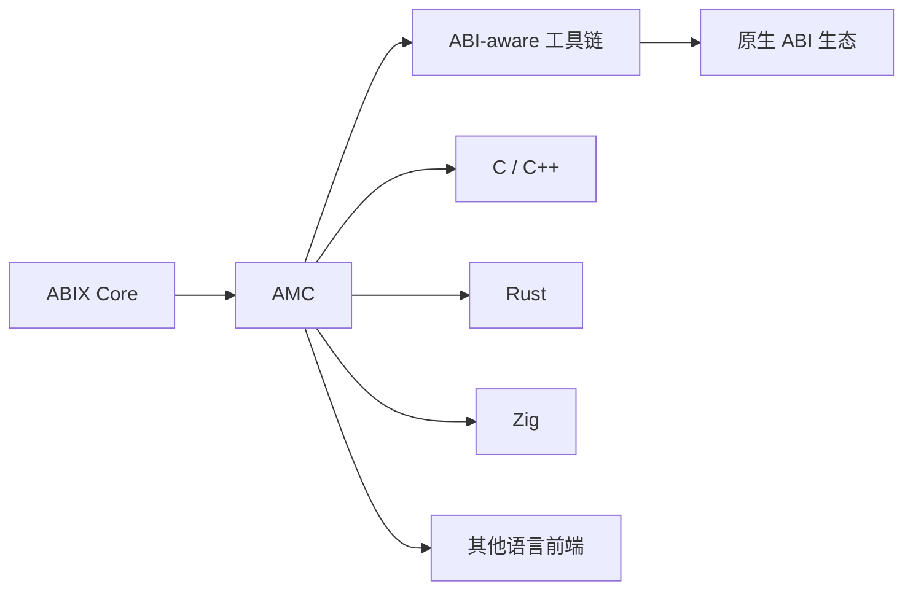

# 路线图

<p align="center">
  中文 · <a href="roadmap.md">English</a>
</p>

<details>

<summary>目录</summary>

- [版本路线](#版本路线)
- [方向](#方向)
- [近期](#近期)
- [AI-native ABI 工具链](#ai-native-abi-工具链)
- [研究 / 实验](#研究-实验)
- [发布历史](#发布历史)
- [明确不在范围内](#明确不在范围内)

</details>

> 英文权威版本见 [`ROADMAP.md`](../../.agents/ROADMAP.md)。本文件为中文版。

路线图优先考虑互操作性与真实使用，而不是增加运行时特性。

## 版本路线

ABIX 的发布是项目阶段，而不是功能清单。每个大版本代表一个阶段，版本号本身承载产品叙事。

```text
ABIX 0.1.0 — Foundation + Toolchain    建立 ABI 基础，且 ABIX 可用于真实工程
ABIX 0.2.0 — Cross-language            跨语言支持：Rust / Zig 前端与跨语言绑定
ABIX 0.3.0 — Ecosystem                 其他项目建立在 ABIX 之上
```

### ABIX 0.1.0 — Foundation, self-hosting and toolchain（当前，pre-1.0/非稳定）

* ABI 规范、metadata 格式、核心运行时。
* 引导与自举：ABIX 用自身描述并校验其公开 ABI。
* ABI 稳定性：外部契约保持显式，内部实现可演进。
* 完整核心 ABI 工作流：检查、diff、兼容性分类。
* ABI adapter 生成与 metadata 模式（Debug / Release / RelWithDebInfo）。
* ELF / Mach-O 二进制检查。
* 构建系统与 CI 集成、运行时稳定性、benchmark 基线。

### ABIX 0.2.0 — Cross-language（下一阶段）

主线：ABIX IR 作为跨语言的统一 ABI 表示。

* language plugin API 与 producer/consumer 协议。
* 在 C++ 之外的第二语言原型 — 先 Rust，再 Zig。
* 基于 ABI 归一化 primitive 身份的跨语言类型投影
  （例如 C `double` → Rust `core::ffi::c_double`）。
* 跨语言绑定与 C++ ↔ Rust 互操作 demo。

已交付：`amc-rust` provider（`frontend` + `backend`）与 C++ → ABIX → Rust 闭环——真实
C++ 库 → `.abix` → 生成 Rust 并链接运行，所有权/错误边界/目标契约承载在版本化的
metadata-region 扩展目录中；以及最小化的 `amc-zig` **仅后端** provider，使同一份
`.abix` 同时驱动 Rust 与 Zig 投影，两个消费者链接同一个原生库（`AMC/tests/interop/`）。

### ABIX 0.3.0 — Ecosystem（未来）

目标方向，而非硬性承诺：

* AI / Agent 集成（MCP、TROI）。
* LSP、插件生态、包管理、应用领域。

### 版本独立性

ABIX 规范版本、AMC 工具链版本与应用版本是相互独立的维度。工具链功能（Rust、AI、Agent、LSP）本身永远不会要求格式版本变更。见 [`ABI-SPEC.md`](../../.agents/ABI-SPEC.md) §14.1。

## 方向



## 近期

* **规范** — 强化 ABIX IR 与 `.abix` 规范，保持模型语言无关。
* **AMC 易用性** — 更清晰的诊断、更好的错误信息、面向编辑器与 CI 的输出。
* **语言 / 工具链集成** — 在 C++ 之外扩展前端（Rust、Zig），ABIX IR 始终是统一表示。
* **ABI 兼容性分析** — diff、兼容性分类与自动 adapter 生成。
* **文档与示例** — 快速上手材料与真实 case study。
* **外部验证** — 在真实项目中采用 ABIX 并反馈结果。

## AI-native ABI 工具链

ABIX 的发展方向之一是 AI-native ABI toolchain：显式 ABI 模型为 AI coding agent
提供持久、机器可读的接口。

当前与计划中的工作：

* `amc context --format llm` — 紧凑、token 友好的 ABI 上下文。
* 所有工具统一的结构化 JSON 错误。
* `amc verify` — 契约与实现一致性校验。
* ABIX Metadata Region — 版本化、可 mmap 的 metadata image。
* `amc query` 与 `amc-mcp` server — 面向 Agent 的 ABI 查询。
* Aue（实验性）— Lua 边界层与 L0/L1 差分一致性框架。

## 研究 / 实验

* metadata image 的运行时 materialization。
* ABI 适配 / shimming。
* 带差分语义验证的动态语言边界层。
* **有界的读者注册表** —— 把"只增不减"的读者链表换成固定容量 + 槽复用的每线程槽位数组
  （liburcu `rcu_register_thread`/`unregister` 的形态）。现状:曾经调用过 `enter()` 的线程会留下一个
  `epoch == 0` 的节点,而 `readers_passed()` 在**每一次**宽限期轮询中都遍历全部节点:实测约
  **3.4 ns/节点**(10 线程 ≈ 12 ns、1,000 ≈ 2 µs、10,000 ≈ **34 µs/次轮询**),另有每线程一次**永不归还**
  的分配。线程反复创建/销毁的宿主会无界地同时付这两笔。槽位永不释放,因此"摘链 vs 并发无锁遍历"
  的 UAF 风险从构造上消失;代价是需要一个文档化的**最大线程数**与注册路径上的槽分配器。
  *不*采用那个显而易见的替代方案:**两个**遍历者都是无锁的(`readers_passed()` 与 `try_collect()`),
  所以"摘链 + 延迟释放"并不更简单——要么把写锁贯穿一次遍历(会堵住推进权自旋),要么为扫描引入
  第二个发布 epoch。触发条件:出现反复重建线程的宿主(每请求一线程的服务器、重建 worker 池)。
  在那之前,`stats().registered_threads` 让这一增长可观测;本项不在任何版本线上。

## 发布历史

ABIX 使用标准 SemVer tag，从非稳定的 `v0.1.0` 线开始。项目阶段在 release 标题中命名（例如 `ABIX 0.1.0 — Foundation, self-hosting and toolchain`）。

* `v0.1.0` — Foundation, self-hosting and toolchain（pre-1.0，非稳定）

## 明确不在范围内

ABIX 不是 VM、RPC 框架、通用对象模型、调试信息格式或 C ABI wrapper。见 README 的
"What ABIX Is Not"。
