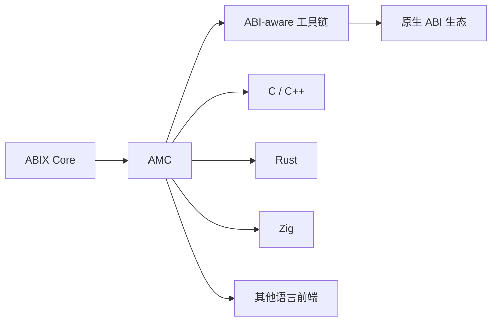

# 路线图

<p align="center">
  中文 · <a href="roadmap.md">English</a>
</p>

<details>

<summary>目录</summary>

- [版本路线](#版本路线)
- [方向](#方向)
- [近期](#近期)
- [AI-native ABI 工具链](#ai-native-abi-工具链)
- [研究 / 实验](#研究-实验)
- [发布历史](#发布历史)
- [明确不在范围内](#明确不在范围内)

</details>

> 英文权威版本见 [`ROADMAP.md`](../../.agents/ROADMAP.md)。本文件为中文版。

路线图优先考虑互操作性与真实使用，而不是增加运行时特性。

## 版本路线

ABIX 的发布是项目阶段，而不是功能清单。每个发布阶段承载产品叙事，补丁版本只做稳定与准备。

```text
ABIX 0.1.0 — Foundation + Toolchain    建立 ABI 基础，且 ABIX 可用于真实工程
ABIX 0.2.0 — Cross-language            跨语言支持：Rust / Zig 前端与跨语言绑定
ABIX 0.2.1 — Maintenance               修复现有行为、补测试和文档，不改变公共 ABI
ABIX 0.2.2 — Built-in type IDs         预定义 canonical primitive TypeId 常量
ABIX 0.3.0 — Ecosystem                 其他项目建立在 ABIX 之上
```

### ABIX 0.1.0 — Foundation, self-hosting and toolchain（已发布，pre-1.0/非稳定）

* ABI 规范、metadata 格式、核心运行时。
* 引导与自举：ABIX 用自身描述并校验其公开 ABI。
* ABI 稳定性：外部契约保持显式，内部实现可演进。
* 完整核心 ABI 工作流：检查、diff、兼容性分类。
* ABI adapter 生成与 metadata 模式（Debug / Release / RelWithDebInfo）。
* ELF / Mach-O 二进制检查。
* 构建系统与 CI 集成、运行时稳定性、benchmark 基线。

### ABIX 0.2.0 — Cross-language（已发布，pre-1.0/非稳定）

主线：ABIX IR 作为跨语言的统一 ABI 表示。

* language plugin API 与 producer/consumer 协议。
* 在 C++ 之外的第二语言原型 — 先 Rust，再 Zig。
* 基于 ABI 归一化 primitive 身份的跨语言类型投影（例如 C `double` → Rust `core::ffi::c_double`）。
* 跨语言绑定与 C++ ↔ Rust 互操作 demo。

已交付：`amc-rust` provider（`frontend` + `backend`）与 C++ → ABIX → Rust 闭环——真实 C++ 库 → `.abix` → 生成 Rust 并链接运行，所有权/错误边界/目标契约承载在版本化的 metadata-region 扩展目录中；以及最小化的 `amc-zig` **仅后端** provider，使同一份 `.abix` 同时驱动 Rust 与 Zig 投影，两个消费者链接同一个原生库（`AMC/tests/interop/`）。0.2.0 的跨语言规则已在 [`ABI-SPEC.md` §20](../../.agents/ABI-SPEC.md#20-020-cross-language-freeze) 冻结。

构建系统/包管理器集成与更深的调试器集成属于 0.2.0 之后的目标，随 0.3.0 生态工作跟踪；它们不属于 0.2.0 的发布门槛。

### ABIX 0.2.1 — Maintenance（维护版本）

本版本只修复现有行为、补测试和文档，不改变公共 ABI 或错误协议。

* 修复 `last_error()` 的线程局部实现，明确 per-thread / per-DSO 语义。
* 为现有错误状态枚举补充显式数值和稳定 `to_string()`，不重编号。
* 增加线程隔离、错误字符串、跨语言错误传播和 `[[error]]` 负面测试。
* 明确 Zig 尚未投影错误集/错误联合。
* `.abix` 格式、`[[error]]` v1、`abix.error/1`、`TypeID` / `LayoutHash` / `ABIHash` 均不变。

发布说明见 [`CHANGELOG.md`](../../CHANGELOG.md)。

### ABIX 0.2.2 — Built-in type IDs

为 canonical primitive ABI 描述符增加预定义 `TypeId` 常量：

* void/bool、全部定宽有符号/无符号整数；
* 指针宽度相关的 `isize` / `usize`；
* IEEE binary16/32/64/128、x87 80-bit、PowerPC double-double 与 bf16；
* `long double` 按 `LDBL_MANT_DIG` 映射到目标格式；
* plain `char` / `wchar_t` 的目标有符号性，以及 `schar` / `uchar` / `char8` / `char16` / `char32`；
* `wint_t` 解析为其底层整数描述符，不引入 `prim:wint`。

这些常量只是既有 canonical 描述符的编译期入口，不改变任何 `TypeID`、`.abix` 格式或公共 ABI。

### ABIX 0.3.0 — Ecosystem（未来）

目标方向，而非硬性承诺：

* **待议：AI / Agent 集成（MCP 高级工具、TROI、工作流）**——需要评估是否过早引入高级工具与工作流；现有 `amc-mcp` 低层查询保持不变。
* LSP、插件生态、包管理与构建系统集成。
* 更深的调试器/编辑器集成 (LLDB go-to-definition、Source Origin)。
* 应用领域。

#### feat — AMC 多态优化 / Interface Devirtualization（v0.3.0）

ABIX Interface 刻意保留显式、版本化、跨模块的契约；它的运行时分派是正确性基线，而不是优化目标。v0.3.0 的新特性是 AMC 的编译期优化：利用 Clang AST 与 ABIX 元数据证明一个调用点可能到达的 adapter/目标，在安全时直接生成 adapter 或原生调用；无法证明时仍走现有分派。目标不是把 ABIX 变成另一套 vtable 机制，也不是增加新的运行时分派路径。

计划与分析见 [`memory/amc-interface.md`](../../memory/amc-interface.md)。

优先级：

* **P0 — 基准 + 静态 `KnownTarget`**：固定可复现的基准，检查 direct、virtual、ABIX unique/shared 与 `pro::proxy` 的 LLVM IR/汇编；先证明单 provider、固定绑定场景，把该调用点的 ABIX slot 间接分派替换为直接 adapter 调用。
* **P1 — 统一目标分析**：让 `UniqueInterfaceProxy` 与 `SharedInterfaceProxy` 使用同一套目标确定性规则；支持跨函数追踪 proxy，对未知别名保守回退。
* **P2 — 守卫式投机去分派**：只用于目标稳定且值得优化的热点调用点：生成目标守卫、直接快速路径和原有动态回退。守卫失败时必须保留重绑定、模块卸载与生命周期语义。
* **P3 — 全程序 / LTO 集成**：跨翻译单元汇总接口实现与 adapter，区分封闭实现集合与可动态扩展的 provider，并在部署允许时复用 LLVM LTO/ThinLTO。

验收标准：

* 基准能在 IR/汇编层解释每条调用路径（direct、真实 vtable、ABIX adapter/unique/shared、`pro::proxy`），且趋势可复现；
* `KnownTarget` 调用点不再存在 ABIX slot 间接分派，行为与原路径一致；
* Unique 与 Shared 使用相同的目标确定性规则，动态/未知绑定保留原路径；
* 守卫路径保持重绑定、模块卸载、对象生命周期、并发与错误报告语义；
* AMC 能解释某个调用点为何未优化（未知别名、可重绑定、实现不可见、生命周期约束等）。

明确不做：修改 `.abix` 契约语义；把 `Unique` 当作优化边界；把构建时的 provider 集合当作运行时完整集合；在目标分析可靠之前先写 LLVM Pass。

### 版本独立性

ABIX 规范版本、AMC 工具链版本与应用版本是相互独立的维度。工具链功能（Rust、AI、Agent、LSP）本身永远不会要求格式版本变更。见 [`ABI-SPEC.md`](../../.agents/ABI-SPEC.md) §14.1。

## 方向



## 近期

* **规范** — 强化 ABIX IR 与 `.abix` 规范，保持模型语言无关。
* **AMC 易用性** — 更清晰的诊断、更好的错误信息、面向编辑器与 CI 的输出。
* **语言 / 工具链集成** — 在 C++ 之外扩展前端（Rust、Zig），ABIX IR 始终是统一表示。
* **ABI 兼容性分析** — diff、兼容性分类与自动 adapter 生成。
* **文档与示例** — 快速上手材料与真实 case study。
* **外部验证** — 在真实项目中采用 ABIX 并反馈结果。

## AI-native ABI 工具链

ABIX 的发展方向之一是 AI-native ABI toolchain：显式 ABI 模型为 AI coding agent 提供持久、机器可读的接口。

当前与计划中的工作：

* `amc context --format llm` — 紧凑、token 友好的 ABI 上下文。
* 所有工具统一的结构化 JSON 错误。
* `amc verify` — 契约与实现一致性校验。
* ABIX Metadata Region — 版本化、可 mmap 的 metadata image。
* `amc query` 与 `amc-mcp` server — 已交付的低层 ABI 查询；更高级的 Agent 工具/工作流是否进入 v0.3.0 待议。
* Aue（实验性）— Lua 边界层与 L0/L1 差分一致性框架。

## 研究 / 实验

* metadata image 的运行时 materialization。
* ABI 适配 / shimming。
* 带差分语义验证的动态语言边界层。
* **有界的读者注册表** —— 把"只增不减"的读者链表换成固定容量 + 槽复用的每线程槽位数组（liburcu `rcu_register_thread`/`unregister` 的形态）。现状:曾经调用过 `enter()` 的线程会留下一个 `epoch == 0` 的节点,而 `readers_passed()` 在**每一次**宽限期轮询中都遍历全部节点:实测约 **3.4 ns/节点**(10 线程 ≈ 12 ns、1,000 ≈ 2 µs、10,000 ≈ **34 µs/次轮询**),另有每线程一次**永不归还** 的分配。线程反复创建/销毁的宿主会无界地同时付这两笔。槽位永不释放,因此"摘链 vs 并发无锁遍历" 的 UAF 风险从构造上消失;代价是需要一个文档化的**最大线程数**与注册路径上的槽分配器。*不*采用那个显而易见的替代方案:**两个**遍历者都是无锁的(`readers_passed()` 与 `try_collect()`), 所以"摘链 + 延迟释放"并不更简单——要么把写锁贯穿一次遍历(会堵住推进权自旋),要么为扫描引入第二个发布 epoch。触发条件:出现反复重建线程的宿主(每请求一线程的服务器、重建 worker 池)。在那之前,`stats().registered_threads` 让这一增长可观测;本项不在任何版本线上。

## 发布历史

ABIX 使用标准 SemVer tag，从非稳定的 `v0.1.0` 线开始。项目阶段在 release 标题中命名（例如 `ABIX 0.1.0 — Foundation, self-hosting and toolchain`）。

* `v0.1.0` — Foundation, self-hosting and toolchain（pre-1.0，非稳定）
* `v0.2.0` — Cross-language（pre-1.0，非稳定）
* `v0.2.1` — Maintenance（维护版本）
* `v0.2.2` — Built-in type IDs（预定义 canonical primitive TypeId）

## 明确不在范围内

ABIX 不是 VM、RPC 框架、通用对象模型、调试信息格式或 C ABI wrapper。见 README 的 "What ABIX Is Not"。
