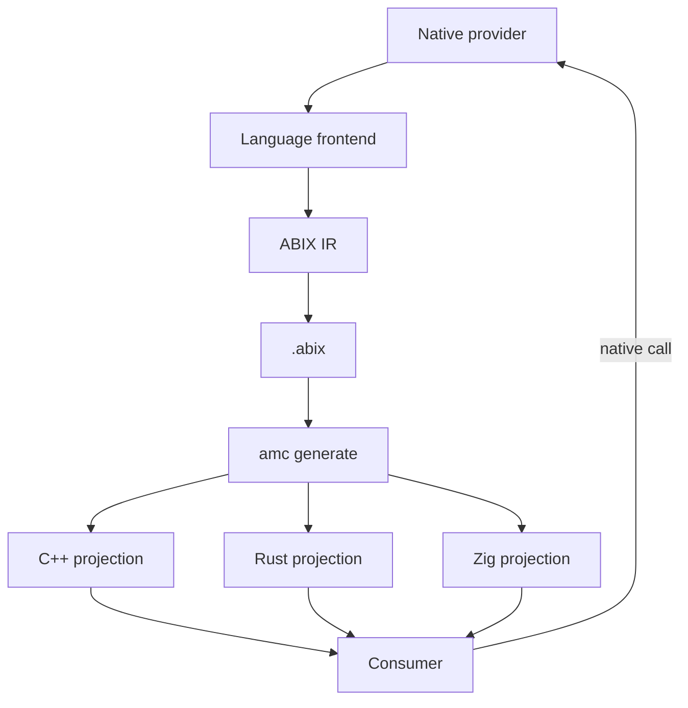

# Cross-language ABI projections

  <a href="README_zh.md">中文</a> · English

Contents

- [The short version](#the-short-version)
- [Not another bindgen](#not-another-bindgen)
- [Memory is the contract](#memory-is-the-contract)
- [The projection model](#the-projection-model)
- [What is preserved](#what-is-preserved)
- [What still follows the platform ABI](#what-still-follows-the-platform-abi)
- [Language status](#language-status)
- [Start with](#start-with)

> ABIX records the ABI and projects it into each language's native type system. It does not make a C header the contract that every language has to imitate.

## The short version

ABIX treats the native ABI as data: sizes, alignments, field offsets, calling conventions, symbols, ownership and error boundaries. The `.abix` artifact is the contract.

`amc generate -l <language>` turns that contract into a language-native projection. C++ gets structs plus `static_assert` checks; Rust gets `#[repr(C)]` records, `extern "C"` entries and ownership/`Result` wrappers; Zig gets `extern struct`, `extern fn` and `comptime` layout assertions.

The binary boundary is still native. What changes is where the contract lives and how the consumer language sees it: the consumer keeps its own type system, ownership model and error handling instead of being flattened into a C-shaped API.

## Not another bindgen

A bind-style workflow usually starts from a C header, generates declarations for another language, and lets that header define the boundary. ABIX starts from recorded ABI facts and generates the projection from them.

| Bind-style FFI                                | ABIX                                                                                                     |
| --------------------------------------------- | -------------------------------------------------------------------------------------------------------- |
| The C header is the source of truth           | `.abix` ABI facts are the source of truth                                                                |
| Declarations are parsed from C                | Projections are generated from size / align / offset / calling-convention / ownership records            |
| The consumer sees a C-shaped API              | The consumer sees a language-native projection, with generated wrappers where the language supports them |
| High-level types stop at the boundary         | ABIX-STD contracts carry views, ownership, optional, result, callbacks and ranges                        |
| Layout drift is caught at run time, if at all | C++ `static_assert`, Rust `const assert!` and Zig `comptime @offsetOf` fail the build                    |
| A hand-written C shim is often needed         | The projection is generated from ABI facts; `amc adapter` maps memory by offset                          |

The important difference is not the spelling of the generated declarations. It is that ABIX knows why a field sits at offset 8, what owns a pointer, and which entry point releases it, and can carry those facts into each language.

This is the difference from `bindgen`, `cbindgen` or a hand-written FFI layer: those tools translate declarations; ABIX translates recorded ABI facts.

## Memory is the contract

ABIX records the memory interpretation itself: offsets, sizes, alignments, field types and calling conventions are data in the artifact, not guesses reconstructed from a C header.

A projection is not a text substitution. It is a set of typed casts over recorded memory facts:

- for a handle or pointer, the provider's object and the consumer's view refer to the same address;
- field access uses the projected field type and the layout asserted against the recorded offset;
- `sizeof`, `alignof` and `offsetof` are asserted when the projection is compiled;
- `amc adapter` copies fields by recorded offset when two ABI versions differ;
- an interface adapter casts the object handle to the provider's concrete type at the boundary.

ABIX does not hand raw memory to application code and hope for the best. It generates the casts, checks the layout and wraps the result in the target language's abstractions: Rust consumers get `Owned*` and `Result` wrappers plus typed span/string/optional records; Zig consumers get typed pointers and `comptime` assertions; C++ consumers get ordinary structs and `static_assert`.

## The projection model

1. The provider exposes a native binary boundary.
2. The frontend records the ABI: type identity, layout, offsets, calling convention, symbols and contracts.
3. `amc generate` projects the artifact into the target language.
4. The consumer calls the native library directly; no VM, RPC or generic reflection dispatch is involved.
5. When two ABI versions differ, `amc adapter` can generate a field-level memory adapter.

## What is preserved

- **Ownership**: `borrow` / `owned` / `copy`; a release entry point is recorded, not guessed. Rust wrappers use `Drop`; foreign memory is never freed by the consumer.
- **Errors**: a status code plus a payload becomes a typed `Result` in Rust; exceptions and panics do not cross the boundary.
- **Containers**: `SequenceView`, `StringView`, `Optional`, `Result`, `Callback`, `Range`, `MapView` and `Opaque` are capability contracts, not a unified standard library.
- **Identity**: `TypeID`, `LayoutHash`, `ABIHash` and `InterfaceId`; names are diagnostic only.
- **Language semantics**: the provider keeps its classes, virtual functions, generics and internal types; only the exported surface is projected.

## What still follows the platform ABI

"No C ABI degradation" means the interface the language sees is native, not that ABIX invents a new calling convention.

- The call itself uses the target platform's native calling convention; ABIX records which one.
- `#[repr(C)]`, `extern "C"`, `extern struct` and `extern fn` are used where the binary boundary requires them.
- Opaque handles and callbacks need a stable binary shape.
- ABIX is not a VM, an RPC framework or a universal object model.
- A source feature that cannot be represented in the exported ABI stays inside the module.
- Not every language has a frontend yet: Zig is backend-only, and the Rust frontend covers `#[repr(C)]` / `extern "C"` surfaces.

## Language status

| Language | Frontend                                     | Backend | Projection                                                                     | Guide              |
| -------- | -------------------------------------------- | ------- | ------------------------------------------------------------------------------ | ------------------ |
| C++      | Clang AST                                    | C++17   | `amc_generated.hpp` + `amc_abi_check.hpp`; `Traits`, proxy when applicable     | [cpp.md](cpp.md)   |
| Rust     | `#[repr(C)]` / `extern "C"` source extractor | Rust    | `amc_generated.rs`; `repr(C)`, `extern "C"`, `core::ffi::c_*`, `const assert!` | [rust.md](rust.md) |
| Zig      | not yet                                      | Zig     | `amc_generated.zig`; `extern struct`, `extern fn`, `[*c]`, `comptime`          | [zig.md](zig.md)   |

## Start with

- [C++](cpp.md)
- [Rust](rust.md)
- [Zig](zig.md)
- [ABIX Interface](../abix/interface.md)
- [ABIX-STD](../abix/std.md)
- [`amc generate`](../amc/amc.md#amc-generate)
