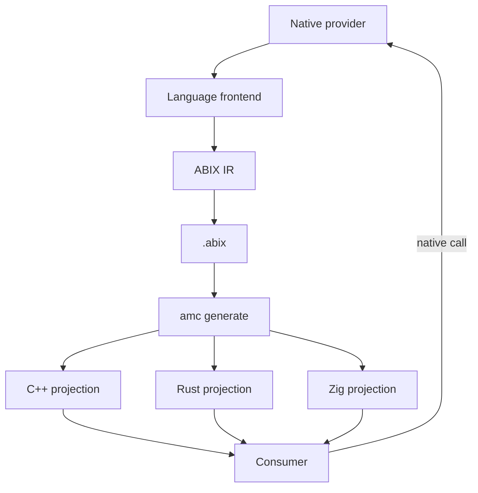

# 跨语言 ABI 投影

  <a href="README.md">English</a> · 中文

目录

- [一句话总结](#一句话总结)
- [不是又一个 bindgen](#不是又一个-bindgen)
- [内存就是契约](#内存就是契约)
- [投影模型](#投影模型)
- [保留了什么](#保留了什么)
- [仍然遵循平台 ABI 的部分](#仍然遵循平台-abi-的部分)
- [语言支持状态](#语言支持状态)
- [从这里开始](#从这里开始)

> ABIX 记录 ABI，再把 ABI 投影到各语言自己的类型系统里；它不把 C 头文件当作所有语言都必须模仿的契约。

## 一句话总结

ABIX 把原生 ABI 当作数据：大小、对齐、字段 offset、调用约定、符号、所有权与错误边界。`.abix` artifact 就是契约。

`amc generate -l <language>` 把契约变成目标语言的原生投影。C++ 得到 struct 与 `static_assert` 检查；Rust 得到 `#[repr(C)]` 记录、`extern "C"` 入口以及所有权/`Result` 包装；Zig 得到 `extern struct`、`extern fn` 与 `comptime` 布局断言。

二进制边界仍然是原生的。变化的是契约放在哪里，以及消费语言如何看到它：消费方保留自己的类型系统、所有权模型与错误处理，而不是被压平成 C 形状的 API。

## 不是又一个 bindgen

常见的 bind 流程通常从 C 头文件出发，为另一种语言生成声明，并让该头文件定义边界。ABIX 从记录的 ABI 事实出发，再由这些事实生成投影。

| 常见 bind FFI            | ABIX                                                                             |
| ------------------------ | -------------------------------------------------------------------------------- |
| C 头文件是事实来源       | `.abix` 中的 ABI 事实是事实来源                                                  |
| 从 C 声明解析出绑定      | 从 size / align / offset / 调用约定 / 所有权记录生成投影                         |
| 消费方看到 C 形状的 API  | 消费方看到语言原生投影；语言支持时会生成包装                                     |
| 高级类型在边界处丢失     | ABIX-STD 契约承载 view、所有权、optional、result、callback 与 range              |
| 布局漂移只能在运行时发现 | C++ `static_assert`、Rust `const assert!`、Zig `comptime @offsetOf` 在编译期失败 |
| 往往需要手写 C shim      | 投影由 ABI 事实生成；`amc adapter` 按 offset 映射内存                            |

关键差别不是生成声明的拼写，而是 ABIX 知道某个字段为什么在 offset 8、某个指针归谁所有、由哪个入口释放，并能把这些事实带进每种语言。

这就是与 `bindgen`、`cbindgen` 或手写 FFI 层的区别：那些工具翻译声明；ABIX 翻译记录的 ABI 事实。

## 内存就是契约

ABIX 直接记录内存解释权：offset、size、align、字段类型与调用约定都是 artifact 中的数据，而不是从 C 头文件反推的猜测。

投影不是文本替换，而是基于已记录内存事实的一组**带类型的强制转换**：

- 对 handle 或指针而言，provider 的对象与消费者的视图指向同一个地址；
- 字段访问使用投影后的字段类型，以及按记录 offset 断言的布局；
- 编译投影时断言 `sizeof`、`alignof` 与 `offsetof`；
- 两个 ABI 版本不同时，`amc adapter` 按记录的 offset 复制字段；
- 接口适配器在边界处把对象句柄强制转换回 provider 的具体类型。

ABIX 不会把裸内存丢给应用代码然后听天由命。它生成强制转换、检查布局，并把结果包装进目标语言的抽象：Rust 消费方得到 `Owned*`、`Result` 包装以及带类型的 span/string/optional 记录；Zig 消费方得到带类型的指针与 `comptime` 断言；C++ 消费方得到普通 struct 与 `static_assert`。

## 投影模型

1. provider 暴露原生二进制边界。
2. 前端记录 ABI：类型身份、布局、offset、调用约定、符号与契约。
3. `amc generate` 把 artifact 投影成目标语言代码。
4. 消费方直接调用原生库；没有 VM、RPC 或通用反射分派。
5. 两个 ABI 版本不兼容时，`amc adapter` 可生成字段级内存适配器。

## 保留了什么

- **所有权**：`borrow` / `owned` / `copy`；释放入口被记录而不是猜测。Rust 包装使用 `Drop`；消费方绝不释放不是自己分配的内存。
- **错误**：状态码 + payload 在 Rust 中变成带类型的 `Result`；异常与 panic 不穿越边界。
- **容器**：`SequenceView`、`StringView`、`Optional`、`Result`、`Callback`、`Range`、`MapView` 与 `Opaque` 是能力契约，不是统一标准库。
- **身份**：`TypeID`、`LayoutHash`、`ABIHash` 与 `InterfaceId`；名字只用于诊断。
- **语言语义**：provider 保留自己的 class、虚函数、泛型与内部类型；只有导出面被投影。

## 仍然遵循平台 ABI 的部分

「不必退化为 C ABI」指的是**语言看到的接口**是原生的，而不是说 ABIX 发明了新的调用约定。

- 调用本身仍使用目标平台的原生调用约定；ABIX 记录它。
- 二进制边界需要时，仍会使用 `#[repr(C)]`、`extern "C"`、`extern struct` 与 `extern fn`。
- 不透明 handle 与 callback 仍需要稳定的二进制形状。
- ABIX 不是 VM、RPC 框架或通用对象模型。
- 无法用导出 ABI 表达的源语言特性仍留在模块内部。
- 并非所有语言都有前端：Zig 目前是 backend-only，Rust 前端覆盖 `#[repr(C)]` / `extern "C"` 表面。

## 语言支持状态

| 语言 | 前端                                   | 后端  | 投影                                                                           | 指南                     |
| ---- | -------------------------------------- | ----- | ------------------------------------------------------------------------------ | ------------------------ |
| C++  | Clang AST                              | C++17 | `amc_generated.hpp` + `amc_abi_check.hpp`；`Traits`，条件满足时生成 proxy      | [cpp_zh.md](cpp_zh.md)   |
| Rust | `#[repr(C)]` / `extern "C"` 源码提取器 | Rust  | `amc_generated.rs`；`repr(C)`、`extern "C"`、`core::ffi::c_*`、`const assert!` | [rust_zh.md](rust_zh.md) |
| Zig  | 暂未提供                               | Zig   | `amc_generated.zig`；`extern struct`、`extern fn`、`[*c]`、`comptime`          | [zig_zh.md](zig_zh.md)   |

## 从这里开始

- [C++](cpp_zh.md)
- [Rust](rust_zh.md)
- [Zig](zig_zh.md)
- [ABIX Interface](../abix/interface_zh.md)
- [ABIX-STD](../abix/std_zh.md)
- [`amc generate`](../amc/amc_zh.md#amc-generate)
